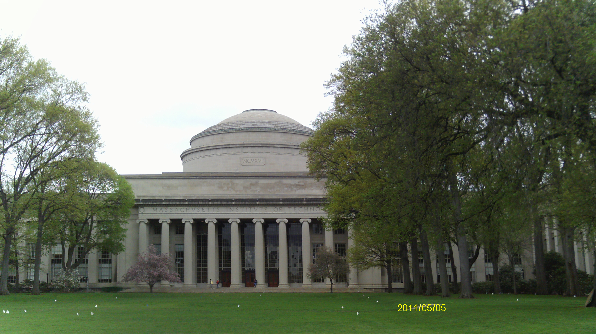
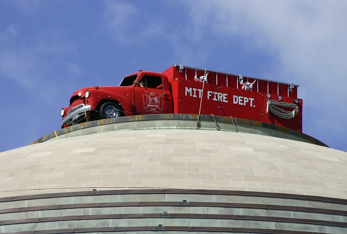
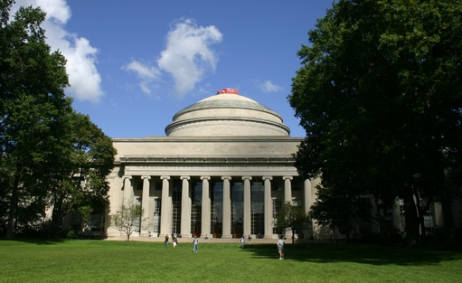
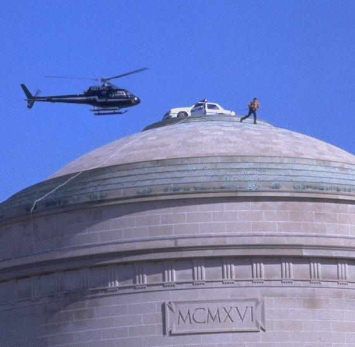

On [my recent trip to Boston](/en/blog/lnds/2011/05/04/red-hat-jboss-summit-2011/)
I took the chance to slip away to see Cambridge and walk around two of the
most prestigious universities in the world, Harvard and MIT (the
Massachusetts Institute of Technology). And although everybody told me to
go see Harvard, the more famous one, what really impressed me was the
[MIT](http://web.mit.edu/) campus.

The photo I took with my camera doesn't convey the size of the Great Dome.
It's enormous, and to give you an idea I'm going to turn to the photos of
one of the most ingenious "hacks" ever pulled off at that university. Take
a look at these pictures:

I think that makes the dimensions of this building clear :wink:.

But let's get to the hacks. At MIT the word hack refers to a prank of great
sophistication, clever, but benign and ethical:

> The word **hack** at [MIT](http://web.mit.edu/) usually refers to a
> clever, benign, and
> "[ethical](http://hacks.mit.edu/Hacks/misc/ethics.html)" prank or
> practical joke, which is both challenging for the perpetrators and
> amusing to the MIT community (and sometimes even the rest of the
> world!).

These pranks are governed by an informal code of conduct. A hack must:

-   Be safe

-   not damage anything

-   not harm anyone, whether physically, mentally or emotionally

-   be funny, at least to most of the people who experience it

It is a tradition that the MIT community celebrates and that is recorded
on its official site: <http://hacks.mit.edu/Hacks/>

Some examples: in April 2009 MIT students put this solar-powered subway
car on the dome:

2006: [a fire truck crowns the top of the dome](http://hacks.mit.edu/Hacks/by_year/2006/firetruck/additional_information.html)

1994, [the Lobby 7 inscription is altered](http://hacks.mit.edu/Hacks/by_year/1994/entertainment_and_hacking/).
The inscription reads: "Established for Advancement and Development of
Science its Application to Industry the Arts Agriculture and Commerce.
Charter MDCCCLXI"; the words Agriculture and Commerce are
replaced by Entertainment and Hacking.

1994: [a police car is deposited on the great
dome](http://hacks.mit.edu/Hacks/by_year/1994/cp_car/):

1990: [The office of the MIT president disappears](http://hacks.mit.edu/Hacks/by_year/1990/vest_bboard/).

There is an [interesting article](http://hacks.mit.edu/Hacks/books/articles/engineering_in_action.html)
that explains the engineering side of hacking at MIT. The design,
preparation and execution of a hack of this kind, within the ethical
constraints laid out above, requires running a flawless engineering
project, which is why these pranks are celebrated, admired and looked on
kindly by the university community at large, the authorities included.

Humor and good engineering, the perfect mix for a good hack. I hope you
enjoy exploring the world of MIT hacking.
