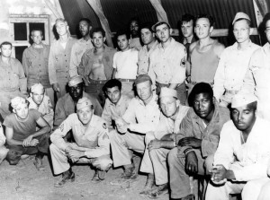

In 1941 the U.S. Army reported a large number of desertions at the
embarkation points in New York. The research division was asked to study
what was going on. The man in charge was the sociologist [Samuel A. Stouffer](https://www2.asanet.org/governance/stouffer.html). After
a quick study he discovered that when soldiers were sent home to say
goodbye, they went dressed as civilians. The recommendation was to send
them home wearing their uniforms. The desertion rate dropped immediately
after the measure was applied[^1].



The result, of course, was no work of magic. In Stouffer's words:

> "When soldiers went home or went to their families or friends in
> uniform they were made much of as soldiers. Their families were proud
> of them and their girlfriends said they were heroes, and saw them back
> to camp."

That is how his work at the War Department began, during which his
research team conducted more than 500,000 interviews with American
combatants of World War II, work he captured in the four volumes of
[American Soldier, Studies in Social Psychology in World War II](https://openlibrary.org/books/OL6044939M/Studies_in_social_psychology_in_World_War_II_...).

How did Stouffer figure out the solution to the desertion problem
described at the beginning? Through the systematic application of the
scientific ideas of his time, such as dynamic psychology, which sees the
human being not as a rational being but rather as a creature driven by
unconscious desires, or the theories of learning and conditioned
responses. Still, he saw his work as an application of social
engineering. He never forgot that although much of the data they were
collecting would be valuable to sociology in the future, they had been
hired to do a quick, practical job in wartime.

Until Stouffer, the only references to military sociology were in the
commentaries of Julius Caesar, Machiavelli, Napoleon and Sun Tzu. Nobody
before him had started any systematic research into the attitudes of
soldiers. His predecessors believed they had innate abilities for
judging men, and that these matters were just a question of common sense
and intuition.

But if anything was learned from Stouffer's work, it is that nothing is
obvious when it comes to human motivations and attitudes. Even though we
tend to believe that the results of sociology are full of obvious
things.

To make this point clear, the sociologist Paul Lazarsfeld, in his review
of *The American Soldier*, proposed six *"representative findings*" from
Stouffer's report[^2]. Number two, for example, says that "men from
rural backgrounds seemed to have a more positive attitude during their
time in the Army than men who came from the cities."

> "'Aha,' says Lazarsfeld's imaginary reader, 'that makes sense. Rural
> men in 1940 were used to harsher living conditions and more physical
> labor than city men, so naturally it was easier for them to adjust.
> Why do we need this huge, expensive study to tell us what we could
> have worked out for ourselves?'"[^3]

Except that later on Lazarsfeld reveals that these "findings" actually
showed exactly the opposite. It was the men from urban backgrounds who
were happier with Army life than the soldiers of rural origin. Of
course, if the reader had been told the real answer in the first place,
he would have reconciled it with what he already thought he knew:

> "City people are more used to working in crowded conditions, and in
> corporations, with chains of command, strict standards of dress and
> social etiquette, and so on. It's obvious!"

But that is exactly Lazarsfeld's point. When every answer and its
opposite appear equally obvious, then, in Lazarsfeld's words, "obviously
something is wrong with the entire argument of *\'obviousness\'*"[^4].

And although Lazarsfeld is talking about sociology, the truth is that
the point is just as valid for politics, marketing, philanthropy,
business, software development and anything that has to do with
understanding, predicting, changing or responding to people's behavior.

All of this leads us to the paradox of common sense. In the words of
Duncan Watts[^3]:

> So why does rocket science seem hard to us, while the problems that
> have to do with people, which are without a doubt harder, seem like
> they should be just a matter of common sense?

The paradox of common sense is that even though it helps us make sense
of the world, it can actively undermine our ability to understand it.

So, if common sense doesn't help us understand people's behavior, why do
we insist on using it to explain, or to guide, the way we understand
people?

When we're exposed to this paradox we tend to agree with it, and we even
think we've always noticed that people believe a bunch of silly things,
that they're certain about things they don't really understand. But we
don't consider that this fact should affect our own beliefs and
convictions. We trust our own common sense a lot, but we distrust
everybody else's. The line "common sense is the least common of the
senses" has become almost a cliché. And the truth is that what Watts
proposes, through his paradox, is that we should distrust the concept
itself.

Stouffer himself invites his colleagues to leave common sense behind and
try to cultivate uncommon sense, something we'll talk about later.

For now I leave you with the nagging thought that everything you
consider obvious probably isn't. When you analyze a fact and find an
obvious answer, consider the opposite explanation. If both answers are
obvious, you're in trouble.

[^1]: "Samuel A. Stouffer and The American Soldier", Joseph W. Ryan,
available as a
PDF [https://www.ufv.ca/jhb/Volume*7/Volume*7\_Ryan.pdf](https://www.ufv.ca/jhb/Volume_7/Volume_7_Ryan.pdf),
interesting for understanding Stouffer's contribution to sociology.

[^2]: Cited by Duncan Watts in [^3].

[^3]: Taken from the book [Everything Is Obvious: \*Once You Know the Answer](https://www.amazon.com/gp/product/0385531680/ref=as_li_qf_sp_asin_tl?ie=UTF8&tag=lanaturaledel-20&linkCode=as2&camp=217145&creative=399373&creativeASIN=0385531680)
by Duncan Watts.
This book is one of the most interesting I've read lately. I recommend
it to everyone interested in these topics, and it is the basis of this
series of articles I'm writing.

[^4]: The phrase is quoted by Duncan Watts, but it can be found in full at:  <https://en.wikiquote.org/wiki/Sociology>

