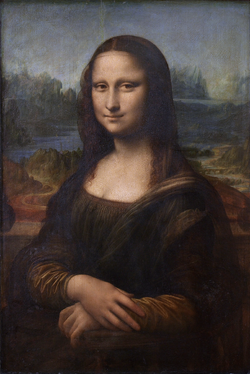

The Mona Lisa, the most famous and important portrait in the history of
world art. The perfect painting, the greatest work of art, the fruit of
the brilliant Leonardo. And yet for centuries it was an obscure piece of
art hanging in the private residences of the French kings. Even after
the French Revolution, once it had moved to the Louvre, it didn't draw
much attention from art critics.

It was the famous theft of 1911, carried out by [Vincenzo Perugia](https://en.wikipedia.org/wiki/Vincenzo_Peruggia) at the urging
of the art dealer Eduardo Valfierno, that cemented this painting's
universal fame. Even Apollinaire and Picasso were accused of the theft.
For weeks people started visiting the Louvre to gaze at the empty space
the theft had left. Slowly the Mona Lisa began to turn into the most
valuable object in Western art.



Two years and one hundred eleven days later, Vincenzo Peruggia was
arrested and the painting recovered. The thief claimed he had done it
out of patriotism, to return the work to Italy, and that he was a victim
of the con man Valfierno. The painting was exhibited in Florence, Rome
and Milan before being returned to France.

This turned it into a cultural icon. Plagiarized thousands of times, it
has been parodied, paid homage to, quoted, over and over. It has been
insured for more than 700 million dollars; it is the most valuable work
of art in the world, irreplaceable. Every time someone quotes, remixes,
parodies or uses the Mona Lisa, its fame grows.

And yet, for all the admiration he commanded, Leonardo da Vinci was
considered, until the 20th century, a good painter, but inferior to
[Titian](https://es.wikipedia.org/wiki/Tiziano) or [Raphael](https://es.wikipedia.org/wiki/Rafael_Sanzio).
The Mona Lisa was not considered a work of higher quality than others.
But today this work is the standard of quality in art.

> "It is impossible now to imagine the history of Western art without the
> Mona Lisa, and in that sense it truly is the greatest of all
> paintings. But it is also impossible to attribute its unique status to
> anything about the painting itself. This last point presents a
> problem, though, because when we try to explain the success of the
> Mona Lisa, we focus our attention precisely on its attributes."

> "\[\...\] To oversimplify slightly \[the art critics' argument\],
the Mona Lisa is the most famous painting in the world because it is
**the best**, and although it may have taken us a while \[as a
society\] to realize this, it was inevitable that we would. And that is
why so many people are puzzled when they see the Mona Lisa with their
own eyes. They are expecting these intrinsic qualities to be apparent,
and they aren't. Of course, most of us, when faced with this moment of
dissonance, simply shrug our shoulders and assume that someone wiser
than us has seen something we cannot see."[^1]

And even if an art critic lays out the evidence that "proves" the Mona
Lisa is the best work of art there is, it is possible to find those same
attributes in other works, which might seem just as good, or even
better. Of course, this problem is avoided by pointing out that it isn't
any single attribute of the Mona Lisa that makes it special, but the
combination of all its attributes (the smile, the use of light, the
fantastic background, etc.) There is no way to refute this argument,
because the Mona Lisa is a unique object. It looks as if the quality of
this work of art is being praised in terms of its attributes, but what
is actually being done is the opposite. It has been decided which is the
best work of art, and only then, from its attributes, is the metric of
quality defined. *"We say that the Mona Lisa is the most famous painting
in the world because it has attributes X, Y, and Z. But what we are
really saying is that the Mona Lisa is famous because it is more like
the Mona Lisa than anything else."*[^1]

And this can be applied to any work of art, or to define genius.
Shakespeare is great because he resembles Shakespeare, or Cervantes
because he is just like Cervantes. We have been taught that Cervantes,
da Vinci, Shakespeare or Mozart are geniuses, and genius is given by
the similarity one bears to those who have been established as
geniuses. I know it's a hard argument to accept, that it may annoy us,
but that's how it is: many standards of cultural quality come from this
kind of circular reasoning:

> X is successful, or brilliant, because X has the attributes of X

This kind of reasoning pervades many of the common-sense explanations of
why some things succeed and others fail.

> "When Facebook first became popular, its success was explained as
> being due to the exclusivity associated with students of certain
> universities. In 2009, when Facebook had already opened up to anyone,
> a Nielsen report attributed its success to its broad appeal, along
> with its simple design and its focus on connecting. Facebook, in other
> words, was successful because it had exactly the attributes of
> Facebook, even though those attributes themselves had changed
> completely."[^1]

Another form this circular reasoning takes is: "People do X because X is
the norm, and it's normal to follow the norm". And how do we know when
something is the norm? Once we start paying attention, we're surprised
by the number of explanations that are circular.

When society asks for same-sex marriage, or a woman is elected
president, we say that society is now *"ready for it"*. But the only way
to know that society is ready for something is for that something to
happen. In other words, what we are saying is: *"X happened because
that's what people wanted, and we know that X is what people wanted
because X is what happened"*.

It is important to highlight this whole problem of circular reasoning
because it has to do with one of the central intellectual problems in
sociology, the one sociologists call the **micro-macro problem**.
Sociologists want to explain things that are intrinsically macro in
nature, because they involve large numbers of people. But these outcomes
are the sum of micro actions carried out by individuals.

Cultural institutions such as marriage, social norms, even legal
principles, are only relevant to the extent that a large number of
people think they are. But for that to happen, society's decisions have
to be driven by a huge number of individual micro actions. Where do
families, cultures and societies come from? Why do they exhibit the
particular characteristics they exhibit? That is the micro-macro
problem.

It turns out this problem shows up in other sciences, where it is often
called "emergence" (as in, for example, emergent behavior). And all of
this has to do with something we have talked about before on this blog:
[complexity](/en/blog/lnds/2010/06/02/the-simple-the-complex-and-the-complicated/).
Sociology sits at the top of the pyramid of complexity that begins with
subatomic particles and ends with global society.

Emergence is a hard problem, because the behavior of the whole cannot be
explained just by describing the parts; the interactions are the key.
Sociology studies a great variety of interactions, so in this science
emergence, in the form of the micro-macro problem, turns out to be more
complex and intractable than in other disciplines. The bad part is that
common sense tends to hide this complexity.

Consider economics. In order to simplify their explanations, economists
talk about the consumer, the market, idealized entities that ignore the
interactions of the thousands or millions of individuals that make them
up. A so-called "representative agent" is chosen, and the reasoning
starts from that entity. The same happens in other social sciences. The
complexity of the interactions between individuals is systematically
ignored.

In our next articles we'll see how modern researchers have tried to
steer away from this kind of reasoning and, taking advantage of the
power computers give us, have begun to explore the complexity of the
interactions between individuals. It is possible to build more complex
models and observe the emergent behaviors, which is an interesting
contribution of computing to the study of society.

[^1]: Taken from the book [Everything Is Obvious: \*Once You Know the
Answer](https://www.amazon.com/gp/product/0385531680/ref=as_li_qf_sp_asin_tl?ie=UTF8&tag=lanaturaledel-20&linkCode=as2&camp=217145&creative=399373&creativeASIN=0385531680)
by Duncan Watts.
