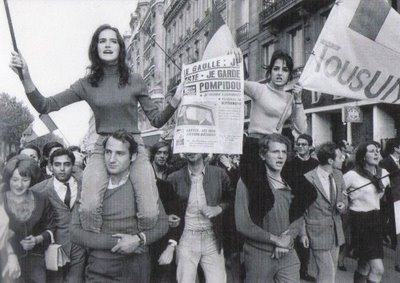
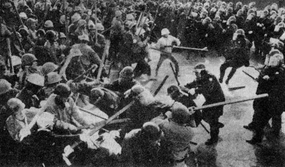

We saw that the success of a work as important as the Mona Lisa is
probably due to an [accidental reason](/en/blog/lnds/2011/07/12/circular-reasoning/).
Maybe if the 1911 theft had never been carried out, the most famous art
object in the world today would be a different one. We can't know. So we
cannot explain the success of the Mona Lisa in terms of its own
attributes. We can reason, circularly, that the Mona Lisa is the most
important work of art in the world because it has the attributes of the
Mona Lisa.

But what about the success of works like Harry Potter, for example? Why
is Harry Potter so successful, and why do so many people buy the books
and watch the movies? Is it because of its intrinsic quality? Is it a
product of advertising? There are reviews explaining that Harry Potter
"exploits a series of stereotypes that illustrate envy, intolerance, a
deep evil that raises the tension, with some moral statements about the
value of courage, friendship, the power of love, in a setting of fantasy
and magic. It is the sum of all these attributes that ensures its
massive success." Once again we have circular reasoning: Harry Potter is
successful because it has the attributes of Harry Potter. That explains
nothing. The reasons lie outside the attributes or characteristics of
this series of books. The explanation of how millions of readers were
brought to buy these books is the philosopher's stone of every modern
publisher (if you'll allow me the joke).

As we saw in the [previous article](/en/blog/lnds/2011/07/12/circular-reasoning/),
a common solution is to adopt a model based on a representative entity
or agent. The idea is to understand the behavior of the average consumer
from observation of, or conjectures about, the behavior of this abstract
entity. We profile the average Harry Potter reader and from that we
model a new product tailored to that ideal reader. This doesn't work, of
course, because it is a common-sense explanation that fails by ignoring
the interactions between individuals.

This becomes clear when we look at the work of the sociologist
[Mark Granovetter](http://en.wikipedia.org/wiki/Mark_Granovetter) and
his "threshold model of riots". The model is quite simple. Consider a
hypothetical crowd, where each person decides whether to take part in
acts of violence depending on whether other people are committing acts
of violence. In this model each person has a "violence threshold". There
are the instigators, who will start the disorder even if nobody else is
willing to be violent; their threshold is zero. There are those with a
threshold of one, that is, they turn to violence only if one other
person is committing violent acts; those with a threshold of 2, who
commit acts of violence if there are 2 people doing so; and so on. The
thresholds range from the ultraviolent with threshold zero to the
die-hard, Gandhi-style pacifist who will never use violence even if the
entire rest of the crowd is fighting (that is, his threshold is
infinite). Each group will have its own unique and particular
distribution of these violence thresholds.

An example of these distributions of violence thresholds is the
following: we have a group in which the first individual has a threshold
of zero, so he starts the violence; the second individual has a
threshold of 1 and therefore joins the first; the third individual has a
threshold of 2 and joins the group; the fourth individual has a
threshold of 4, the fifth individual has a threshold of 5, the rest of
the individuals have thresholds higher than 5; the violence doesn't
catch on, and the event ends peacefully with few incidents.

Now suppose we have two crowds, A and B, with the same number of people,
of the same kind: for example, they are all students, in the same age
ranges, who are also protesting for the same cause (the government's
education policy), only in different cities and with slightly different
distributions of violence thresholds. For example, group A might differ
from group B in just one person, who has a slightly lower threshold than
his counterpart. What can happen is that crowd A produces disorder and
violence, and in case B there is no vandalism at all, all because of
this minimal difference. In city A the protest ends with arrests, damage
to public property, injuries, etc. In city B the protest ends peacefully
and breaks up after a while. Of course, we know that the probabilities
of violent acts occurring are different because we know these
distributions, because we invented these probability distributions for
the violence of these groups. But two outside observers would try to
find explanations for the different outcomes of the protests in A and B.
The observers would try to guess at the causes that led to violence in A
and not in B. Maybe in A the police were more aggressive, maybe group A
was angrier, or more desperate, than group B, maybe in group B there was
a more explosive leader who stirred up more passion in his audience,
etc. All common-sense explanations. The real reason, that the violence
threshold was barely higher in B than in A, is something that stays
hidden from these observers. Apart from the violence threshold, there is
nothing in this thought experiment that sets crowd A apart from group B.
And this point is super important, because the only way a representative
agent model, "the average protesting student", could explain the
differences is if there were differences in the average properties of
the two populations, and that is not the case, because we have built two
groups that are identical in every observable property.

In Granovetter's model it doesn't matter what model of individual
behavior you have, because the populations are indistinguishable from
one another. The only difference comes from the degree of interaction
between individuals, which requires you to go through the complete
sequence of decisions each individual makes as a function of everyone
else's behavior. This model makes clear the importance of the micro
interactions between individuals.

Granted, this is a very simple model of influence between individuals,
but it serves to highlight this important property: the micro
interactions are what matter. In the next articles we'll look at the
ways in which we influence one another in social networks.
