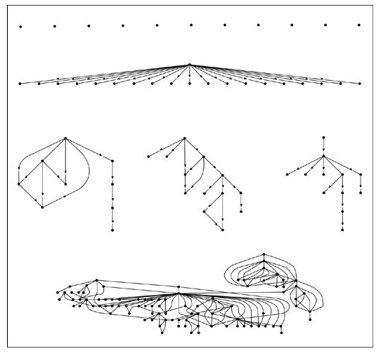

 
One of the central premises of Malcolm Gladwell's book
"[The Tipping Point](http://www.amazon.com/gp/product/0316346624/ref=as_li_qf_sp_asin_il_tl?ie=UTF8&tag=lanaturaledel-20&linkCode=as2&camp=1789&creative=9325&creativeASIN=0316346624)"
is that a few well-connected people can spread ideas, set fashions, or
influence the behavior of many people. In essence the argument is that
there are a few influencers who are capable of dictating the behavior of
the many. Gladwell calls this the law of the few: in every phenomenon of
"social contagion" there are a few special people who determine whether
ideas go viral. Gladwell classifies them as "connectors", "mavens" and
"salesmen". Connectors would be people with the gift of connecting the
world, the ones with the ability to connect easily with lots of other
people, the ones who can easily make many friends. These people have a
social network of over a hundred people. Mavens would be the people we
turn to for new information, the ones who accumulate information and
trade it in some way. Besides having knowledge, they have the social and
communication skills to spread it. Salesmen, or persuaders, are the ones
with powerful negotiation skills. Somehow they get everyone else to want
to reach an agreement with them.

Gladwell's theory is based on the famous six degrees of separation
studies carried out by the psychologist Stanley Milgram, who ran a
series of experiments in the 1960s (the [small
world](http://en.wikipedia.org/wiki/Small_world_phenomenon)
experiments) that tried to connect two people in a social network. For
example, two people in the United States were chosen and the goal was to
link them through the smallest number of contacts. It was found that the
average length of the chain for sending a message from any person A to
another person B was between 6 and 7 people.

Milgram believed there were certain central points (hubs) in social
networks that act as true "routers", making shortcuts possible within
social networks. Suppose I want to send a message to a resident X of
Chicago. One way would be to try to contact Barack Obama, since as
president of the USA he could more easily reach someone who can get my
message to that person; one path would be to go to our own president, or
to the mayor of Santiago ;). It would seem that Milgram, and therefore
Gladwell, are right: there would be special people who make sure social
networks build connecting paths of short length.

But once again we are being trapped by common-sense explanations,
because Gladwell's theory doesn't hold up. The law of the few is really
two hypotheses that are very hard to prove. The first is that some
people are more influential than others, and the second is that the
influence of these people is magnified by a process of social contagion.
The first hypothesis can be criticized from an epistemological point of
view: you need to define very well what influence is and then design
experiments that can confirm it.

As for the problem of contagion, or "social epidemic", we can turn to
experimentation and analysis of the information that social networks
give us, in particular the internet social networks developed in recent
years. On that front, in 2008 two researchers at Microsoft Research
analyzed a network of 240 million Messenger users to find the degree of
separation between 2 users by analyzing their contact lists, and found
that in general people are separated by at most 7 steps. Milgram's
studies covered a few hundred people. Later, Duncan Watts and other
researchers used email to repeat Milgram's experiment with the
participation of 60,000 people across 166 countries. If Gladwell's
theory of hubs, or connectors, were true, they would have found stars,
or concentration points, in the traffic of the messages, and that is not
what was observed. With no hubs to be found, it seems the role of
connectors is not that relevant in social contagion.

But what about the influencers? Is it possible for a few mavens, or
salesmen, to spread their social "infection" to an entire network?
Initially Duncan Watts proposed some statistical models based on the
models proposed by Granovetter (like the ones we saw in [a previous
article](/en/blog/lnds/2011/07/13/influences/)). But there is a network that
allows a much better study, and that is Twitter.

Watts worked with a team of researchers at Yahoo! and they investigated
74 million diffusion chains on Twitter (sequences of RTs of links),
started by 1.6 million users, over a period of 2 months at the end of
2009. The idea was to count how many times a URL was retweeted, counting
the RTs by direct followers, then by the followers of their followers,
and so on, following the cascade of RTs. The figure below is a
representation of the results:

As you can see, there are cascades that are shallow but wide, that is, a
link that is sent to a large number of followers but gets few "retweets"
after that. There are other cascades that are thinner but deeper. And
others that are quite complex, even with cycles. The vast majority, 98%
of all the URLs, don't spread at all (the isolated dots).

This study does not solve the problem of influence. If a famous Twitter
user with many followers promotes a product, the count of retweets is
not a measure of how effective that influence is. What this study does
tell us is that the law of the few, from the point of view of "social
contagion", is probably not correct. The study finds that these "social
epidemics" do indeed exist, but they are rare events. Of the 74 million
events analyzed, only a few dozen generated more than a thousand
"retweets", and only a couple reached ten thousand. In a network (at
the time) of tens of millions of users, ten thousand is not much, and
yet it is a very hard number to reach.

Given this, it may be more practical to forget the idea of trying to
generate one big cascade of events and concentrate on creating many
small cascades, and in that scenario the small influencers work quite
well. A viral campaign seems to work better when you work with many
individuals than when you try to aim for the big influencer. Here's a
tip for those who want to do marketing on networks like Twitter: you're
better off investing in ordinary, everyday Twitter users with a few
followers than spending large sums on Twitter users with thousands of
followers. At least in statistical terms, and in terms of viral results,
the studies suggest that both groups are similar.

So the conclusion seems to be that there are no special people, at least
not at the level of social networks. We all have the potential to
generate a big impact on social networks; the degree of connection, or
the supposed skills of connectors, mavens or influencers, is
statistically no different from that of any other member of the network.
The law of the few is an idea that doesn't seem to have any real
support. It is more a matter of perception than of reality.
