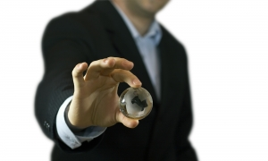
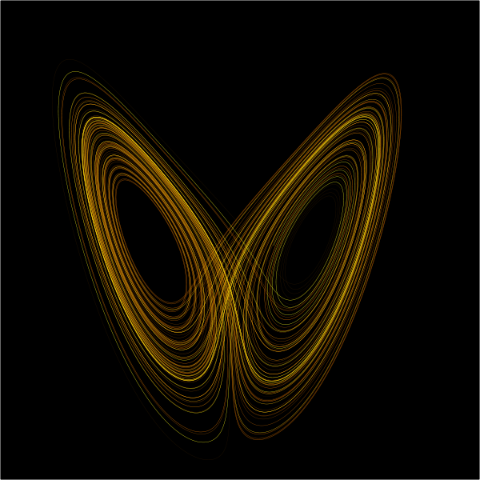

 
If we're bad at [explaining the past](/en/blog/lnds/2011/07/12/circular-reasoning/),
how are we at predicting the future?

We love predictions. Every year we read technology predictions written
by experts from important firms like Gartner and others. Important think
tanks and publications make predictions about economic and political
events, and newspapers even quote fortune-tellers, astrologers and
numerologists who foretell the events of the year. These last seem to
have very poor results, but are an astrologer's predictions any better
than those of a prestigious market research firm? The truth is nobody
knows, because nobody bothers to audit the results.

But there is an experiment, carried out by the psychologist Philip
Tetlock, that put the predictive ability of 284 political experts to the
test. In the mid-1980s Tetlock contacted these experts and asked them
for around a hundred predictions about a variety of possible future
events, from the possible outcomes of an election to the probability of
two nations facing each other in an armed conflict. For each prediction
the experts were asked to specify which of two options they expected to
happen, and to assign a probability to their prediction. After
collecting these predictions Tetlock waited twenty years, and published
his results[^1].

Although the experts performed better than random guessing, they didn't
do so well compared with a simple statistical model. But the most
surprising thing is that the experts did slightly better when they were
operating outside their area of expertise. The results of this
experiment, and many other stories about the ability of experts to
predict the future, are the basis of Dan Gardner's book
[Future Babble](https://www.amazon.com/gp/product/0525952055/ref=as_li_tf_tl?ie=UTF8&tag=lanaturaledel-20&linkCode=as2&camp=217145&creative=399369&creativeASIN=0525952055).

In this book Gardner delivers a series of stories that show the
consistent inability of experts to predict the future, to the point
where it seems any of us could do better.

Nobody ever predicted the success of Star Wars or Harry Potter, the
economic collapse of late 2008, or the success of Google or Facebook. In
the late 1990s Sergey Brin and Larry Page tried unsuccessfully to sell
their company for 1.6 million dollars, and nobody thought that company
would ever be worth that much. Just as well, because today Google is
valued at some 100,000 times more.

Given all this, it would seem that we human beings are simply bad at
making predictions. But it's not quite like that. For example, every day
we can make a certain degree of prediction about the weather where we
live, and curiously our predictions will be pretty good. We know that
certain things will happen, and they seem inevitable to us, and there
are others that simply happen with such regularity that they are totally
predictable. The sun will keep rising in the east, a war between Canada
and the United States in the next ten years is unlikely, etc. Of course,
these predictions impress nobody. In the words of Duncan Watts: *"the
real problem with predictions is not that we are universally good or bad
at them, but that we are bad at distinguishing the predictions we can
make with certainty from those we can't."*

In simple systems we can make precise predictions. For example, we can
predict when Halley's comet will appear again, because we know its orbit
and there is a simple model that lets us predict its path through the
solar system. But in complex systems, like social systems, this is not
possible. What we can do is give a certain probability that an event
will occur. However, complex systems are not exactly random; the fact
that we can calculate probabilities of certain events occurring has
nothing to do with a random nature. Complex systems are chaotic, that
is, they are the product of thousands or millions of micro interactions.
The problem is that each interaction helps perturb the system in ways
that are unpredictable. We are dealing with something popularly known as
the **[butterfly effect](http://es.wikipedia.org/wiki/Efecto_mariposa)**.

"The mere flap of a butterfly's wings can change the world": we've all
heard lines like that. A butterfly flaps its wings in the Amazon and a
monsoon is unleashed in the Indian Ocean. The initial conditions in a
complex system can vary slightly and the outcomes vary enormously. The
concept of the butterfly effect comes from the work of Edward Lorenz,
who worked on modeling weather predictors. Today's weather forecasting
models are pretty good, but even so they are very sensitive to small
variations. It is not possible to predict beyond a certain number of
days, because the perturbations keep getting bigger as time goes by.
That is why weather models deliver their results expressed as
probabilities: "the probability of rain tomorrow is 60%, and of rain the
day after tomorrow, 40%".

So when in 2008, the day before Barack Obama was elected, people were
saying he had a better than 90% probability of being elected, what did
they mean? That if he had run for president 10 times he would have won
9? Clearly not, because this election is a one-time event. From a
mathematical point of view, assigning probabilities to a one-time event
is problematic.

When we look at the past we feel no confusion about the events that
happened, and we know which events were relevant. But which events are
the relevant ones in the future? The future is a big cloud of
probability that collapses when things happen. Only when events occur
can we know which were the most important and relevant ones. It follows
that the importance of events requires the prediction to be not only
about the facts that will occur, but about their outcome. If we are
going to predict social events, we must predict not only what will
happen, but what the social process will be that makes everything that
happened make sense.

We have seen that common sense gives us no explanations of past events,
only descriptions of them. Add to that our inability to predict the
future. The problem is that economic policies, development plans and
public policies affect large groups of people. A marketing campaign, or
a public health plan, depends on our ability to properly link cause and
effect, so they require a proper scientific explanation rather than a
historical narration of the facts. For all these reasons one wonders
whether there might be a better way of making predictions, a sort of
"uncommon sense" to help us. Well, that will be our goal now: the search
for uncommon sense, for its virtues and implications for prediction,
planning and social science.

[^1]: [Expert Political Judgment: How Good Is It? How Can We
Know?](https://www.amazon.com/gp/product/B003HOXLAW/ref=as_li_qf_sp_asin_tl?ie=UTF8&tag=lanaturaledel-20&linkCode=as2&camp=217145&creative=399373&creativeASIN=B003HOXLAW), Philip Tetlock.
