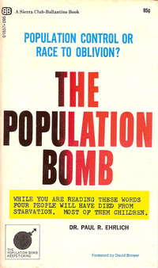
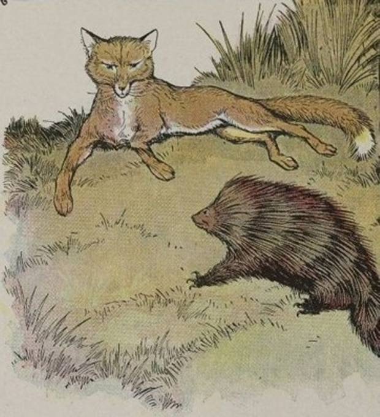

At the end of 2007 BusinessWeek published the forecast of 54 economists
for the following year, under the title
"[A Slower But Steady Economy](https://www.businessweek.com/interactive_reports/economist_forecast.html)" [^1].
One disastrous year later, and without so much as blinking, it published
the new forecast for 2009, under the title:
"[A Slower But Steady Economy](https://www.businessweek.com/interactive_reports/economist_forecast_2008.html)"[^2].

In our era economists inspire the same degree of respect the oracles of
Delphi did among the Greeks: whatever they say, however vague it sounds,
is listened to by the highest authorities and decision makers. But
nobody seems to care that these predictions are systematically wrong.

Just like the old oracles, the experts have arguments for brushing off
criticism. "I was almost right" is a typical line, or the other one, "it
would have happened if it hadn't been for an unexpected event". Another
is the idea of the [self-defeating
prophecy](https://es.wikipedia.org/wiki/Profec%C3%ADa_autofrustrada),
that is, that the very act of making the prediction keeps it from coming
true. Remember what happened with the year 2000, the famous Y2K? Well,
there were experts who claimed that computers would fail on January 1,
2000 and civilization would collapse.

> "The doomsayers boasted that their predictions had prompted the
> massive remediation efforts that saved humanity from its inevitable
> fate: \'you're welcome\'."\[3\]

Another trick is "wait and see". There are many predictions with pretty
vague time windows, so that when an observer thinks the prediction
didn't come true, the expert can insist that the time hasn't come yet:
"wait and see". A variation is to shift the time window. In this case
the expert has made a prediction with a specific deadline that has not
been met; the forecaster grants us that, but insists it's a minor
detail, and what matters is that the predicted event will occur.

An example: in 1968 the American biologist Paul Ehrlich published a book
called [The Population Bomb](https://en.wikipedia.org/wiki/The_Population_Bomb),
in which he predicted worldwide famines in the 1970s: "The battle to
feed all of humanity is over. In the 1970s hundreds of millions of
people will starve to death in spite of any crash programs embarked upon
now", and we know what happened: food production went up. In the
so-called "[green
revolution](https://es.wikipedia.org/wiki/Revoluci%C3%B3n_verde)", between 1961
and 2000 the world's population doubled, and calorie consumption per
person increased by 24%[^4].

Despite all this evidence, Paul Ehrlich insists there is nothing wrong
with his predictions. In 2009 he even claimed that "perhaps the most
serious flaw in The Bomb \[he means the book\] was that it was much too
optimistic about the future" (although he admits he underestimated the
impact of the "green revolution").

One last, sorry argument is the elastic prediction. "I didn't say event
X would happen, what I said was that event X *could* happen", and with
that conditional the possibility is left open that the event won't
happen. So if the event didn't happen, that doesn't mean the prediction
was wrong.

Of course, things aren't that simple, because sometimes there is some
truth in these arguments. For example, the predictions about the
consequences of damage to the ozone layer did cause governments to take
action and produce policies that kept those predictions from coming
true; this was indeed a "self-defeating prophecy". It is also true that
the fact that there were no global famines at the end of the 20th
century doesn't prove that population growth won't cause famines in the
future, as Ehrlich says.

So we can argue for or against the experts and their predictions. What
we should be trying to do is determine the experts' failure rate. That
is precisely what Tetlock did in his experiment, which we mentioned in
our [previous
article](/en/blog/lnds/2011/07/26/predictions/).

Tetlock compared the experts' predictions against a simple statistical
model. He tabulated 27,450 predictions made by 284 experts (political
scientists, economists and journalists). The unsettling conclusion is
that the experts' predictions are no more accurate than a random guess.
You can visit an astrologer, or a Harvard professor, or read a fortune
cookie. You'll get, in essence, the same results; at least you can eat
the cookie :wink: Actually that is not Tetlock's conclusion, it's [Dan
Gardner](https://www.amazon.com/gp/product/B004BDP07A/ref=as_li_qf_sp_asin_tl?ie=UTF8&tag=lanaturaledel-20&linkCode=as2&camp=217145&creative=399373&creativeASIN=B004BDP07A)'s
(though I subscribe to it).

The interesting thing is that Tetlock found a great deal of variation
among individual experts.

> "There is a wide variety. Some experts are disconnected from reality,
> almost to the point of delusion. Other experts are only slightly
> disconnected. And a few experts are surprisingly nuanced and well
> calibrated."\[3\]

The difference between these kinds of experts doesn't come from their
professional profiles, their level of education, or their political
leanings. What makes the difference is *the way they think*.

The experts who did particularly badly, worse than a random prediction,
were the ones who weren't comfortable with uncertainty and complexity.
They always tried to reduce the problem to a single central theoretical
theme, and they used that theme over and over. These experts were the
ones who felt their predictions were the most reliable, that is, they
were the ones with the most confidence in their own predictive powers.
These experts are sure their One Big Idea is right, and therefore the
predictions that fit that idea must be right too.

On the other hand, the experts who did better than average, and slightly
better than a random prediction, thought differently. They had no
template. On the contrary, they take information and ideas from diverse
sources and try to synthesize them. They were self-critical, always
questioning whether what they thought was true really was. And when they
were shown they were wrong, they didn't try to minimize, cover
themselves or dodge. They simply acknowledged they were wrong and
adjusted their thinking accordingly. Most of these experts were
comfortable with the idea that the world is complex and full of
uncertainty; in fact they tend to doubt anyone's ability to predict the
future. So a paradox arises: the experts who are better at predicting
tend to have less confidence in their predictions.

In his famous essay "[The Hedgehog and the Fox](https://en.wikipedia.org/wiki/The_Hedgehog_and_the_Fox)" [^5],
the liberal thinker [Isaiah Berlin](https://es.wikipedia.org/wiki/Isaiah_Berlin)
quotes a fragment of a poem by [Archilochus](https://es.wikipedia.org/wiki/Arqu%C3%ADloco):

> "A fox knows many things, but a hedgehog knows one big thing."

In honor of Berlin, Tetlock named these two classes of experts "foxes"
and "hedgehogs". Foxes are better than hedgehogs. Analyzing the data in
more detail, Tetlock found that hedgehogs who are ideologically extreme
are worse predictors than others of their kind. He even found that when
hedgehogs make predictions about their own particular specialty their
accuracy declines, and it gets worse if it's a long-term prediction.

Hedgehogs are easy to spot, especially the ones who show up in the
media: they are sure, confident, clear, and they don't bother with
details, complications, complexities or uncertainties. Tetlock found
that the bigger the hedgehog's media profile, the less accurate his
predictions. Paul Ehrlich, for example, is a hedgehog.

The big problem is overconfidence, and disconnection from reality. The
lesson of Tetlock's work is that people can be nudged into being more
like foxes, more self-critical and reflective, and that way they can get
better at seeing what's coming and at preparing to handle the
uncertainty and complexity of the world. It is better to be flexible,
open to doubt, with very few certainties, like the fox. Let's admit
that, no matter how intelligent we are, or how sophisticated our way of
thinking, the brain we use is limited, and the world is essentially
unpredictable.

[^1]: It's available online at [https://www.businessweek.com/interactive*reports/economist*forecast.html](https://www.businessweek.com/interactive_reports/economist_forecast.html); the deck reads: "The economy won't sink into a recession next year. That's the overwhelming view among the 54 economists in BusinessWeek 's annual economic outlook survey"

[^2]: Believe it or not, also available at [https://www.businessweek.com/interactive*reports/economist*forecast\_2008.html](https://www.businessweek.com/interactive_reports/economist_forecast_2008.html); the deck reads: "The economy will begin 2009 mired in a long and deep recession, before a tepid start toward recovery in the second half. That's the view of the 45 economists in BusinessWeek's annual economic outlook survey."

[^3]: Quoted from the book [Future Babble: Why Expert Predictions Are Next to Worthless, and You Can Do Better](https://www.amazon.com/gp/product/B004BDP07A/ref=as_li_qf_sp_asin_tl?ie=UTF8&tag=lanaturaledel-20&linkCode=as2&camp=217145&creative=399373&creativeASIN=B004BDP07A) by Dan Gardner.

[^4]: With their pros and cons, you have to admit that these techniques
allowed India to raise calorie consumption per person by 20%, South
Korea by 44%, Indonesia by 69%, and in China, which had a famine that
killed more than 30 million people between 1959 and 1969, the increase
was 73%. In countries like the United States one of the main health
problems now is obesity. Personally I have no problem with GMOs, but I
do criticize the economic control and abuse of this technology; but that
is another discussion.

[^5]: In Spanish it is sometimes found translated as El Erizo y la Zorra (erizo, the hedgehog, is also known as puercoespín). In Spanish, Editorial Península, ISBN9788483079034
