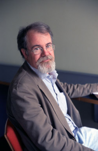

> "A **planner** thinks he already knows the answer. He thinks of
> poverty as a technical engineering problem that his answers will
> solve. A **searcher** admits he doesn't know the answer in
> advance; he believes that poverty is a complicated tangle of
> political, social, historical, institutional and technological factors\... and
> he hopes to find the answer to individual
> problems by trial and error\... A planner believes that
> outsiders know enough to impose a solution.
> A searcher believes that insiders have enough
> knowledge to find solutions, and that many solutions must
> come from within."\
> -- [William  Easterly](http://williameasterly.org/)
