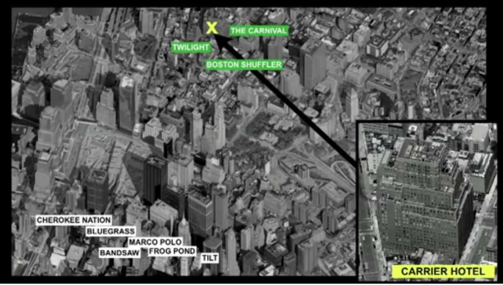

 
On May 6, 2010 at 2:45 PM New York time there was a
stock market crash that sent the Dow Jones index down 900 points (a
9% drop), and it recovered completely a few minutes
later. This phenomenon was named the 
[2010 Flash Crash](http://en.wikipedia.org/wiki/2010_Flash_Crash)

There are over 2,000 particle physicists currently working on Wall
Street. What they do is model the behavior of the markets in
algorithms that trade stocks in a matter of microseconds. To give
you an idea, it takes us 500,000 microseconds to click
a mouse. So in algorithm terms, if you take a couple of
seconds you are a loser.

Consider this image, taken from a recent talk by 
[Kevin Slavin at TED](http://www.ted.com/talks/kevin_slavin_how_algorithms_shape_our_world.html):

A Carrier Hotel is a datacenter where you rent space to
put your servers. In the picture we have the carrier hotel located
on Hudson Street, where the New York Stock Exchange's shares are
traded. The names shown in white or green are sites with
servers running stock buying and selling algorithms.
What happens is that algorithms such as Cherokee Nation, Bluegrass,
Marco Polo and so on are at an 8-microsecond disadvantage compared to
the sites running the algorithms The Carnival, Twilight and Boston
Shuffler. So the buildings around the carrier hotel are
being hollowed out to make room for servers that sit closer to the
place where the stocks are traded.

The company Spread Networks dug a 1,300-kilometer trench
between Chicago and New York to be able to transmit a 14-millisecond
signal over a dedicated fiber optic link. So
we are literally reshaping the world to give an edge to some
algorithms that trade for us on the stock exchanges. But
has anyone thought about the consequences all of this could have?

Nobody really knows what happened in the 2010 Flash Crash, because nobody
was in control of what happened. It was literally the machines
that brought the market down for 9 minutes that day. Somehow
the algorithms fell into a strange resonance and generated a
spiral of trades that led to the instant drop in the market,
and those same algorithms reacted and generated the recovery.

I get chills when I think that our pension funds, or
the jobs of thousands of people, depend on the coordinated behavior
of many algorithms, written under the assumptions of a bunch of
theoretical physicists experimenting on their computers with their ideas about how to deal with
complexity, as if this were a puzzle game
where the point is to show who can write the smartest algorithm,
about things we barely understand.

I hope this helps you understand why I am so concerned
with exploring all these strategies for predicting both the future and
the present.

I leave you with this TED talk where Kevin Slavin talks about these
things:


