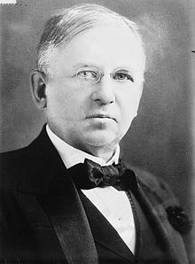

When we looked at [the strategy paradox](/en/blog/lnds/2011/08/02/the-strategy-paradox/)
we found that big plans can produce a big disaster, or a
big success. Mediocre plans produce mediocre results. They say
that "a bad plan is always better than no plan", so in the face of
uncertainty a 
[measure and react](/en/blog/lnds/2011/08/04/measure-and-react/) kind of strategy
looks like a reasonable alternative, and probably a more successful one.

Now, in many situations measurements don't tell us what
we want to know. For example, when we are planning an advertising
campaign. The CFO of a major international
company once lamented that they had spent 400 million
dollars on a brand positioning campaign, not for any
particular product, just for the brand. The question was how
effective that spending had been. He couldn't tell whether the payoff had been 400
million or zero. The CFO was not saying the advertising spend had
been ineffective, only that he had no idea how effective it had
been. It was entirely possible that if they hadn't spent a cent their
performance as a company would have been the same, but it was also possible that without
spending those millions they would have faced a disaster.

Now, 400 million dollars sounds monstrous, but
consider that American corporations spend 500
billion dollars a year on marketing. So the obvious question is
how much of that money actually has an effect on consumers. Does anybody
have any idea?

In the late 19th century the American magnate [John
Wanamaker](https://en.wikipedia.org/wiki/John_Wanamaker), considered by
some to be [the pioneer of modern
marketing](https://mises.org/daily/5054/The-Pioneer-of-Marketing),
complained that:

> *"Half the money I spend on advertising is wasted; the trouble is
> I don't know which half"*

Wanamaker was considered an advertising genius, and a pioneer of the
department store, introducing concepts such as the money-back
guarantee. He was regarded as an honest businessman; he
offered his employees free medical care, education, recreation
facilities, and pension and profit-sharing plans. Although he
fiercely opposed unionization.

Much of what retail does today to grab consumers'
attention Wanamaker had already tried in the 1860s.

So, despite all the progress we have made in science and
technology, Wanamaker's question still stands. The CFO mentioned
earlier is left with the same doubt as the late-19th-century
magnate.

It's not that we lack better measurements. On the contrary, since
Wanamaker's time we have plenty of companies whose business is measuring;
stores have their customer databases, CRM systems,
business intelligence. There are rating agencies like Nielsen or
ComScore that measure the stream of clicks on digital ads.
We have a lot of information, but the problem is that advertisers
want to know whether the ads cause an increase in sales, and almost
always what you get is a correlation between ads and increased
sales.

"Correlation does not imply causation". That should be clear, but we
get confused. Take people who go on a diet. When people diet
and lose weight they immediately credit the diet. But it turns out that
besides dieting, people who start a weight-loss program
also start exercising, or change their habits, like the times
they eat, or their sleep routine, and they even pay more attention to what
they eat. So any of those changes, or a combination of
them, is probably responsible for the weight loss, more so than
the choice of diet.

The same thing happens in advertising. Advertisers plan their ad
spending based on future sales, or start spending more in
peak seasons, like the run-up to the holidays. So in those
scenarios sales and advertising will be correlated, even if the
advertising produces nothing special (at Christmas people will go
shopping anyway, regardless of the ad campaign), or there may be other
external factors causing the higher sales that are not necessarily
related to the advertising.

So telling correlation from cause is hard, in general. One
possible solution is to run an experiment. If we want to measure the
effectiveness of a "treatment" (a diet, or an ad campaign), we must
apply it in some cases and not in others (the control group). Just
as is done when evaluating new drugs. Some
patients are given the drug, and others get a
placebo. Only if the people on the treatment improve more
often is the new drug approved.

In the world of online advertising it has been found that the sponsored
ads that show up in search results are more
successful than the ones placed on websites. The reason is that
sponsored ads depend heavily on what you were searching for.
People searching about problems with their car will click on
ads for repair shops in their area.

It is the foundation of Google's wealth, and the reason that advertising can be
more effective than what you see hanging on Facebook, in Gmail, or
in the sidebar of this very blog. When I am searching I am more
receptive to advertising than when I am simply browsing the internet.

This is poorly understood, because advertisers pay a premium to
reach the consumers most likely to buy
their products. This is what is called targeted advertising, where the idea is
to segment the consumer. What they fail to realize is that those
consumers will buy their products anyway. The value of that
advertising lies only in the _marginal consumer_, the one who would not have
bought the product had he not seen the ad. The only way to
determine the effect of advertising on marginal consumers is
by running experiments in which the decision of who sees the ad and
who doesn't is made by chance.

That is hard to do in traditional advertising, like billboards on
the highway, or ads in a magazine. But it is possible in the electronic world.
There is an experiment discussed by Duncan J. Watts[^1], carried out by his
colleagues at Yahoo, David Reily, Taylor Schreiner and Randall Lewis:
[Advertising Works](https://research.yahoo.com/project/2616).

It was a field experiment with 1.6 million customers of a
retail chain who were also active Yahoo! users. To
run the experiment, Reiley and his team assigned 1.3 million
users to the "treatment" group, who would be shown the *retailer's* ads
whenever they landed on a site operated by Yahoo!. The other
300,000 were assigned to the control group, meaning they would never see
the advertising, even if they visited exactly the same pages as the
other group. Since the assignment was random, any differences had to
come from the performance of the ad itself, and since the users were also
in the company's databases, the effect of the ad could be
measured in terms of actual purchases.

Using this method the researchers estimated that the additional revenue
generated by the ads was roughly four times the cost of the
campaign in the short run, and probably higher in the long run.
They therefore concluded that the campaign had indeed been effective,
good news for the retailer and for Yahoo!. But they also
discovered that almost all of the effect was on older customers.
The ads had almost no effect at all on people under 40.
This looks bad but it is an advantage, because the experiment tells us that
something here isn't working with young people, and we can run new
experiments to capture their attention. And even then, if we get no
results with the young consumer, we can find out whether it is the brand that doesn't
appeal to that audience, or whether online advertising is ignored by that
group. Whatever the outcome, at least the advertiser knows it isn't
worth spending money on this segment and can concentrate resources on
the segment that does respond to the ads.

So experiments should be seen as a way of learning
as you go; they are part of an ongoing process. You shouldn't expect
the definitive answer from them. They will probably raise new
questions, but they let you draw certain distinctions that
help make more efficient use of resources.

These experiments are being used more and more, not only in
online marketing but also in user interface design, or in
designing website navigation. In the social sciences,
to measure the effectiveness of certain public policies, and in companies
to measure pay-for-performance schemes. The potential of
experiments is enormous, and they clearly should be used more.

[^1]: Duncan J. Watss. [Everything Is Obvious: \*Once You Know the
Answer](https://www.amazon.com/gp/product/B004DEPHGQ/ref=as_li_qf_sp_asin_tl?ie=UTF8&tag=lanaturaledel-20&linkCode=as2&camp=217145&creative=399373&creativeASIN=B004DEPHGQ)
