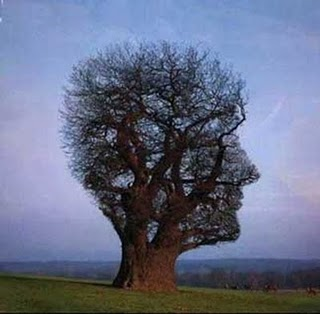

We human beings are cognitive misers: we try to think as little as
possible. That's not something I came up with, it is what many
cognitive psychologists argue. One of the mental shortcuts we use is
framing.

Framing is a schema of interpretation, a collection of anecdotes
and stereotypes we rely on to understand or respond to
different events. As we grow up we develop a series
of emotional mental filters, which we later use to
make sense of the world we live in. These mental filters take
the form of simple narratives.

All complex narratives are made up of smaller
narratives with very simple structures. These simple structures are
known as "frames". Frames are a kind of
cognitive structure, a mechanism we use to think. For example,
when we read a murder mystery there is a typical frame with
several kinds of characters: the murderer, the victim or victims, the
possible accomplices, the suspects, the motive, the murder weapon, the
detective, the clues, and a scenario, in which the murderer kills his
victims and is later caught by the detective.

It has been found that frames are cognitive
structures that require a fairly simple neural circuit. Jerome
Feldman argues in his book "[From Molecule to Metaphor](http://amzn.to/mPFJv7)" that
combinations of "triangle nodes" are enough to
characterize the computational properties of a frame. Each node is
a small collection of neurons forming a circuit. In a triangle
node there are three of those circuits, and activating any two of them
activates the third. There is a control node that triggers this process.
Our brain uses these frames in many of our mental
processes.

Frames have been described in several fields. Sociologists have
found that all institutions are structured as
frames. Linguists have found that words are defined
relative to conceptual frames. Groups of related words,
known as "semantic fields", are defined with respect to the same
frame. Words like "cost", "sale", "goods", "price",
"purchase", etc., are defined with respect to the same frame, the one that describes
commercial events. It has even been found that the physical
understanding of an object can be observed at a neural level that takes the
form of a frame structure.

Frame structures are also found in all narratives.
They are easy to spot in mythological tales and folklore, and in
all cultural prototypes. In all these narratives we have a
series of "semantic roles", such as the main characters, the
actions and the instruments.



Consider the "rescue narrative". The characters are the Hero,
the Victim, the Villain, the Helpers. The Hero is inherently good,
the Villain inherently bad. The main actions form a
scenario: "The Villainy, committed by the Villain against the Victim.
The Difficulties the Hero must overcome. The Battle of the Hero against
the Villain, the Victory of the Hero over the Villain, the Rescue of the
Victim by the Hero, the Punishment of the Villain, the Reward for the
Hero. The Villainy upsets the moral order. The Victory, the Rescue,
the Punishment and the Reward restore the moral order.

It doesn't matter whether the story is about Rama, Hercules or Batman, the
same structure is used. This is what is known as a "deep
narrative", and it is what establishes a series of cultural prototypes.
There are many of these prototypes: the martyr, the rogue, the freeloader, etc.

So what is it that lets the brain combine these simple
narratives to create new narratives? What is the mechanism that
lets us identify the different semantic roles in different
narratives? What lets the brain apply a general form to a
special case?

The answer is "neural binding". For example,
when you see a blue cube you perceive it as a single object, but in
reality color and shape are registered in different parts of the
brain. Neural binding lets us bring together these neural
activations, in different parts of our brain, to form an integrated
whole.

There are various theories that try to explain how this
mechanism works. The important thing is that it isn't magic; it requires the
interaction of different circuits of neurons firing
simultaneously in our brain. These neural bindings are what
shape our different experiences. The repetition of these
bindings over and over in our brain creates patterns that
get "recorded" in our brain. When we face new
situations, our brain turns to this warehouse of stored
experiences and produces associations. It is the cheapest mechanism for
our brain. Only when it finds nothing analogous does it form
a new circuit, which will be recorded in our brain for future
use.

Neural binding is important for understanding the temporal structure of
a narrative. Even the simplest narratives have a structure
that is activated over time again and again, in the following stages:

-   Preconditions, the prior context required by the narrative.

-   The Buildup, the events leading up to the central event.

-   The Main Event, the subject of the narrative, what the
    narrative is about.

-   The Purpose, what is achieved (if there is a purpose).

-   The Wind-Down, the events that end the narrative.

-   The Result, the final context, and

-   The Later Consequences

There are variations, but this is the typical structure of a
simple narrative. It is a structure known as the "executing
schema" in the field of computational neural modeling. Software
people will recognize a similarity with use cases, as used in
software development.



Neural bindings can create emotional experiences. In fact, at
the level of the [limbic system](https://es.wikipedia.org/wiki/Sistema_l%C3%ADmbico), the most
primitive part of the brain in evolutionary terms, there are two emotional
circuits with different neurotransmitters. The one for positive
emotions (happiness, satisfaction), known as the
[dopamine](https://es.wikipedia.org/wiki/Dopamina) circuit. And the one for negative
emotions (fear, anxiety and anger), the
[norepinephrine](http://es.wikipedia.org/wiki/Noradrenalina) circuit. There are pathways
in the brain that link these emotional circuits to the
[prosencephalon](http://es.wikipedia.org/wiki/Prosenc%C3%A9falo), the
forebrain, where the dramatic circuits appear to be
located.

So narratives are colored with heavy emotional content. You feel
fear when the hero is threatened, anger when the villain commits his
villainy, and satisfaction and pleasure when the hero rescues the victim.

This also happens in political experience, which has a narrative
form. You feel elated when your candidate wins the election, or
when he is ahead, and depressed when he loses. The political narrative is a
basic hero narrative. Your brain **falls into the analogy
trap**. The circuitry that characterizes the hero's triumph (= your
candidate) is neurally bound to the dopamine circuit,
which produces positive feelings when it is activated.

Narratives and frames are not just intellectual
structures; they carry integrated intellectual-emotional
content. It is the neural binding circuitry that provides this
integration.

All this business of framing is somewhat complex, but it is
important for understanding what we will explore in the next few articles,
where we will see how these mechanisms explain certain forms of
manipulation we may be exposed to, on different levels,
from advertising to politics.

Sources:

-   [Framing](http://es.wikipedia.org/wiki/Encuadre_(ciencias_sociales)),
    Wikipedia.

-   [The Political Mind](http://t.co/q3siTc2), George Lakoff,
    mainly chapter 1.

-   [From Molecule to Metaphor](http://amzn.to/mPFJv7), Jerome Feldman.

Image sources: the metaphors image was taken from this
[post](http://heartcrepusculo.blogspot.com/2009/11/metaforas.html). The
image of Rama was taken from
[here](http://www.ruchiskitchen.com/kids/stories/avtaars/rama2.htm).
Limbic system image taken from Wikipedia.
