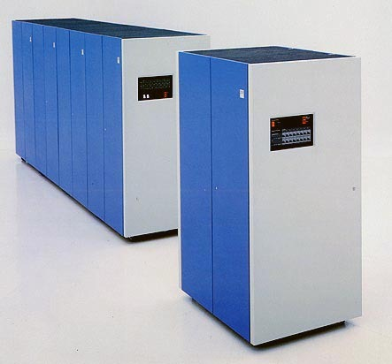

In 1980 IBM introduced these storage devices, holding roughly 2.5
gigabytes:

If I remember correctly, I saw a *"refrigerator"* much like these in
the CEC server room at the School of Engineering when I was a student.

By 1987 this more compact little model had the astonishing capacity of
7.5 gigabytes:

Today, just 24 years later, we have devices like
this one:

With a capacity of 1 terabyte, about 134 times the capacity of that last one, in
the palm of your hand.

Amazing, isn't it?

Given that we have this much storage capacity, at ever lower
cost, it's only logical that what we want to do is improve
our ability to analyze data.

What if we want to do time series analysis, forecasting,
the kind of work that groups information sequentially, where order
matters? The kind of analysis that answers questions like: what
happened? why did it happen? what will happen next?

Storage doesn't solve this problem; what solves it is software
capable of using that capacity intelligently. The traditional
answer from a present-day software engineer will be: "store the
information in a relational database, because that way you'll be able to
analyze it efficiently and safely."

But things aren't that simple.

## An exercise in data analysis

I don't know how much information will be collected in the upcoming 2012
population census, but suppose only the following variables were
captured: sex, age, region, level of schooling.

Sex can be stored in 1 bit, age in 7 (let's assume nobody
lives past 127), and there are 16 regions, so that fits in 4
bits. Level of schooling goes from 0 to 12 for the full schooling
guaranteed by our constitution; let's say 13 means
vocational or technical education, 14 university, and 15 a
graduate degree. All of that fits in 4 bits. So a
simple scheme for storing these variables from Chile's 2012 census is this:

> sex: 1 bit age: 7 bits\
> region: 4 bits\
> schooling: 4 bits\
> Total: 16 bits, 2 bytes

Let's reserve 20 million records: the information fits
in less than 40 megabytes. Given what today's personal
computers can do, this demographic information can be held in
RAM and used for simple calculations, such as computing the median,
for example. On my PC a [C++
program](https://github.com/lnds/La-Naturaleza-del-Software/blob/master/censo.cpp)
(about 70 lines of code) that computes the median age per region
takes around 200 milliseconds.

You can store these 20 million records in a relational
database. In my case I used SQL Express, and it took me 2 minutes to load all
the records from a CSV file.

Computing the mean age is, in programming terms, much
simpler. This simple SQL query is enough:

> select region, sexo, avg(edad) from datos\_censo\
> group by region, sexo\
> order by sexo, region

This calculation takes 7 seconds, about 30 times longer than my
C++ program. Of course, the mean is not the same thing as the median.
Unfortunately Transact-SQL has no median function, so to
do the same thing as my C program you have to write an ugly SQL
statement[^1].

All these exercises have used a very simple database, with
barely 3 variables. If the census measured some 200 variables, and we used 2
bytes for each possible value, the entire census would take up
about 7.5 GB. The census data could be processed
on a laptop.

Reality isn't that simple, because the big problem is collecting the
information and keying it in, in a distributed fashion, at data collection
centers in different parts of the country, with hundreds of census takers
who will have to enter the data, and so on. All of this will require
adequate infrastructure, with backup systems; it will surely be
published online and hosted in a data center, and maintaining that
infrastructure will carry an _extravagant cost computed by the
enigmatic calculators of the data center's sales executives_.

The census IT team will probably create a pretty relational
model to organize the information, trying to keep it
in at least third normal form, in order to improve
transaction times when the data is entered (besides the census
data, you need administrative and control data to
guarantee the integrity of the information). But after all those
complications, the information can perfectly well be dumped into a
vector, a single table with one field per variable and some 20
million rows, and be processed efficiently to
compute a whole range of statistical indicators. I wonder whether they'll do it
that way, or turn to SQL for these calculations.

While I was writing this post, SQL Server on my computer tried to
compute the median age of the 20 million simulated records.
Let me remind you that my C++ program took 230 milliseconds. The
SQL statement was interrupted after half an hour; analysis of the execution
plan reveals that the table scan and the subsequent join will mean going through
400 trillion rows. Adding indexes won't solve the problem[^2],
and their impact will probably be minor. The solution in these cases is to
write a stored procedure, or to walk the data with cursors,
a task of programming complexity similar to my C++
algorithm, and, I suspect, with worse results in time (the reader could
try to solve this problem with another relational database, or
program the median calculation in Transact-SQL).

## The problem with relational databases

This is a simple problem, with just one table, and with an amount of
data that isn't that large by today's standards. There are
applications that are much bigger. At my job we have
databases with hundreds of gigabytes of information, which pose challenges
well beyond this one.

The thing is that relational databases are very efficient at
processing transactional operations, the kind that add,
insert, retrieve and modify a small amount of data in a
much larger database.

Picture a typical transactional shopping website: a user
logs in to the site, the account information is retrieved,
session data is written to a log, products are searched, a
purchase order is created, the user's data is updated, payment is recorded,
and so on. Thousands of transactional operations, but each one handling a
subset of the total data.

Over time this database will hold billions of records,
and at that point the sales department will need to analyze
that information. When we try to meet those needs with SQL we'll
run into problems similar to the ones I faced with my little
census data exercise. We're looking at the classic change of
approach: we go from the transactional world, where relational
databases reign, to the problem of massive processing
([1 out of 5,000 is not the same as 5,000 out of 1](/en/blog/lnds/2010/04/04/1-of-5000-or-5000-of-1-batch-and-transactional/)).

## What does it mean to process a large amount of data?

Not long ago I solved a similar problem at work. In one part of a
process carried out by a group of analysts, 70,000 vectors had to be
sorted using Microsoft Excel. They had built the process
themselves because there is still no application for
this service. The problem was that this sort took 4 hours for those
70,000 vectors, and there are files of up to 400,000 vectors to process
(yes, it can be done with Excel, a big machine and a lot of patience).
Rewriting the vector sort in C took 1 hour, and it does the
calculation in under 1 second for the 70,000 vectors, on a PC. The
bottleneck in the process disappeared.

Not that many years ago no business analyst would have tried
to solve this problem with Excel. The capacity simply wasn't there; it
was considered a large-scale problem that required custom
development by the IT department. In the 90s that would have been a
***big data*** problem.

What is big data? That is the question Adam Jacobs asks in his
2009 ACM Queue article: ["The Pathologies of Big Data](http://queue.acm.org/detail.cfm?id=1563874)". What
are we talking about? Gigabytes? Terabytes? Petabytes? Jacobs proposes the
following meta-definition:

> "data whose size forces us to look beyond the tried-and-true
> methods that are prevalent at that time." In the
> 1980s, it was data sets so large that they required a
> robotic "tape monkey" to swap thousands of tapes
> in and out. In the 1990s, perhaps, it was data that
> went beyond the limits of Microsoft Excel and a desktop PC,
> requiring analysis software written for Unix workstations.
> Nowadays, it may mean data that is too large to be
> placed in a relational database and analyzed with the help of
> a desktop statistics or data visualization
> package, data whose analysis requires massively parallel
> software running on tens, hundreds, or
> even thousands of servers.

Those are the problems we face now. Our users have
access to hardware able to store huge amounts of data,
capacities that were unthinkable just two decades ago; what they need are
software solutions that let them work with that data
efficiently. That is the challenge, and the tools the market offers,
or sets as standards, are not up to this new reality.

Fortunately a mix of old techniques and a few innovations,
plus what current hardware makes possible, is enabling the
construction of new tools that can meet these
demands. That is something we'll explore in the next few articles.

[^1]: The SQL statement used is based on this article, [Statistics in SQL](http://oreilly.com/catalog/transqlcook/chapter/ch08.html), which comes from O'Reilly's Transact-SQL Cookbook. If any reader knows a better way to compute the median with Transact\'-SQL, your comment is welcome. This is the query in question (note that it computes the overall median, not grouped by sex and age):\
\
    select x.sexo, x.region,x.edad\
    from datos*censo x, datos*censo y\
    group by x.sexo, x.region, x.edad\
    having\
    sum (case when y.edad \<= x.edad then 1 else 0 end) \>= (count(*)+1)/2
    and\
    sum (case when y.edad \>= x.edad then 1 else 0 end) \>= (count(*)/2)+1

[^2]: The problem gets worse, because reindexing the database took another 20 minutes, and care had to be taken to optimize the data types and other conditions (such as disallowing nulls, and other index optimizations). After another half hour of execution the statement stopped with an arithmetic overflow error (?!). I hope some SQL Server DBA reading this post will explain to me how to do it better.
