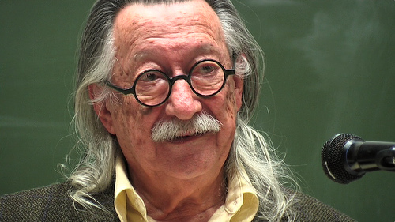

> The computer programmer is a creator of universes for which he alone
> is responsible. Universes of virtually unlimited complexity\
> can be created in the form of computer programs.

> -- Joseph Weizenbaum, Computer Power and Human Reason

