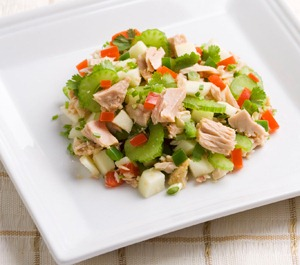
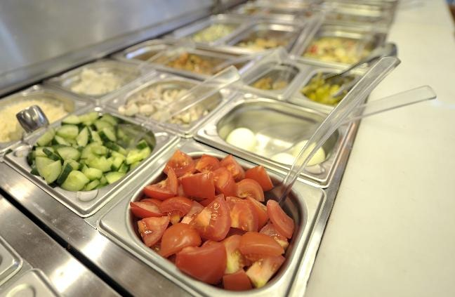

A few years ago, probably inspired by
[Ratatouille](/blog/2007/07/ratatouille-lecciones-de-ingenieria-de-s.html),
I took up cooking. My wife says I don't cook badly, but I turn out to be
a rather expensive "chef", and a messy one (something to work on). Still,
I've learned to make a few dishes and experimented with others. It's
a pleasant and relaxing activity, maybe because it
has something in common with programming an efficient algorithm.

Some of the simplest and most fun dishes to learn to cook
are salads, even better if they come with a dressing. Yesterday, Saturday
afternoon, my older daughter, my wife and I improvised a delicious
green apple and tuna salad. The recipe is at the end of this
post; the interesting part was the process we used to put together this
particular salad.

We had a five-minute constraint to get the job done, so
we divided the work: someone chopped the apples while someone else
prepared the lettuce, and a third person mixed apples and lettuce
with the tuna. At the end my daughter made the dressing, we poured it over the
salad, dished it out onto each plate and served. It was all pretty
quick.

Technically, we used parallelization and
pipelining in some of the stages.

And what if I decided to go into selling salads on a massive scale?
The way to produce fresh salads in large quantities is
to parallelize the production work. I picture parallel lines
preparing ingredients, converging on containers where the
vegetables are mixed and packed, while the same is done in parallel with the
dressings and seasonings. It's a simple picture, and I assume the idea
is clear. Well, that picture reflects one of Google's great
secrets. The famous
[MapReduce](http://labs.google.com/papers/mapreduce.html) algorithm.

In salad terms, we have an initial stage where the
ingredients are prepared, and each ingredient is placed in a container with
a label: "green apples for tuna salad", "apples for
fruit salad", "tomatoes for pebre" (the Chilean salsa), "tomatoes for salad",
and so on. The key is to **label and separate**.

Then each line takes the containers for its own salads. The
cook who mixes the ingredients takes them from the lines
assigned to his mixing process. Order, organization through
labeling and classification, matters a great deal, because it makes the cook's
job easier.

The first phase, separating the ingredients, chopping them, peeling them, and
finally placing them in the container with the right label, is
called the **map phase**. The second stage, when we mix the
ingredients and assemble the salads to put them on their plates or in their
packages, we call the **reduce phase**.

When we process large volumes of data we can use this technique,
which is described in technical terms like this:

> map(in key, in values) --\> list(out key, intermediate values)
>
> - Processes key/value pairs
> - Produces a set of intermediate pairs
>
> reduce(out key, list(intermediate value)) --\> list(out value)
>
> - Combines the intermediate values for a particular key
> - Produces a consolidated set of output values (usually just
one)

If you remember the census problem we
[described a few days ago](/en/blog/lnds/2011/10/03/data-data-data/),
what we had to compute was the median age for each region.
Suppose the data arrives unordered. The MapReduce
strategy for solving this problem is the following:

> map(census_data) --> list({region,sex}, count by age for
> {region,sex})
>
> - splits the census data, determining region, sex and age
> - using the key (region, sex), counts the frequency of each
> age
>
> reduce({region,sex}, count by age for {region,sex}) --> median({region,sex})
>
> - walks through the age counts for this {region,sex} key
> - determines the median; that is, knowing the total number of
> inhabitants for this {region,sex}, it determines the age that splits the
> people into two halves (below or above that age)

Both stages could be parallelized, although the *map* stage would be
harder to parallelize than the reduce stage (why?). For an
amount of data as small as the population of Chile it may not
make much sense, but think about running a world
census, where we have some 6.5 billion inhabitants.

Even so, as we've seen, those 6.5 billion inhabitants are no
formidable challenge for an algorithm like MapReduce, which is used to
process far larger volumes of data.

But this technique is a great way to take a different approach to problems
that are traditionally solved with relational databases, but
that become very slow to process because of the use of *joins* and the
infamous *full table scans*, which can end up being impossible to
eliminate. It's not that relational systems aren't powerful
enough to solve these problems; the thing is that these
parallelization methods achieve much shorter times (at
the cost, sometimes, of greater implementation complexity in programming
terms).

Careful: the degree of parallelization will always be subject to
[Amdahl's law](/blog/2009/09/el-problema-de-paralelizar.html).
Fortunately, many of the problems you can tackle with MapReduce are
*[embarrassingly parallel](http://www.lnds.net/blog/2009/09/el-problema-de-paralelizar-2.html)*
(like making salads, computing word frequencies across many
texts, or
[computing the PageRank of the web pages indexed by Google](http://michaelnielsen.org/blog/using-mapreduce-to-compute-pagerank/)).

So there is a connection between salads and algorithms, which is why
I highly recommend practicing the culinary arts. It's a source of great
inspiration, and who knows what future developments may come out of
simply experimenting and mixing ingredients. And if a great
algorithm like MapReduce doesn't occur to you, you can at least enjoy a fresh
salad.

## **Recipe**: Tuna and apple salad

### **Ingredients** (serves 4):

-   2 green apples

-   1 small can of tuna (tuna fillets in water work best)

-   1/2 head of lettuce, chopped

-   Mayonnaise

-   Ketchup

### **Instructions** (we engineers call this a procedure):

-   Slice the apples, chop the lettuce. Mix with the
    tuna in a bowl or other suitable container.

-   Mix mayonnaise and ketchup; this is known as [salsa
    golf](http://es.wikipedia.org/wiki/Salsa_golf) in Chile and Argentina.

-   If you're in a hurry, apply parallelism using the MapReduce algorithm :smile:

It can be improved with carrot, chopped tomatoes, mushrooms, walnuts, or
asparagus. The tarter the apples, the better.

