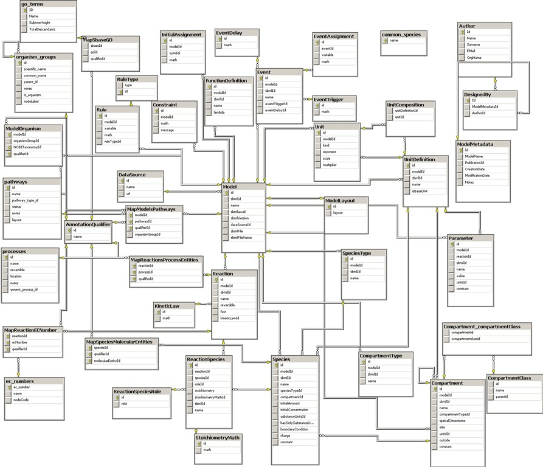

Sometimes we just love scratching our left ear with our right
hand, purely to complicate things


That happens a lot in the design and data modeling stages. A
simple problem, after going through analysis and design, can
end up like this:



Ah, how beautiful these generic models are, with traceability,
access controls and profiles, an orgy of tables and relations
(could it be that this business of "foreign relations" awakens some
unspeakable fantasy in systems analysts?)

Sometimes this turns into pure onanism, born of an axiom that
was drilled into our brains by a group of IBM researchers
in 1969[^1]: the idea that everything must be modeled in a relational
database down to the "twenty-fifth normal form"[^2].

There's no denying that the relational model has its advantages;
after all, it is the heart of most transactional
systems today. To wit: relational
databases, when used properly, have many advantages.

1.  The theory behind them is based on first-order logic
    and set theory, so it's easy to understand and explain
    from a theoretical point of view.

2.  Since relational databases let you operate on sets,
    you can define very efficient operations for "crossing"
    the data; this is known as "relational algebra". An
    equivalent language is "relational calculus" \[3\]. These two
    theoretical languages made it possible to create the structured query language SQL,
    a simple and very powerful language for extracting information
    from the relational model.

3.  When relational databases are well modeled they use
    space efficiently.

4.  A good model lets you run queries that weren't foreseen,
    and cross information in new ways, though at a cost. If the
    indexes don't exist, queries can take quadratic time, or
    worse.

All these benefits come from the fact that relational databases
promote a solid, fault-tolerant structure that lets the engine
itself catch semantic or structural errors. Given
these advantages, database management systems later
incorporated other concepts, such as transactions, the famous
[ACID](http://en.wikipedia.org/wiki/ACID) (Atomicity, Consistency,
Isolation, Durability), which is what makes these databases so widely used in
enterprise applications (accounting, banking, retail, etc.).

The other day I heard an important executive say that everybody
uses Oracle or SQL Server because they're good for solving big,
enterprise-level problems. I told him that [Facebook stores 135 billion
messages a month in a non-relational
database](http://highscalability.com/blog/2010/11/16/facebooks-new-real-time-messaging-system-hbase-to-store-135.html),
but even then he didn't get it. It's a textbook case of [motivated
reasoning](/en/blog/lnds/2011/07/05/irrational-decisions/).

While almost any problem can be modeled with a relational
database, solving a problem with a relational database isn't always
the right call. I already [showed you an
example](/en/blog/lnds/2011/10/03/data-data-data/) where
a C program can be more efficient than processing a simple
SQL statement. Sure, it takes more development work, but that's where
the art and the science come in: knowing and using the right tool for each
kind of problem.

Consider this model:


```
 class Book {   
     String title   
     String author   
     Integer year    
     Integer pages    
     Set keywords    
     Set ratings   
}
```

Versus this other one

```
class Book {   
    Integer id    
    String title    
    String author    
    Integer year    
    Integer pages
} 

class Keyword {   
    Integer id    
    String keyword    
    Integer bookId    
}


class Ratings {   
    Integer id    
    String rating    
    Integer bookId    
}
```

If you run an online bookstore, it's far more
convenient from a semantic point of view to use the first model, with
a single Book class that holds all the relevant information in
one place. Since the user will normally interact with one book at
a time, this model is simpler and more direct.

If you're going to do statistics or grouped operations over the books, the
second model suits you better. But keep in mind that you can also
run those operations through some
[MapReduce](/en/blog/lnds/2011/10/16/salads-and-algorithms/)-style mechanism at
another time of day, or on an offline database.

Non-relational databases let you tackle the same problem,
but sometimes from a simpler, and often more agile, perspective.
We'll see some examples soon. What matters is keeping an
open mind and considering that there are simpler ways to scratch your ear.


[^1]: Edgar F. Codd, a British researcher working at IBM in 1969,
proposed the theory of relational databases in a series of
papers in the early 1970s, and received the Turing Award in 1981.

[^2]: To date [6 normal forms](http://en.wikipedia.org/wiki/Database_normalization#Normal_forms) are known,
but an academic's imagination knows no bounds.

[^3]: Codd's theorem, which is really a result in first-order
logic, guarantees that an expression in relational algebra can
be expressed in relational calculus.
