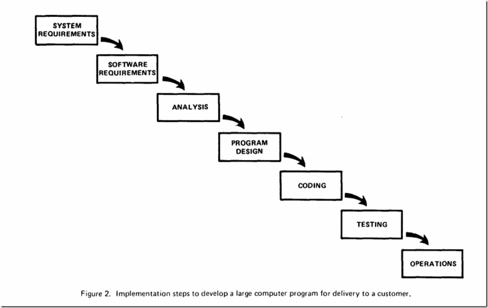

It turns out the waterfall model is perhaps one of the biggest reading
comprehension failures in the entire history of software engineering.
In 1970 Winston Royce wrote a
[paper](http://www.cs.umd.edu/class/spring2003/cmsc838p/Process/waterfall.pdf)
in which, unfortunately, he used the words "grandiose approach"
to refer to the following figure:

Winston Royce actually wrote this
[paper](http://www.cs.umd.edu/class/spring2003/cmsc838p/Process/waterfall.pdf)
to criticize this model, but it ended up being cited over and over by
the "scientific" community as a classic, established model.

It's typical to find references like: "the waterfall model is a
proven model (Royce, 1970)". But in reality Royce made up this
diagram in his article to illustrate how the projects he had
taken part in were run, and then went on to propose his own
iterative development model.

Royce's model is not only iterative and incremental, it also proposes 5
elements that are fundamental to a project's success.

1.  Design first.

2.  Document the design.

3.  Build it twice: a first version that is reviewed by the
    users, a sort of working prototype, and a second version
    that is the finished product.

4.  Plan, control and monitor testing.

5.  Involve the customer.

Sadly, everything Royce said was lost. When the
US Department of Defense had to define its standard for
software development it adopted the waterfall model, simply because
"Royce already invented the right model, let's use it", and
[DoD-2167](http://www.product-lifecycle-management.com/download/DOD-STD-2167A.pdf) was born.
And when NATO faced the same problem, guess who they
asked what should be done.

Zero reading comprehension. Even today we still see
consultants who regard the waterfall model as an
established, traditional model (worse yet, it is still taught in universities as a good
model for developing software).

Now, the interesting thing about this story, and about rediscovering Royce's
paper, is that agile software development models are not new,
that it has never been scientifically proven that the waterfall model was
ever successful, and that it's not a good idea to put a diagram of
a bad idea at the beginning of an article: people probably don't read
past the first page.

Sources:

-   [Don\'t draw diagrams of wrong practices -- or: Why people still
    believe in the Waterfall
    model](http://tarmo.fi/blog/2005/09/dont-draw-diagrams-of-wrong-practices-or-why-people-still-believe-in-the-waterfall-model/)

-   [Managing the development of large software
    systems](http://www.cs.umd.edu/class/spring2003/cmsc838p/Process/waterfall.pdf),
    Dr Winston W. Royce

-    [Defense System software development,
    DoD-2167](http://www.product-lifecycle-management.com/download/DOD-STD-2167A.pdf).
