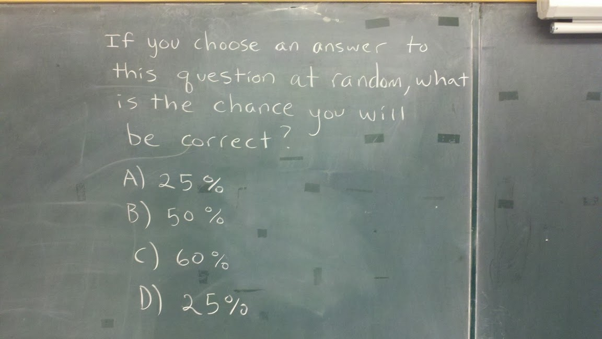
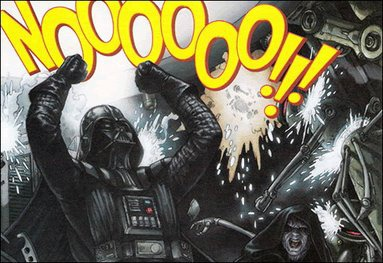
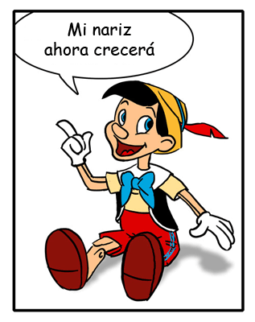
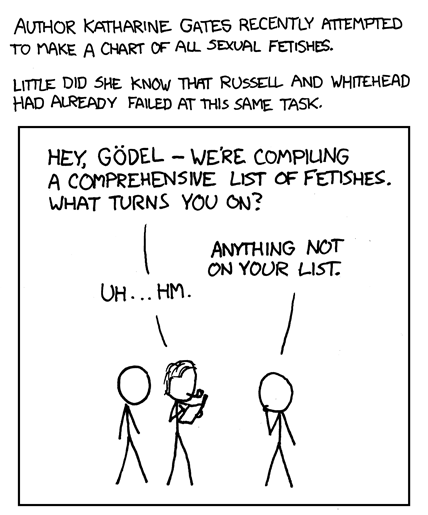

They say that toward the end of his days Kurt Gödel was trying to prove the
existence of God by means of an [ontological
argument](http://en.wikipedia.org/wiki/G%C3%B6del's_ontological_proof).
In 1960 he wrote down in his notes his
[philosophical viewpoints](http://cs.nyu.edu/kandathi/goedel_viewpoint.html); for him
the world had to be rational. I suppose he wouldn't have accepted the
current findings of the cognitive sciences. It's also said that he was
a shy man who lived in some anguish... I wonder: what
would Gödel's answer have been [to the problem we posed on
Sunday](/en/blog/lnds/2011/11/13/probability-challenge/)?

Here it is again:

What was the professor who wrote this on the board thinking?

This is a real [denial of service
attack](http://es.wikipedia.org/wiki/Ataque_de_denegaci%C3%B3n_de_servicio)
(DoS) on the brain, don't you think? :wink:

On to the answer, or at least the answer I assume the
professor who wrote this expects.

The answer is not 25%, nor 50%. The answer is **B,** of course. We're
talking about the answer a math professor would expect! :smile:

The reasoning goes like this:

First you have to consider that this is a "meta-question", a question
about a question. If the board said "for any
question with 4 choices, what is the probability of
picking the correct choice at random?", the obvious answer would be 1 in
4, that is, 25%.

But the question is self-referential, it's a meta-question, remember, and
it says: "if you choose an answer to **this question** at random".
It turns out this question has 2 answers that say 25%: A and D.
So the probability for this question is 2 out of 4 (because each
answer is independent of the others), that is, 50%. So the
answer would be B: 50%. The interesting part is that since the
correct answer to the meta-question is just one, option B, it still
holds that the probability of picking at random the answer to any
question with 4 choices is 25%!!

But some of you aren't satisfied with this answer, are you? The thing
is, this is a recursive question, a subject that fascinated Kurt
Gödel.

Remember the [Pinocchio paradox](/en/blog/lnds/2010/11/09/the-pinocchio-paradox-and-the-origin-of-computing/)?
Here it is for those who don't:

Gödel used this kind of recursive expression to
[prove his famous incompleteness theorem](/en/blog/lnds/2010/11/09/the-pinocchio-paradox-and-the-origin-of-computing/).
So you, my computer geek friends, who have been programmed in the
tradition of first-order logic, go around looking for paradoxes
everywhere, because recursive thinking leads you down that road.

But the question on the board doesn't go into an infinite loop, like the
Pinocchio paradox, or the famous sentence Gödel used to prove
his theorem. Here there are two levels, which is what lets us solve the problem.

OK, I'm sure this is going to spark several arguments in the
comments, as happened to Cedric Beust, who [originally posed
this problem on his
blog](http://beust.com/weblog/2011/10/27/probability-quiz/). The
discussion that followed on
[G+](https://plus.google.com/108840253750748459271/posts/3g9UvRt4iZi)
about this question is intense, and quite philosophical, but I'm with Beust:
I think answer B has the best argument, and in the end, [at
some point you have to
cut](http://www.akarru.org/blog/2010/06/nudos-espadas-y-huevos/). There's a
reason we're engineers and not philosophers, don't you think?

Now, what happens if we change choice C, and instead of 60% it were
42?

