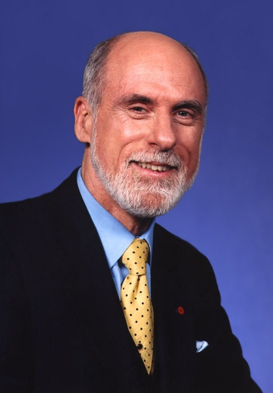

In 1963 Joseph Licklider wrote his famous memorandum. Remember it?
No? Well, I told the story in [this post](/en/blog/lnds/2011/01/03/the-memorandum/). His idea was
to create the "intergalactic computer network"; he was the man with the
dream. Leonard Kleinrock, the kid who wanted a capacitor to
build the radio shown on the back cover of a Superman comic
([the story is here](/en/blog/lnds/2008/01/18/all-for-a-variable-capacitor/)),
gave us the mathematical theory for building a network based on
packet switching; he was the man with the theory. Then Lawrence
Roberts led the team that built ARPANET, the network that preceded
the internet.

It's called the Internet because it is a network of networks: inter-net, "between networks".
Around 1973 there were several networks being interconnected
with each other and with ARPANET. At that point it became clear that
a mechanism was needed to unify the networks. To solve
this problem [Robert E. Kahn](http://en.wikipedia.org/wiki/Robert_E._Kahn)
recruited [Vinton Cerf](http://en.wikipedia.org/wiki/Vint_Cerf), a young doctoral
student, to work on the specification of a new protocol. The
fruit of that first effort was [RFC 675](http://tools.ietf.org/html/rfc675), which describes TCP/IP, the
basic protocol of the network. This document also contains the first
use of the word internet, for those who care about that sort of thing.

Vint Cerf was here in Santiago today, and I had the opportunity, the honor,
of shaking his hand and greeting him, but above all of listening to him
in a talk he gave today at the [Escuela de In**J**eniería](http://escuela.ing.uchile.cl/) (the University of Chile's engineering school, old-fashioned spelling included).

He spoke about the importance of innovation, and shared with us
what characterizes an innovative environment like Silicon Valley, and what
is required, and perhaps missing in Chile, to achieve that, such as not punishing
an entrepreneur's failure and having educated, well-trained people.
He spoke about the future, about how we're going to have far more information
within our reach. About the internet of things, and why we should promote,
and even demand, IPv6 support from our ISPs. About privacy and
security on the net, about citizen participation on the net, about
network infrastructure, and even about energy (with some
interesting proposals, such as his packet switching analogy and the
need to develop the concept of "buffering", but for
energy).

My congratulations to the organizers of the talk, to Patricio Poblete and the
NIC Chile team. It was a great opportunity, a memorable event.
