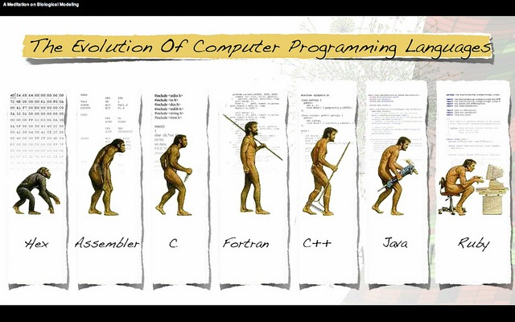

> "Of all the ways of acquiring books, writing them oneself is regarded
> as the most praiseworthy method" -- Walter Benjamin
>
> "'Ta muy malo el corralero, y allá en el potrero como viejo está. Hay
> que ayudarlo a que muera para que no sufra más." -- Sergio Sauvalle
> (a Chilean folk song about an old horse that has to be put down)

That seems to have been the slogan for the last two or three years: Java, as
a programming language, must give way to more modern languages.

When you use a tool for a long time you start to
discover its limitations, and you try to make changes to improve it,
adaptations, or you flat out go and get another one.

It's natural. We are technological beings, and one of the things that
sets us apart is our use of tools. We are experts in the
continuous improvement of our tools; our history is, in a
sense, the history of our tools.

Of all the tools available to a programmer, the language is
the most important. And boy, has it evolved, though not always for the
better :wink:

By 1973 the C language was already established; in 1983 C++ came on the
scene. By 1995 the introduction of Java marked an important milestone in
the history of programming. At that point C++ was about 12 years old
and it was time to replace it; we seem to have this 10 to 12 year cycle
for starting to change languages. Why is Java still with us? (C\#
is a copy, as Gosling said[^1], so it doesn't count[^2]. And Scala?
Well, we'll talk about that further on).

The truth is Gosling didn't get it very well either. C\# may
be a copy, and that's because business forced it in that
direction. The lead designer of C\# is Anders Hejlsberg, famous for
Turbo Pascal and for Delphi (Object Pascal). Hejlsberg may never
have created a language from scratch, but he has always had the knack
of taking an existing language in very interesting and
innovative directions.

One thing you have to understand about evolution is that it doesn't
necessarily mean progress. Evolution is adaptation to change. In
evolution, different alternatives get tried out under new conditions; if
they work they stay, if they fail they're discarded.

The figure above is wrong, because evolution is not linear.
Evolution moves through a tree, a far more
intricate structure, with crossbreeding, atavisms, mutations, and so on.

When something works well in a niche it can go unchanged for
a long time. Think of the crocodile: it has been basically the same species
for 84 million years!

So there are things about Java that have worked very well; that's what
we call the Java platform. A platform that has made it possible to build a
rich ecosystem. In this niche Java, the language, lumbers along like a
heavy sauropod.

Perhaps the biggest source of criticism of Java lies in the
concept of "**simplexity**", which Anders Hejlsberg pinned down very well
in [this interview](http://www.artima.com/intv/simplexity.html) that
Bill Venners did with him years ago:

> **Bill Venners**: One way C\# differs from Java is in how it
> propagates events to interested objects. Java uses classes, often
> inner classes, that implement listener interfaces. C\# uses
> delegates, which are a bit more like function pointers. Why
> delegates?
>
> **Anders Hejlsberg**: Let me first talk a little bit about how I view
> simplicity in general. No one ever argues that simplicity isn't
> good, but people define simplicity in a variety of ways. There's one
> kind of simplicity that I like to call ***simplexity***. When you take
> something incredibly complex and try to wrap it in something
> simpler, you often just shroud the complexity. You
> don't actually design a truly simple system. And in some ways you make it even
> more complex, because now the user has to understand what was
> omitted that they might sometimes need. That's simplexity. So
> to me, simplicity has to be true, in the sense that
> the further down you go the simpler it gets. It shouldn't get
> more complicated as you delve down. Delegates add a
> kind of expressiveness that you don't get with classes or interfaces,
> which is why I think they are important. Programming languages that have
> gone before us have recognized that they are important. They have many
> names: function pointers, member function pointers. In LISP
> they are closures. They are what functional
> programming is all about when it comes right down to it. They are tremendously useful.

Simplexity is another way of scratching your ear the wrong way. Let's look at an example.
Suppose we want to teach programming; the natural thing would be to start with
the classic hello world program.

Consider the first Python class:

> To create a very simple program that prints the phrase
> "hola mundo" on the screen, you need to write the following statement:
> print("hola mundo")
>
> print is a statement that takes this text in quotes and
> displays it on the console (screen), etc.

Now think of the effort the Java trainer has to make:

> To create a very simple program that prints the phrase
> "hola mundo" on the screen, you need to write the following code:
>
> class HolaMundo {
>
> public static void main(String args\[\]) {
>
> System.out.println("hola mundo");
>
> }
>
> Please ignore the class statement, we'll explain it when
> we get to the concepts of object orientation.
>
> For now, ignore what public static means.
>
> void means this is a function that returns no value
> (wait, I haven't taught you what a function is yet, have I?)
>
> System.out.println is a call to the System class (we'll
> learn what a class is, don't rush), which has a public
> variable called out that has been initialized with the standard output
> (the console, or screen).
>
> etc., etc.

I can imagine the students' confusion. That's why Java should not be
taught in the first years!

And what about more interesting things, like delegates, or closures?
First-class functions? Java 7 is only just starting to explore these
topics, and with horrible syntax.

OK, but we have to acknowledge that those things come from a different
paradigm; the functional paradigm is different from the object-oriented
paradigm Java is built on, so let's be fair.

The thing is, we need to bring in the functional paradigm,
because, among other reasons, we need to develop
parallel computing further. Multicore processors are more and more
common, and the concepts of functional programming are very useful in
this new world.

The new languages will be a hybrid of the functional and
object-oriented paradigms, because both paradigms have traits that
need to survive under the new conditions and in the new ecological
niches that are opening up.

The current trend in the Java ecosystem (the platform) is to create
new languages (Scala, Groovy, Clojure), or adapt others (Jython,
JRuby) for the JVM.

It's curious: when .Net was born, it was designed to accept a
wide variety of languages. Microsoft itself decided to launch the CLI
with three languages: Visual Basic, C\# and a dialect of C++. The idea was
to create a large number of languages adapted to this platform.
In spite of that, C\# is the most widely used language, and it will probably end up
eating most of the .Net pie.

But on the JVM, a real race has started lately
to create Java's successor.

[Scala](http://www.scala-lang.org/) is the most bombastic assault on the
heavens so far, followed by a modest and more effective
[Groovy](http://groovy.codehaus.org/). Another notable candidate is
[JRuby](http://jruby.org/), driven by the popularity of
[Ruby](http://www.ruby-lang.org/). But there is no clear winner.

Even so, the effort goes on: we have [Clojure](http://clojure.org/), and
[Kotlin](http://confluence.jetbrains.net/display/Kotlin/Welcome), and
[Gosu](http://gosu-lang.org/)!

But there are two interesting recent additions:
[Xtend](http://www.eclipse.org/Xtext/xtend/), which has the backing of
[Eclipse](http://www.eclipse.org/), and [Ceylon](http://ceylon-lang.org/),
sponsored by [RedHat](http://www.redhat.com/).

Let's kill Java, so that Java may live! I think it's interesting that
these languages are being developed. Let's see what comes of this [Cambrian
explosion](http://es.wikipedia.org/wiki/Explosi%C3%B3n_c%C3%A1mbrica);
let's explore these languages.

I, at least, am going to go one step further and follow Walter
Benjamin's advice, applied to programming languages: I'm going to write one,
and I hope you'll help me, so stay tuned.

[^1]: The line from Gosling, the creator of Java, is: \"The trite answer
is, \'imitation is the sincerest form of flattery\--thank you very much,
but the other answer is, \'You guys (at Microsoft) still don\'t get
it,\' because it\'s sort of Java with reliability, productivity and
security deleted.\" (source: <http://news.cnet.com/2008-1082-817522.html>)

[^2]: Although starting with C\# 2.0 things began to change, and C\#
2.0 came out in 2005! Maybe they should have changed its name.
