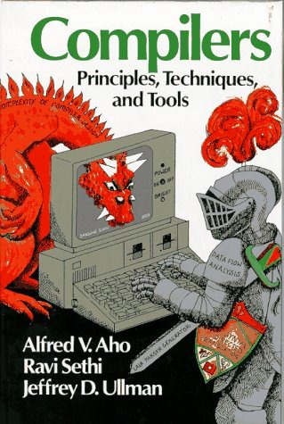

Compilers is now an elective course for computer engineering at the school
where I studied[^1]. Back when I was a student I believe it was
required, and I think it should be a required course.

I don't know why the University of Chile decided to make this course optional,
nor do I know how many people take it each semester. I've also
heard that enrollment in computer science has dropped; I hope some
academic can confirm that for me.

Either way, I think making the compilers course optional is
a mistake, because it is one of the courses that best pulls together everything
you learn in the degree.

When you build a compiler you apply:

-   Data structures (ASTs, graph coloring)

-   Algorithms, automata theory, formal language theory

-   Fundamentals of programming languages (in the design of the language)

-   Optimization

-   Programming in machine code (real or virtual)

-   Modularity, integration, loose coupling (the structure of the
    lexical, syntactic and semantic analyzers and code generation
    helps you understand and apply, for the first time, the concepts of
    software architecture

-   Software engineering, design, analysis

Building a compiler is the challenge that shapes you into a real
software developer. Anyone who wants to work as a
software engineer should try to build a compiler at least once in
their life.

In my professional life I have built 2 compilers and designed 3
languages (one of the languages used the C preprocessor, so
it was really a set of macros).

These languages are what we now call DSLs, domain-specific
languages, designed to solve one specific problem. The first
was developed together with Marco Zúñiga. It had a compiler and its
own virtual machine, and we ran training courses and licensed it;
we made some good dollars with SanScript, as we called it. A DSL
for automating data communication tasks.

The second compiler was really a translator, which translated from a
sort of [Haml](http://haml-lang.com/)-like markup and generated
JSP pages. The fun part was that the pages were also resolved by a filter
implemented as a servlet, which interpreted the files with the
.edc extension (my initials) and generated the JSP pages into a cache. The
technical counterparts I dealt with back then were always
asking me what these pages with the '.edc' extension were :smile:

But I have never built a compiler for a general-purpose language,
even though I've had the idea of doing it for many years. Now that
[everybody feels like killing Java](/en/blog/lnds/2011/12/08/java-must-die/), it
occurred to me that it's time to show my proposal, so that the
first version of my language runs on the Java Virtual Machine.

**Ogu**

The language is called
[Ogu](http://es.wikipedia.org/wiki/Og%C3%BA#Personajes). Its name is a
tribute to the character created by the Chilean cartoonist [Themo
Lobos](http://es.wikipedia.org/wiki/Themo_Lobos), a very
likable caveman who is the adventure companion of
[Mampato](http://es.wikipedia.org/wiki/Mampato)[^2].

This is a simple program in Ogu:

> println \"Akarrú!!!\"

Nothing new, you'll say, even Python does that, but try
writing this program in Java :wink:

In this article I'm going to give a brief introduction. I hope to write more
over the next few days, describing the features of this
new language as I go. I'm still in the design process, although there are ideas
I've had for years. There are certainly influences from other languages, as
you'll notice. The important thing is to keep in mind that things are very
likely to change.

The first thing to note is that it is a statically typed language,
like Java, like Scala or like Haskell; that is, every variable must have
a type, so every declaration of a symbol in Ogu must carry its
type.

Here is an example of declarations in Ogu:

    blog : String

    ogú : Cavernícola

    x, y : Int

The colon ':' separates the variable from its type.

Assignment in Ogu uses the '=' sign, and serves to initialize a
variable that has been previously declared, for example:
 
    blog = "La naturaleza del software"

    ogú = Cavernícola(nombre:"Ogú", grito: "akarrú!!!)

    x = 1

    y = 2

Of course, variables can be given an initial value when they're declared:

    blog : String = "La naturaleza del software"

    ogú : Cavernícola = Cavernícola(nombre : "ogú" )

    x, y : Int = 1, 2

But Ogu has a certain flexibility, to reassure the
lovers of dynamic languages, in that it infers types:

    blog := "La naturaleza del software" // blog is of type String

    ogú := Cavernícola(nombre: "ogú") // ogú is of type Cavernícola

    x, y := 1, 2 // x and y are of type Int

You'll have noticed that the variable names have accents; that's because
Ogu accepts (will accept) code written in Unicode.

Another important thing: in Ogu, if something starts with an uppercase letter it is
a class declaration; if it starts with a lowercase letter it is a variable.

But all variables are immutable; that is, you can't change
their value once assigned:

    x := 1

    x = 2 // error!!!

If you need variables to be mutable you must declare them
with the reserved word 'var' in front:

    var x := 1

    x = 2 // ok, because x is mutable

This matters because Ogu favors functional programming, as
we'll see further on.

Ogu is like the [Scala](http://www.scala-lang.org/) language: it supports 2
programming paradigms, functional and object-oriented. In Ogu the
difference between functions and classes is somewhat blurry (the use of uppercase
for classes helps disambiguate it).

**Functions:**

Let's see how to declare a function:

    factorial : Int --\> Int

    factorial 0 = 1

    factorial n = n \* factorial (n-1)

This example shows that Ogu favors the functional paradigm, and follows
a syntax very similar to Haskell's.

The value of a function is determined by the expression to the left
of the '=' sign.

What we have are patterns, or cases, that define the function. We can
write factorial in this abbreviated form:

    factorial : (n:Int) --> Int  =  (n == 0) 1 else  n \* factorial(n-1)

If there is more than one expression in a function, they must be enclosed in
braces {}.

In the abbreviated form the named arguments must go in
parentheses, and naming the result is optional.

The value of the function will be the value of the last expression, unless
the result has been named:

    suma : (a,b : Int) -> Int = { a+b // the value is a+b\ 
    }

    suma2 : (a, b : Int) -> (resultado: Int) =  {
        resultado = a+b
        println "el resultado es " + resultado // the value of suma2 is
        resultado
    }

If the function takes no arguments you must use the expression () --\>
Type, in order to resolve ambiguities:

    uno : () -> Int = 1 // always returns 1, but it is a function

    uno := 1 //  is the variable uno

If the function returns no value you must use --\> Void, or just write
the parentheses:

    saludar : () -> Void = println("hola" )

    saludar : () = println("hola" )

Let's see how to declare a class

    Persona : (nombre: String, edadInicial: Int) ={

    **var** \_edad = edadInicial

    saludar : () = println "hola " + nombre

    celebrarCumpleaños : () = {\
        _edad = \_edad + 1\
        println "¡¡ feliz cumpleaños " + nombre + "!!"\
        } 
    }

As you can see, Ogu is a language that favors syntactic economy. The
arguments nombre and edadInicial are attributes of the class, and there's no
need to declare them in the body; \_edad is also an attribute, but
a private one. Identifiers that start with \_ are private, as in
Python.

Names that start with an uppercase letter are types or classes, and
names that start with a lowercase letter are names of functions or
variables. If a name starts with \_ followed by an uppercase letter it is a
private type.

Notice that along with declaring the Persona class, we have defined the
class constructor.

Now we can present the declaration of Cavernícola:

    Cavernícola : (nombre, grito : String)

    Cavernícola  : (nombre : String)  = Cavernícola(nombre, "akarrú!!")

    Cavernícola = {

        pelear : () = {\
            println "yiko pelea!"\
            println grito\
        } 
    }

Note how we have declared Cavernícola with two constructors.

There's more to tell, but this is a preview of Ogu, which I hope
you like. The project will be open source and will be published on
[github](https://github.com/lnds/Ogu/). For now there is only a parser,
which still has some problems with certain ambiguities. I hope
to have a first version soon so you can start trying it out.

This is the first article on Ogu; as I work through the
design problems I'll publish more. I look forward to your opinions, questions and
suggestions.

[^1]: The curriculum for Computer Science Engineering (Ingeniería Civil en Computación) taught by the DCC
(for [those who enrolled before
2007](http://www.dcc.uchile.cl/node/114), and [those who enrolled after
2007](http://www.dcc.uchile.cl/node/235)).

[^2]: The character's name is actually Ogú (with an accent on the u), and his
war cry is Akarrú, yes, [Akarrú](http://www.akarru.org/blog/).

