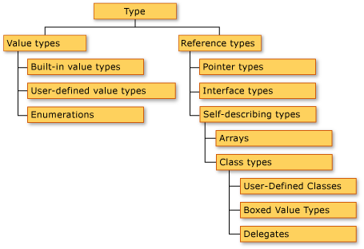

It's time to look at more details of the
[Ogu programming language](/en/blog/lnds/2011/12/15/compilers/). We'll start
with its type system; this article is an introduction to the subject.

Ogu is a language with static type declarations, although it implements
type inference. Let's look at some examples:

    i : Int = 0

    j := i // j is of type Int

    s : String = "un string"

    t := s

Ogu has "syntactic saccharin" to support tuples

    naipe : (Int,String) = (10, "espadas")  // naipe is a tuple

    as := (1,"espadas")

    Naipe = (Int,String) // Introduces the type Naipe as an alias for the tuple (Int,String)

There is also saccharin for lists and hashes:

    vocales : \[String\] = \["a", "e", "i", "o", "u"\]

    ListaDeStrings = \[String\]

    mapa : \[String : Int\] = \["Chile":56, "Usa":1\]

Classes can be generic:

    Stack{T}  : () = {

        var \_data : \[T\] = \[\]

        push : (x:T) = \_data = x :: \_data

        pop : ()-\>(r:T) = {

            r = head \_data\
            \_data = tail \_data\
        }

    }

Tuples, lists and maps are implemented on top of generic types. In
fact, declaring a variable of type \[T\] is the same as
declaring it as Sequence{T}, and declaring it as \[K:V\] is the same
as Map{K,V}.  Both Sequence and Map are classes defined in Ogu's
basic runtime.

To create a stack of integers we do the following

    stackOfInt := Stack{Int}()

    // another way

    StackOfInt = Stack{Int} // type alias

    stackOfInt := StackOfInt()

Ogu supports class inheritance

    // a troglodyte is a caveman who lives in a cave

    Troglodita : (nombre,grito,cueva : String) > Cavernicola(nombre,grito) = {
        _cueva := cueva
    }

**Interfaces**

Consider a package that works with geometric shapes

    Circulo : (radio:Int) = {

        area : () -> Int  = pi * radio ^ 2

        perimetro: () -> Int = 2 * pi * radio

    }

    Cuadrado : (lado:Int) = {

        area : () -> Int = lado * lado

    }

Suppose we want to create a function that prints the area of a
geometric shape:

    imprimeArea : (c:Cuadrado) = println("el area es "+c.area())

    imprimeArea : (c:Circulo) = println("el area es "+c.area())

the problem is that Ogu doesn't let us overload functions :sad:

There are three ways to solve this. The first is to use type
selectors:

    imprimeArea : (c:Cuadrado\|Circulo) = println("el area es "+c.area())

what we've done is make the type of the imprimeArea function either a
Cuadrado or a Circulo (Cuadrado \| Circulo ).

Now if we define this function:

    imprimePerimetro : (c : Cuadrado\|Circulo) = println("el perimetro es "+c.perimetro())

we'll get a compilation error: Cuadrado doesn't define the
perimetro function.

The other way to solve this problem is to declare an interface:

    Figura := {

        area : ()->Int

        perimetro : () -> Int

    }

An interface is like a class, but it has no constructor and the function
bodies are optional.

This way I can redefine the Circulo and Cuadrado classes like
this:

    Circulo : (radio:Int) ~ Figura = {

        area = pi * radio ^ 2

        perimetro = 2 * pi * radio

    }

    Cuadrado : (lado:Int) ~ Figura ={

        area = lado * lado

        perimetro = lado * 4

    }

and implement our functions like so

    imprimeArea : (f:Figura) = println("el area es "+f.area())

    imprimePerimetro : (f:Figura) = println("el perimetro es"+f.perimetro())

The third way to implement polymorphism is through inheritance, and that
one is left as an exercise for the reader.

Consider the Dibujo interface

    Dibujo :=  {

        dibujar : () = println ("dibuja un "+nombre)

        nombre : String

    }

We can now extend Circulo and Cuadrado so that they are also drawings:

    Circulo : (radio:Int) \~ Figura & Dibujo = {

        area = pi \* radio \^ 2

        perimetro = 2 \* pi \* radio

        nombre = "circulo"

    }

    Cuadrado : (lado:Int) \~ Figura & Dibujo ={

        area = lado\*lado

        perimetro = lado\*4

        nombre = "circulo"

    }

This article is just an introduction, and complements [the
first part of the presentation of Ogu](/en/blog/lnds/2011/12/15/compilers/). I look forward to your
comments.
