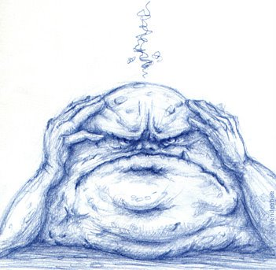

Frustration is the feeling that comes up when we don't get what we
want, when we fall short of our expectations.

Having this feeling is not a problem. The problem doesn't come from the
pain or the frustration we go through; the problem is our attitude
toward those feelings.

Low tolerance for frustration, the great problem of our age of
permanent pursuit of "success".

Tolerating frustration means facing our problems and limitations, in
spite of the annoyance and discomfort they cause us.

Low tolerance for frustration comes from having a mistaken, or
exaggerated, perception of the situation we are living through, and
from the belief that what we are experiencing is horrible, and that we
don't want to live through it or put up with it.

Frustration is part of life. It's impossible to avoid, but we have to
learn to handle it and get past it. Some people tolerate frustration
poorly, and end up unmotivated, abandoning goals and projects.

The thing to do is learn, understand, and make amends. The ones who take
their frustration, handle it, learn from their mistakes, and make the
improvements are the ones who get past this
[insanity](/en/blog/lnds/2011/03/09/insanity/) and achieve success. Success is
not everything going right the first time, or coming out perfect;
success is getting past the obstacles and managing to live a
[full life](/en/blog/lnds/2011/09/04/a-full-life/).
