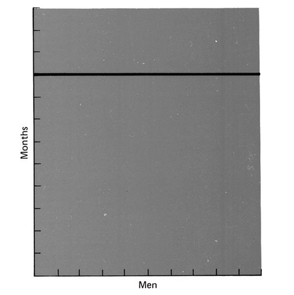
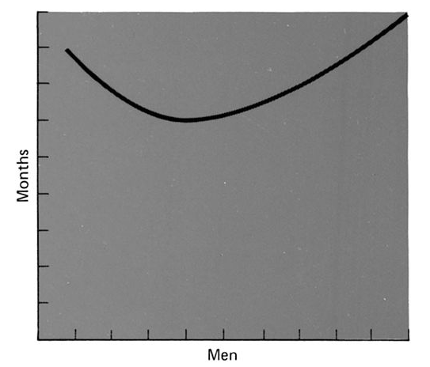

## **Intro**

> Time is a gypsy caravan Steals away in the night

In 1997 Rush was a successful band, and its drummer, Neil Peart, was
considered the best in the world, by his peers and by the critics alike.
But that year his only daughter, 19 years old, died in a car accident;
ten months later his wife, who never got over the loss, died of cancer.
A grieving Neil told his bandmates he had decided to take a break, to
reflect, he didn't know for how long, got on his motorcycle and took to
the road. The band's future was uncertain.

## **Verse**

> We will pay the price, But we will not count the cost

[Nicholas Taleb](http://es.wikipedia.org/wiki/Nassim_Taleb) would tell us that
what happened to Neil Peart is one of those disastrous events that hit
our surroundings hard, something totally unpredictable, something we are
not prepared for. A "Black Swan", for the musician and for the band
alike, which from that event on went through a hiatus of almost eight
years.

The image of the black swan, introduced in the book
[The Black Swan, The Impact of the Highly Improbable](http://amzn.to/zmPCl1), by Nicholas
Taleb, comes from the fact that for many years, as far as European
naturalists were concerned, all swans were white, until one turned up in
Australia. The concept illustrates how fragile our knowledge is. A
single observation invalidates a general statement held for millennia
after the sighting of millions of white swans.

In his book, Taleb introduces the concept of the **black swan** as an
event with three attributes: first, it lies outside all regular
expectations, because nothing in the past can convincingly point to its
possibility. Second, it carries an extreme impact, and third, in spite
of its outlier status, our nature makes us concoct explanations for its
occurrence after the fact, so we take it in as if it were something
explainable and predictable.

## **Riff**

> Why are we here? Because we\'re here\
> Roll the bones

Taleb describes himself as a skeptical empiricist, in the tradition of
Montaigne and, above all, of David Hume; this author reminds us of the
old maxim that the past is no good for explaining the future. Something
we talked about in "[imagined
causes](/en/blog/lnds/2011/10/22/imagined-causes/)".
The book covers many of the topics we have dealt with
[here](/en/tag/common-sense/), which is no
surprise, since it joins a list of texts that are all talking about the
same things: handling complexity, human irrationality, and our cognitive
limitations in dealing with reality.

What we are going to look at now is whether this applies to managing
software projects, because apparently we have black swans. What follows
is an exploration of that idea, and also a reply to
[a post](http://www.alejandrobarros.com/no-es-bueno-estar-cerca-de-un-proyectos-cisne-negro)
by my esteemed colleague [Alejandro Barros](http://www.alejandrobarros.com/), with whom I have had more
than one argument about how real the "software crisis" concept is, or
about the debt in the efficiency of IT project management [^1] [^2].

## **Chorus**

> Why does it happen? Because it happens\
> Roll the bones

We were fooled, [by people who didn't understand what they were reading](/en/blog/lnds/2011/11/12/reading-comprehension/), and
piles of books taught software engineers how to do things badly, "*the
curse of the waterfall"*; only now are some people questioning the worst
methodology for running a software project that has ever existed, but
there are still people waiting for miracles, crashing into reality.
"[Insanity is doing the same thing over and over and expecting
different results](/en/blog/lnds/2011/03/09/insanity/)".

I am convinced we must abandon "the image of software as something
that gets built". I refuse to believe this craft should be lumped in
with civil construction, or with the engineering of works, the kind that
builds bridges, because that view is the source of so much frustration
and confusion.

## **Bridge**

> Face up! There\'s still time to turn the game around Face up! -- Turn
> it up\
> Or turn wild card down

Alejandro [tells us](http://www.alejandrobarros.com/no-es-bueno-estar-cerca-de-un-proyectos-cisne-negro)
about an article called [Why your IT Project may be riskier than you think](http://www.alejandrobarros.com/media/users/1/50369/files/4363/Black_Swan.pdf).

The article's subject is the usual one: IT projects are doomed, we are
terrible at estimating, and our projects always end badly. Well, not
always, but the average cost overrun on projects is above 27%. The bad
news, though, is that 17% of IT projects turn into black swans. What the
article's authors define as black swans are projects whose costs
unexpectedly shoot up by more than 200%.

## **Break**

> Shadows on the road behind Shadows on the road ahead\
> Nothing can stop you now

After his loss Neil Peart rode 80,000 kilometers by motorcycle across
North America, and poured what he lived through into a book and a song.
The pain dissolved with time, and suddenly, while he was visiting a
friend in Los Angeles, the friend introduced him to the woman who would
end up being his second wife. After that he called his bandmates to
announce that he was back, that he wanted to return to the studio to
record and write; after 14 months Rush came back with "Vapor
Trails"[^3].

## **Solo**

> Well, I was only a kid \-- didn\'t know enough to be afraid Played the
> game, but not the way the big boys played\
> Nothing to lose \-- maybe I had something to trade

I don't consider myself an optimist, but it seems I am one. I care less
about failures than about how they are overcome. Success is always
boring; engineering is boring if there are no challenges. To me, the
idea that the right methodology will lead projects to success is always
comforting, but it is pure fantasy, wishful thinking, born of not
recognizing the nature of software development. The bad part is that you
can't say that to the people putting up the money, who expect the
project to come in on time and on budget. And there lies the problem.

The authors of the study mentioned above say they collected a global
sample of 1,471 IT projects, comparing their budgets and expected
benefits with the actual costs and results. The projects ranged across
things like ERP and CRM rollouts and information management systems. The
average project cost was 167 million dollars, and the largest came to 33
billion dollars. These were big projects, several of them planned to run
over a number of years. 92% of the projects were in public agencies and
83% were based in the USA. But since they found little difference
between the 92% of public projects and the 8% of private projects in
their sample, the authors figured the behavior is the same in the
private sector. Oh, I forgot to mention: of the authors, Bent Flyvbjerg
is an academic at Oxford, and Alexander Budzier is a consultant at
McKinsey & Co. and a PhD candidate.

What can a (not so) humble developer argue against credentials, and a
sample base, of that size?

Quite a lot, I think. To begin with, it seems to me the authors make
many of the mistakes the author of The Black Swan takes care to point
out in his book. We know that at the end of 2008, after the financial
crisis, Taleb was a mandatory reference, and many people have cited his
work without so much as skimming the back cover. There have been so many
misreadings of Taleb's ideas that the author decided to write a long
appendix for the second edition of his book:

> "The fact is that many researchers do not immediately realize that a
> Black Swan corresponds mainly to an incomplete map of the world, or
> that some researchers have to stress this subjective quality \[...\]
> which takes us to the historical problem of the very definition of
> probability. \[...\] The notion that two people can have different
> views of the world, and then express them as different probabilities,
> remains foreign to researchers. So it has taken scientists a while to
> accept the non-Asperger notion that different people can, while being
> rational, assign different probabilities to different future states of
> the world. This is called "subjective probability"
>
> *-- Nicholas Taleb, "Probability has to be subjective", postscript essay: On
> Robustness and Fragility... Second Edition of The Black Swan.*

That paragraph holds the key to understanding what the problem is with
these analyses, as we will see.

## **Chorus**

> Do we have to be forgiving at last? What else can we do?\
> Do we have to say goodbye to the past?\
> Yes I guess we do

We have not only been fooled, we have also fooled ourselves; we have
suffered an unforgivable amnesia. Because we have known this for more
than 30 years: the fallacies of estimation were laid out by Brooks in
his classic essay [The Mythical Man Month](http://amzn.to/zhUwYa).
We make mistakes because we forget the past; we live as if software
development had been invented yesterday, as if all these problems were
new. Taleb smiles from his empiricist skepticism...

## **Verse**

> I don\'t believe in destiny Or the guiding hand of fate\
> But I believe there\'s a ghost of a chance

Whatever objections I might have about the choice of sample, or about
the methodology of Flyvbjerg and Budzier's study, the numbers are there:
when an IT project goes off the scale, the cost is very high. Why does
that happen?

At the start of his essay Brooks quotes the menu of Restaurant Antoine
in New Orleans:

> "Good cooking takes time. If we make you wait, it is to serve you
> better, and to please you"

How badly we need Chef Antoine's attitude! If we negotiated deadlines
and costs with the Chef's polite inflexibility, Alejandro Barros would
lose so much material to write about...:wink:

More than 30 years ago Brooks identified the problems with estimates:

-   Unjustified optimism: programmers are optimists. Many estimates
    start from the premise that everything will go well. Code is such a
    malleable medium that it gives the programmer a deceptive sense of
    absolute control, because he trusts that everything depends on his
    own intellectual capacity, on his own ideas. But our ideas evolve as
    we understand the problem better, so our optimism is inherently
    unjustified. And this feeling also slides into the Asperger-ish
    attitude that it depends on nobody else, it's me and the code in
    front of me. All the other components will honor the interface and
    there will be no compatibility problems, or problems in the
    infrastructure.

-   The man-month fallacy: the same unit is used for estimating and for
    scheduling the work: the man-month. Cost is the product of the
    number of men and the number of months, but progress must not be
    measured that way. "The man-month as a unit for measuring the size
    of a job is a dangerous and deceptive myth."

Brooks says: "Men and months are interchangeable commodities only when
a task can be partitioned among many workers with no communication
among them. This is true of reaping wheat or picking cotton; it is not
even approximately true of systems programming."

In the essay Brooks includes several charts that make this problem
clear. The first shows time versus the number of workers for tasks that
can be perfectly partitioned (like harvesting wheat):



If the task cannot be divided (debugging, for example), this is the
chart of time versus workers:

When there are complex interrelationships (as when we develop a system),
the work and the division of labor will behave like this:

We know this; Brooks published these essays in 1975. No wonder the
initial estimates were lowballed. The last chart explains many of the
observations Flyvbjerg and Budzier came across.

Another of the problems Brooks also identified is the famous
"second-system effect"[^4]. I suspect many of the projects Flyvbjerg
and Budzier found suffer from it. The "second-system effect" is a
dangerous trap architects fall into when designing the second version or
the reimplementation of a process or system: they will tend to add
everything they left out the first time around because of time
constraints, and that leads to overload; the complexity curve shifts so
that the project's cost goes up (guess by what percentage: 200% or more,
exactly!).

## **Bridge**

> You just don\'t get it What it is \... well, you\'re not really sure\
> You move like you\'re walking on thin ice\
> Talking like you\'re still insecure

The projects presented in Flyvbjerg's paper are not black swans. They
don't meet Taleb's definition, because they represent known problems;
the surprise factor isn't there, except as an excuse. Maybe the
companies that embarked on these projects had never heard of Brooks's
ideas; that wouldn't surprise me, plenty of software engineers still
haven't.

Brooks isn't taught at universities, he's an old-timer, "we're talking
about a book from 1975, what could it teach us that we don't already
know?!". Universities have decided that only PhDs and full-time
academics may teach in their classrooms, not people with real experience
in software development (the professor Andrés Bello was talking about).
So what can we expect from the arrogant new engineers who go out and
repeat mistakes from 1960 when building systems for the public or
corporate sector?

[History teach us nothing](/en/blog/lnds/2011/07/20/necessary-conditions/),
sang Sting...

## **Collision**

> The odds get even You name the game\
> The odds get even

Neil Peart rebuilt his life, and Rush came back; it was hard, but they
came back. And not only that, they became a bigger band than before.

Rush's drummer says one of their concerts is like running a three-hour
marathon while solving equations[^4]. Well, programming is more or less
like that :wink:

Despite the image many people may have, rock requires a lot of
discipline. (There is a connection between developing software and rock,
there has to be, I promise I'll find it!)

The most remarkable thing about Rush's story is their evolution. This is
a band that experimented with synthesizers, that went back to basics,
that took on modern elements from grunge and alternative rock, even from
hip hop and jazz, without losing its progressive base. All three are
virtuosos, intelligent, well-read. They had commercial failures, and
sometimes blew the budget they were given. Brilliant men proud of their
work, the best at what they do, people without fear.

Software engineers, software developers, should have that
progressive-rock musician's attitude: no fear. I believe software
development is better today than in 1975, or than in 1984, when Brooks
wrote "No Silver Bullets" (another forgotten text). Brooks tells us
about the mistakes that get made not to scare us but, on the contrary,
to encourage us to face them and overcome them.

Heavyweight methodologies, consulting, the literature, even the
estimating of time and effort, are all full of fear. The idea that
software projects will always fail, or will run over budget.

Black swans are the new werewolves[^5].

## **Coda**

> The stakes are the same You bet your life\...

Software is developed by people, for people. People make mistakes,
estimate badly, are optimistic, are ignorant, are intelligent, are
brilliant, are deficient. People are the key factor.

The Asperger view (to use Taleb's expression) will not take the human
factor into account, and will end up condemned to underestimate the
work, and to deliver late and over budget.

The key to the success of any project, and above all of IT projects, is
managing people. We forget that. Risk management starts with managing
the human team.

There are no black swans, there is bad management, above all bad
management of people: expectations, communication, coordination, trust
(distrust), attitude, and so on.

Software is developed, not built. It is developed in a social setting,
among interconnected people. With that in mind, we have to look at our
processes and question them. Every methodology is in vain if it doesn't
go to the essence of things; we pay the price, but we do not count the
cost, and that is how we run our projects.

Black swans are excuses.

**Bow**

Alejandro Barros has a [remarkable
blog](http://www.alejandrobarros.com/), a mandatory reference for all of
us who care about IT, and one I read whenever I can; you should follow
it.

This little controversy, which I don't think really is one, is just a
game, a matter of more or less optimistic views of our profession, and
it is stimulating. I thank him for the hours of fun that preparing this
reply to his post gave me.

All the epigraphs are lyrics from songs on the album
[Roll The Bones](http://amzn.to/x7DhLg) by [Rush](http://www.rush.com/), except
the epigraph under Break, which is from the song Ghost Rider on the
album Vapor Trails. Roll The Bones was the soundtrack while I wrote and
researched this post. The headings are, obviously, the parts of a rock
song.

**Notes**

[^1]: [Comportamiento de proyectos TI: Están en deuda!](http://www.alejandrobarros.com/content/view/691759/Comportamiento-de-proyectos-TI-Estan-en-deuda.html#content-top)
("How IT projects behave: they are in debt!"), on Alejandro Barros's
blog, published in January 2010, visited on January 14, 2012.

[^2]: [What debt are you talking about?,](/en/blog/lnds/2010/01/07/what-debt-are-you-talking-about/)
my reply to Alejandro's article, published on this blog on January 7,
2010.

[^3]: I admire Peart, one of the greatest drummers in rock.
[In an interview](http://articles.latimes.com/2011/jul/25/health/la-he-fitness-neil-peart-20110725/2)
he says that playing drums is a way to get kids who hate sports but love
music to exercise. That is exactly what I did, to the surprise of my
gym teacher, who never understood how I, the worst in his class, could
play drums with such coordination (true story :wink:).

[^4]: I have an example at my job that suffered from second-system
syndrome: the final effort is double the initial estimate, precisely
because they tried to put in all the things that weren't in the first
version.

[^5]: The reference is to the werewolves Brooks talks about in No
Silver Bullets.
