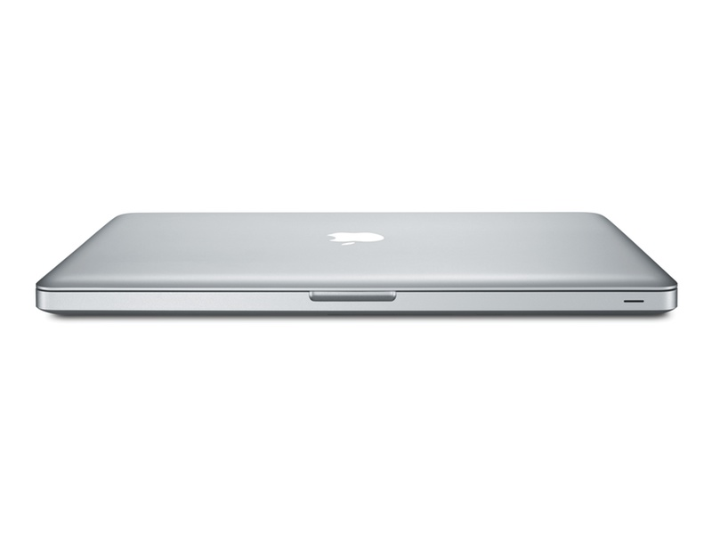

I finally bought myself a macbook, and I'm writing this note on it. This
may surprise a few people, and somebody will surely throw a post from a
few years back in my face, but as Unamuno says, only the man who says
nothing never contradicts himself.



We are irrational beings. In the end these gadgets seduce you, and when
you see everyone at conferences, and all your friends, using macbooks,
you start to doubt your sanity.
There is [a trick to all this](/en/blog/lnds/2010/12/11/its-all-in-your-head/):
it's a viral effect, studied and planned by that great designer, Steve
Jobs. He's laughing at us from his grave; he finally got control of our
heads.

What drew me in was the operating environment. It's Unix in the end,
with all the advantages of having a Unix that works, and it's still the
best working environment for a software developer. But you have to admit
the style factor matters a lot. That little glowing apple, or the
backlit keyboard, is very cool, and the product aims at our ego; in the
end we want to have it.

Steve Jobs recognized this, and that's why he insisted so much on
controlling everything. Among all his skills was that famous reality
distortion field, which he used to seduce his customers, the thousands
of fans and buyers of his products, and which he used to manipulate his
technical teams.

In [Jaron Lanier's words](http://othmanelmoulatblog.wordpress.com/2011/11/25/the-most-ancient-marketing-december-2011-communications-of-the-acm/),
what Steve Jobs did was learn the trade of Guru, and apply it.

I'm probably under the effect of Jobs's reality distortion field, I've
probably eaten an enchanted apple, but I feel my macbook pro is the best
computer I've had so far, and I've had (I have) several.

You have to acknowledge the aesthetic sense and the build quality. I've
spent these weeks playing with this notebook and getting used to it, and
there are things I like a lot, things that make using it a real
pleasure.

Still, I keep thinking the price isn't right. It's probably a better
computer than the rest, but I don't know if it's worth what they ask for
it. The market seems to say it is, though, and as long as that doesn't
change, and we stay under the reality distortion effect, that's how it
will have to be.

A couple of weeks have gone by without my writing on this blog. The
truth is I started my vacation a few days ago and I was very tired, with
no desire to write. I'll be back soon; I just wanted to leave you this
little note with the news, and I hope we pick our contact back up over
the coming weeks. I'm reading a couple of very interesting books that I
think will inspire a lot of writing this year.

Over the next few days, as usual, I'll recycle some old pieces; I hope
you like them. Enjoy your vacation.

