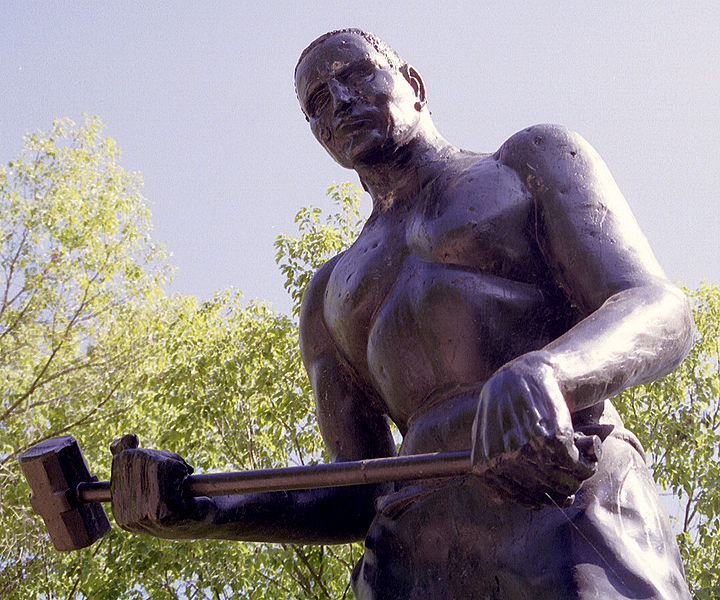
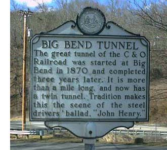

Legend has it that John Henry was a freed Black slave, a man of
incredible strength, who went to work building the railroad after the
American Civil War. He was the best worker on the line, the strongest
and the fastest.

One day a machine arrives, a steam drill, brought in to bore

a tunnel, a machine able to replace the whole crew of workers. John
Henry, to defend his job and his fellow workers' jobs, proposes a
challenge to the foreman: he will race the machine at drilling through
the mountain.

The foreman accepts, and John Henry gets ready. His wife comes to watch
the feat, and although her name doesn't always match, in every version
of the tale she is always dressed in blue. The man says goodbye to his
wife, tells her where his savings are, takes his little son in his arms,
and explains to him that this great tunnel he is about to build will
mean his death.

With two huge hammers in his hands, the man starts that impossible race.
Fast as the machine is, John manages to pull several yards ahead of it.
The machine stops, breaks down, unable to keep going, and John forces
his way through the mountain and finally opens the tunnel.

John Henry has beaten the machine, only to fall at the end, his heart
giving out from the effort. His wife runs to his side; "I'll always be
true to you," she tells him, before he dies in her arms.

John Henry is a hero of American folklore, above all among African
Americans and the working classes. "A symbol of the marginalization of
workers in the late 19th century. He is the clearest illustration of the
futility of fighting technological progress. Some have proposed that he
is an example of how many of the best and most skilled workers are
pushed aside when companies are more interested in efficiency and
productivity than in the health and well-being of their employees.

Although John Henry proves to be more efficient than the steam drill, he
works himself to death and is replaced by the machine anyway."[^1]

I read the story of John Henry many years ago, and it struck me, and it
still does. You can read more about this legend on [this
site](http://www.ibiblio.org/john_henry/index.html), or listen to the
many songs, ballads and blues written around this mythical character.

Some fights are just, and it's clear that technology often ends up
displacing jobs, manual ones above all. A large part of structural
unemployment is a direct effect of technological efficiency. A great
deal of human labor has been replaced by technology, and technology
makes it possible to replace crews of John Henrys with a single man.

Much of this was behind the original Luddite movement, but that's
another story\....

[^1]: This account is an adaptation of various songs and poems about
John Henry, taken from [this
site](http://www.ibiblio.org/john_henry/story1.html).

[^2]: Wikipedia, free translation
