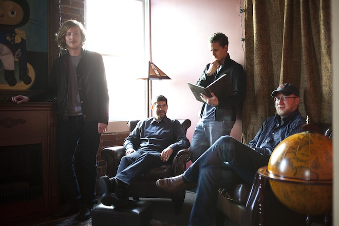

This is a translation of the Wired article about GitHub titled "The
Lord of The Files: How GitHub Tamed Free Software (And More)",
published on February 21. The "code" for this article was published by
Wired on GitHub itself, with permission to remix and translate it under
a creative commons license. My translation is available on
[a branch in my GitHub account](https://github.com/lnds/Lord-of-the-Files). I'm grateful in advance for
any comments to improve this translation, since it still needs a lot of
work.

## **Lord of the Files: How GitHub Tamed Free Software (And More)**

by Robert McMillan, Wired Enterprise

Originally published
at: <http://www.wired.com/wiredenterprise/2012/02/github/>

> SAN FRANCISCO — When the founders of GitHub moved into their swank
> South-of-Market loft last year, the first thing they did was
> redecorate. They turned the floor’s biggest office into a parody of an
> executive suite — complete with fake fireplace, plush leather chairs,
> and a wooden globe that slides open to reveal a bottle of single malt
> scotch. Hanging from the wall is a painting of a cat, dressed as
> Napoleon, with five octopus-like legs. They call it the Octocat.



Images taken from the [Wired article](http://www.wired.com/wiredenterprise/2012/02/github/), used under the CC license.
