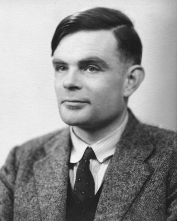

> "The isolated man does not develop any intellectual power. It is
> necessary for him to be immersed in an environment\... He may then
> perhaps do a little research of his own and make a very few
> discoveries\... the search for new techniques must be regarded as
> carried out by the human community as a whole, rather than by
> individuals." \-- Alan Turing

