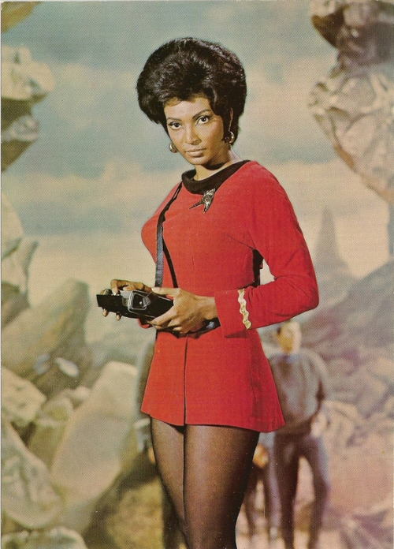

Uhura comes from the Swahili word uhuru, which means freedom. In the
futuristic world of Gene Roddenberry, the creator of Star Trek, humanity
has moved past the prejudices of racism, sexism and xenophobia. That's
why, when he created the crew of the starship Enterprise, he filled it
with people of different nationalities, such as a Russian navigator, a
clear message at the height of the Cold War.

NBC executives, however, objected to his hiring Nichelle Nichols, the
actress who played Uhura, as a permanent cast member of the hit science
fiction series; they were afraid of upsetting the affiliates in the
Deep South states.

So Gene Roddenberry was forced to hire Nichols as a day player. Although
the actress ended up making more money than other actors on the show,
she found the whole arrangement humiliating, and by the end of the first
season she had made up her mind to leave. But it was a meeting with
Martin Luther King that changed her decision. The reverend asked her to
keep playing the part, because she was an inspiration, playing the first
non-stereotyped role for a Black woman on television.

The actress Whoopi Goldberg and the astronaut Mae Jemison have publicly
acknowledged being inspired by the character of Uhura. When Star Trek
was canceled in 1969, Nichols volunteered for NASA to recruit women and
minority personnel. Among the people recruited through her work are
Sally Ride, the first American woman astronaut, Judith Resnik, and
Ronald McNair, one of the first African American astronauts.

What this story teaches us is that it's not about "improving the
race", it's about inspiring others to have confidence in themselves, to
better themselves, and to overcome the barriers society puts in front of
them. We need more role models who help us become better people. That's
called education, culture, diversity, and it is what makes nations
great.

Photo
[via](http://wilwheaton.tumblr.com/post/14173672444/deejaybird-uhura-comes-from-the-swahili-word)
