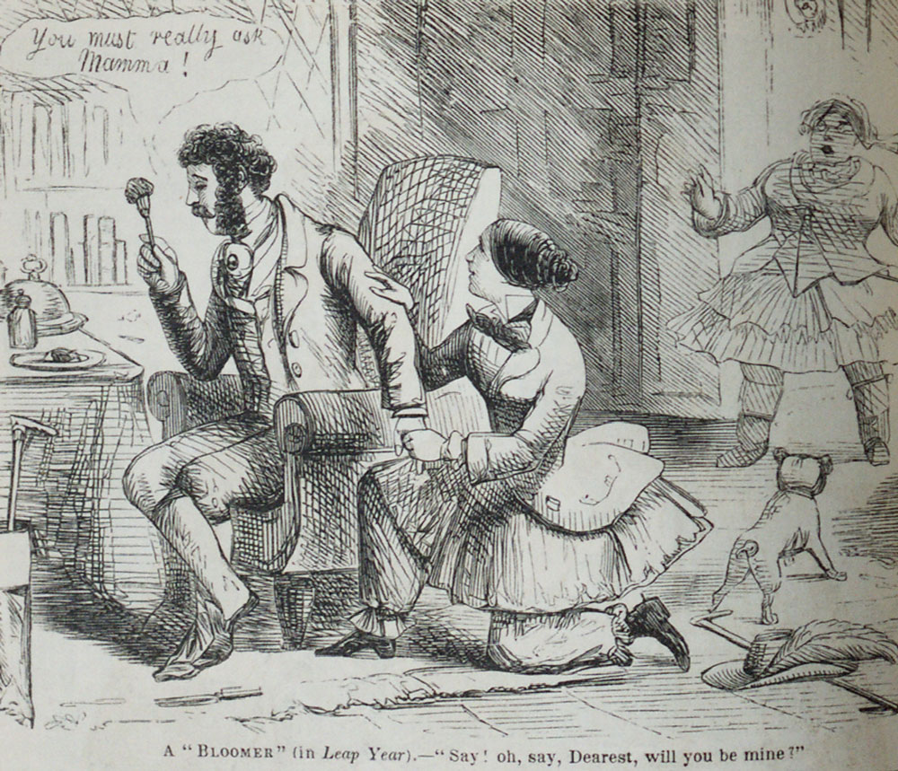

February 29, 2012: a validation process refused to work properly today
at my job. Essentially the bug was this: a program had to check against
a date 10 years back. The solution the programmer implemented was simply
to subtract 10 from the year. So, to compute a date 10 years earlier, it
just subtracts 10 from the year, and gets the imaginary date: February
29, 2002.

Odd as it may seem, leap years tend to cause trouble for programmers.

Apparently Gmail's chat history was showing December 31, 1969 as the
date for every message saved on January 29, 2012.

Joel Spolsky, co-founder of Stack OverFlow, [laughs about it on
Twitter](https://twitter.com/#!/spolsky/status/174999972830384130):



> "haha, we had a leap-year bug on stack overflow today. The author
> of [http://stackoverflow.com/questions/9/how-do-i-calculate-someones-age-in-c](http://t.co/FQOVGzkw) did
> not take the community\'s advice"

It's not very clear what it was, but apparently they had an error
computing the leap year.

In 2008 the leap year bug in the Zune, Microsoft's now discontinued
product, was discovered. It turned out that the 30 GB version of the
device freezes every December 31 of any leap year!

The Zune's problem is that, when working out the year, it got stuck in
an infinite loop. What happened was this: the Zune's internal clock
counted time in seconds starting from January 1, 1980. The problem was
(is?) in this piece of code:

```c
 year = ORIGINYEAR; /* = 1980 */

 while (days > 365)
 {
     if (IsLeapYear(year))
     {
         if (days > 366)
         {
             days -= 366;
             year += 1;
         }
     }
     else
     {
         days -= 365;
         year += 1;
     }
 }
```

In a normal year this loop has no problems, but on the last day of a leap year, when there are 366 days, the if (year > 366) makes the loop stop subtracting days, and the cycle never ends.

That programmers have trouble with leap years becomes obvious when you read the answers to <a href="http://stackoverflow.com/questions/9/how-do-i-calculate-someones-age-in-c?page=1&tab=votes#tab-top">this question on StackOverflow</a>.

But it turns out this "bug" is older than computers.

After all, the leap year is the fix for a celestial bug :), our planet doesn't go around the sun in an orbit that lasts a constant 365 days, and it was <a href="http://es.wikipedia.org/wiki/A%C3%B1o_bisiesto">in the time of Pope Gregory</a> that the problem was corrected by adding a day every four years, except in century years, although century years divisible by four hundred are exempt from the exception. This is a bit complicated, and the source of other kinds of bugs. I've seen implementations that apply the rule of computing leap years by simply dividing by 4. I can't wait to see them when they treat 2100 as a leap year!

But apparently there is another, older and more fascinating leap year "bug". An old English law established that "February 29 was not to be considered a real day". Given that, many traditions could be ignored; after all, that day didn't count. So on February 29 <a href="http://blog.nyhistory.org/ladies-get-ready-its-a-leap-year/">ladies were allowed to propose marriage to gentlemen</a>, and if the man refused he was obliged to buy her a gift in compensation. This gave rise to parties and dances celebrating this "special power" women had on these dates, which let them skip the rigid social conventions of the time.


