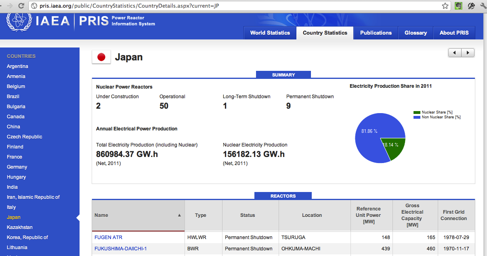

This post is born of a concern that came out of a discussion with Matias
Asun, executive director of Greenpeace Chile. In [his column in El
Mostrador today](http://www.elmostrador.cl/opinion/2012/03/05/chile-el-lobby-nuclear-y-las-lecciones-de-fukushima/),
along with laying out his position on the energy debate in our country,
which is what his role calls for, he slips in a statement that left me
intrigued:

> "Currently in Japan only two of the 54 reactors are operating, and it
> is possible that even those will stop running in the short term."

This post is not about whether or not nuclear power is a good idea for
Chile, nor about whether or not I agree with Matías on that subject. I
respect his work at Greenpeace and I think he is a responsible and
well-informed person; my problem is with that statement. Something
didn't add up. So I did a little digging, and the result was
uncertainty\...

Because Matías has his sources, and they contradict what some official
bodies say. After all, Greenpeace is an institution present all over the
world, and the Japan chapter will have reported those figures.

But how do you confirm them? Because they don't add up for me, because
that's several thousand GWh that have to be generated, and if the
nuclear plants get replaced by thermal power plants (the fastest
alternative), we are at the doorstep of a major ecological crisis, the
cure is worse than the disease, and I don't think GP would like that
either.

How do you confirm this information? If you start with Wikipedia, the
most common source, several pages contradict each other. But hey, it's
wikipedia! Nothing says the information has to be up to date. So I
decided to look into an official source, the International Atomic
Energy Agency, the IAEA, which maintains on its site the
[PRIS](http://pris.iaea.org/public/), Power Reactor Information System,
a system that lets you find out the status of reactors around the world.
There you can look up Japan's status as of today, as you can see in this
screenshot I just took:

50 reactors, 9 out of service and 2 under construction! According to the
PRIS site this information is current as of March 5. The bad part is
that, according to [this Greenpeace
report](http://www.greenpeace.org/international/Global/international/publications/nuclear/2012/Fukushima/Lessons-from-Fukushima.pdf),
the IAEA has failed in its oversight role, for various reasons. So this
source can be questioned from a political point of view.

On the other hand there are press reports indicating that Japan [has
shut down its
reactors](http://www.world-nuclear-news.org/RS-Japanese_reactors_await_restart_approvals-1601124.html?utm_source=World+Nuclear+News&utm_campaign=7cbc1b7161-WNN_Daily_16_January_20121_16_2012&utm_medium=email),
and a story in EMOL, originating with the EFE agency, [confirms that
Japan has 2 active
reactors](http://www.emol.com/noticias/internacional/2012/02/21/527217/japon-para-otro-reactor-nuclear-y-ya-solo-cuenta-con-dos-operativos.html);
the Greenpeace people can offer that as a source.

Fine, but my point is that if I try to investigate from my desk,
searching the internet for sources to find out what is really going on
in Japan with the nuclear plants, I have no way of getting a reliable
figure! The only "trustworthy" sources are the official ones; maybe I
could dig through the sites of the companies that operate nuclear plants
in Japan, and so on. But that would take a lot of time and effort. Or
believe what the news says, or Greenpeace.

Is there no way to have certainty in this case? Evidence, hard data?
Because there is an objective truth over there in Japan: there is some
number X of nuclear reactors operating, and there must be some other
number Y of reactors under construction. Whether X is 50 or 2, and Y is
2 or 0, matters, because it completely changes my perception of the
problem.

This is one example; it happens in many other situations and
discussions. From national energy policy to the quality of cloud
computing services. It is very hard to find objective information and
facts that don't raise some degree of suspicion. Now, I think this
happens because we live in a society that despises the truth, or simply
isn't interested in the truth. Nowadays it is very easy to create a
reality, to manufacture a truth. And we accept it, we don't care.

Someone told me: "the truth is very dangerous when it's used to justify
nonsense". It's a remarkable line, but it has the problem of knowing
what counts as "nonsense".

All this reminds me of [the piece by Milagros Perez
Oliva](http://elpais.com/elpais/2012/02/25/opinion/1330186967_932761.html),
readers' editor of the newspaper El Pais, who said, among other things,
as she signed off:

> "Many readers have asked me how it is possible that, for one and the
> same event, versions as opposed as the ones you can read in the
> different media can appear. The ease with which readers can now see
> those differences has increased their skepticism about what we tell
> them. How do you know who is lying and who is telling the truth?"

"Society is saturated with information, and the press tries to adapt to
the new demands by offering a more interpretive journalism. But
interpretation cannot be an alibi for distortion. We have to start from
the facts to arrive at their interpretation, and not the other way
around. The problem is that there are journalistic practices that do
without the facts, or distort them until they fit the version they want
to impose. Their goal is to distort reality and, if possible, to create
it."

"Distrust those who put interpretation ahead of demonstration.
Interpretive journalism must be based on verifiable facts and data. And
distrust, too, those texts that don't make enough of an effort to show
you how they arrived at the version they hold."

And what Milagros Perez Oliva criticizes in journalism applies to others
too: to pressure groups, to incumbents, political parties, social
movements, the government, and so on. Saturated with information, we
become a people that decides based on emotions, and not on the
interpretation of facts.

I think we are on the edge of a paradox: the information society is
heading toward a new age of obscurantism, because we are creating
skeptical minds on one side and uncritical minds on the other. Nobody is
going to trust anybody or anything this way, and dialogue and the common
good don't look possible in this scenario; we will end up attending new
bonfires where we burn those who preach reason or science as witches, or
simply because they don't agree with our ideas.

These things worry me; we have to be more responsible about what we
assert. "**Distrust those who put interpretation ahead of
demonstration**", or else we are on the road to decadence. What do you
think?
