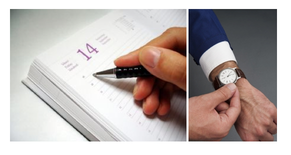
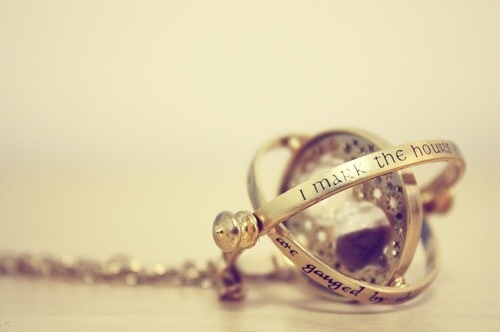

In the old days you wrote down the time of a meeting in a paper
planner: "9:30, March 12, coordination meeting\...", the clocks changed,
you adjusted your watch, and that was that. The ink didn't erase and
rewrite itself by magic, leaving 10:30 on the page, at least not in our
[muggle](http://es.wikipedia.org/wiki/Muggle) world.

But there is more and more technological magic in our world; Ms.
[J.K. Rowling](http://www.jkrowling.com/) got us used to paintings that
move and interactive news. Now our calendars move by magic: if the time
changes, our digital calendars adjust themselves and nobody misses an
appointment or shows up late. The magic works.

Until the [Ministry of Magic](http://es.wikipedia.org/wiki/Ministerio_de_Magia) steps in. You
know how it goes: just like in Harry Potter's magical world, the
ministry steps in to make life harder for its people. Especially when it
decrees, on very short notice, that the clock changes must be moved, and
the wizards, sorcerers and elves who keep our servers in order have to
work overtime adjusting time zones, Exchange servers, application
servers, and all the mystical paraphernalia that holds up our esoteric
timekeeping reality, so that nobody gets to work late and things run
when they should.

Last year the Ministry ordered the time change, but issued the official
decree one day after the measure took effect! That caused problems,
because despite all the lobbying of sorcerers and wizards around the
world, they split into two groups: the proactive ones, like those at
Microsoft and in the open source world, who rushed to create corrective
enchantments before the date of the change, official decree or not. And
on the other side, the proud Pure-Blood Wizards of Google, who would not
brew a single potion until the Department of International Magical
Cooperation issued "The Decree".

This year the Pure-Bloods made a gesture of condescension, waved their
magic wands
[and moved us to Argentina](http://www.fayerwayer.com/2012/03/chile-ajusten-su-google-calendar-desde-esta-noche-para-mantener-los-eventos-a-la-hora-correcta/).
They even made a nice video:

Thank you, Pure-Blood Wizards of Google!

Once again the procedure for switching to winter time in our country
has been modified. Officially this measure [is considered
positive](http://www.minenergia.cl/ministerio/noticias/generales/gobierno-anuncia-fechas-de-cambio-de.html)
by The Ministry. Its grounds are:

> a\. Information provided by the National Traffic Safety Commission,
> which evaluated the effects of the time change and found signs of a
> decrease in traffic accidents.

> b\. Evaluations of energy consumption indicate that the savings
produced by shifting the schedule would allow for lower consumption, of
between 0.4 and 0.7% of average daily consumption in the residential
sector.

> c\. On security and crime, the Strategic Center for Crime Analysis
carried out an inconclusive analysis of the changes in criminal behavior
following the time modification, which offers signs that would make it
possible to state that, even if only marginally, the measure contributed
to reducing the occurrence of crimes during the hours with more daylight
resulting from the time change.

> d\. Public opinion studies show that more than 60% of the population
is in favor of eliminating or shortening winter time.

And where is the impact on IT taken into account?

Ground a) is perfectly reasonable, more light, fewer accidents, but
couldn't the accident rate have dropped because of other factors too?
As for energy consumption, the impact was not as big as they said.

[Alejandro Barros](http://www.alejandrobarros.com)
[wrote](http://www.alejandrobarros.com/content/view/1432514/Cambio-de-hora-requiere-evaluacion-mas-profunda.html) last year:

> "In the case of some [European Union
> studies](http://www.elpais.com/articulo/sociedad/Ahorro/cero/cambio/horario/elpepusoc/20071030elpepisoc_1/Tes),
> the potential energy savings range between 0% and 0.5% of
> consumption, which depends a great deal on the country's energy mix,
> as well as its level of development, since the higher the level of
> development, the higher the per capita consumption.

The National Energy Commission has said that in Chile the savings
would be [on the order of 3% of
consumption](http://www.emol.com/noticias/nacional/detalle/detallenoticias.asp?idnoticia=440519).
Let's remember that this mainly affects household consumption and not
industrial consumption. I would like to know how they arrived at this
number, since I don't see why in Chile it would be 6 times greater than
the maximum savings projected in Europe. In today's press coverage
Chilectra estimates the savings at 0.3% to 0.5%, which will depend on
the length of the period."

Congratulations, Alejandro! You have proven yourself a great wizard, an
expert in the divinatory arts: you predicted the Ministry's results. The
people at the National Energy Commission took classes with
[Professor Trelawney](http://en.wikipedia.org/wiki/Hogwarts_staff#Sybill_Trelawney).

On public safety, and the rise or fall in crime, well, let's not talk
about that; we all know what is going on with that item\...

And point d) on citizen support: at last the government can show more
than 60% support for something! (Just don't ask me or the IT people.)
I'd like them to run the survey again this year and see whether that 60%
holds.

I think it's fine that The Ministry runs evaluations and [shows its
results](http://www.minenergia.cl/ministerio/noticias/generales/gobierno-anuncia-fechas-de-cambio-de.html),
though it's easy when you only consider the positive or neutral
variables and ignore the negative impacts. The impact on magic, I mean
on information technology, is not among the Ministry's concerns; it is
simply ignored.

But fine, if the measure is so positive, then why don't we make it
permanent? That way we can ask the wizards of the whole world to adjust
their services, operating systems and software to Chile's new rules.
Let's stop changing this every year! How long are we going to keep
wasting everyone's time? (if you'll pardon the pun ;).

In any case I still believe that [what I proposed last
year](/en/blog/lnds/2011/03/30/time-as-a-parameter/) is better:
a single time, year-round, aligned with our real solar time, UTC-5.
That would be healthier for our bodies and our psyche, but maybe I'm
being too esoteric\...

