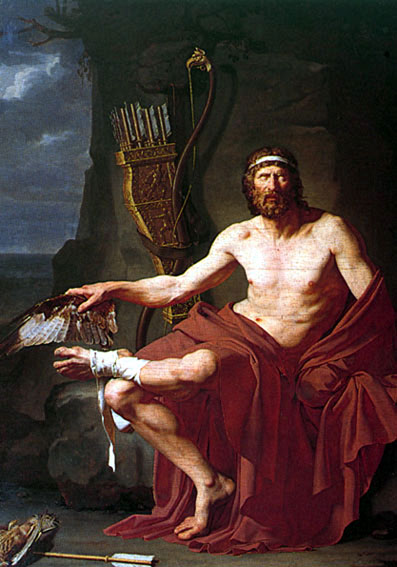
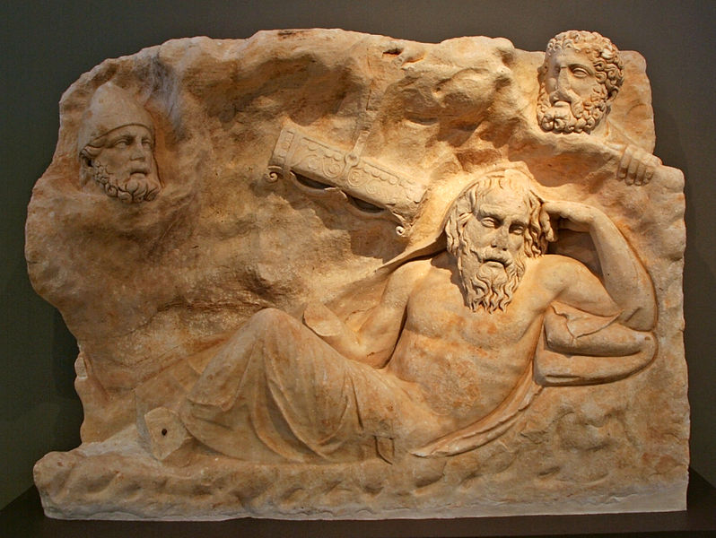

Of all the Greek warriors who set out for the Trojan War, Philoctetes
stood out not only for his bravery, but for the marvelous inheritance he
carried: the bow and arrows of Hercules himself.

But this brave warrior suffered a terrible mishap on his way to Troy.
During a stop along the way he is bitten on the foot by a snake. The
wound is not fatal, but it causes him pain and gives off an unbearable
smell. Philoctetes' moaning and screaming, plus the stench of his wound,
lead his companions, egged on by Ulysses (Odysseus), to abandon him on
the island of Lemnos.

For ten years Philoctetes laments day and night, as much over the pain
of his wound as over the betrayal and abandonment he has suffered.

Ten years!

Philoctetes spends ten years complaining, and alone! Alone on an island
in the Aegean.

During that same time his companions fight at the gates of Troy without
managing to take the city. An oracle reveals the requirements for
winning the war. The presence of Philoctetes and his prodigious bow is
necessary. It is not the only requirement for taking the city: the
presence on the battlefield of Neoptolemus, the young son of the late
Achilles, is also demanded. The Achaeans entrust the mission to
Odysseus, and he decides to fetch the young man first, to use him as a
messenger and convince the embittered Philoctetes to come back with
them.

At first Neoptolemus sets out to convince old Philoctetes, but he also
doubts Odysseus' selfish intentions, and his heart softens as he listens
to the wounded warrior's laments. Things get complicated, Odysseus
steps in, but he is rejected, and it seems there is no way to convince
Philoctetes to go with them to Troy. When they have finally decided to
leave, and as Neoptolemus is saying goodbye to Philoctetes, Hercules
miraculously appears, having come down from Olympus with an instruction
for them both:

> "Know well [Philoctetes] that an honorable destiny is marked out for
> you, and that you will enjoy a glorious life in exchange for your
> sufferings. Once you have arrived with this man at the Trojan city,
> you will first be cured of your terrible affliction, and, chosen as
> the bravest of the whole army, with the help of my arrows you will
> take the life of Paris, the cause of these evils, and you will lay
> waste to Troy\.... And you, son of Achilles, I warn as well: you will
> not be able to bring down Troy without him, nor he without you;
> rather, united like two lions, do not part from each other. I will
> send Asclepius to Ilium, and he will free you from your affliction:
> for Ilium is destined to be taken twice by my arrows."

Both are convinced and committed to the demigod, resolved to travel to
Troy to fulfill the oracle and the order of the son of Zeus. Not only is
Philoctetes' wound healed by the sons of Asclepius; just as the hero
prophesied, it is his arrows that kill Paris, the Trojan prince who
caused this whole war by abducting Helen. Young Neoptolemus is one of
the warriors who hide in the famous horse with which the Greeks finally
take the city, and well, you know the rest of the story (I hope).

There are many things we can learn from this story, masterfully told by
Sophocles in one of his tragedies, but allow me to highlight a personal
interpretation.

Philoctetes is the heir to a marvelous gift who, deceived by an
ill-intentioned companion, and suffering an injury that is not even
fatal but that he takes as a curse or punishment from the gods
themselves, lets his colleagues abandon him. He, who holds the key to
the conquest of Troy, chooses to sink into self-pity. Instead of facing
adversity, of facing his companions, he complains bitterly all day long;
he feels cursed, miserable, and in pain. Perhaps it was not so much the
stench of the wound as the constant grumbling that made his companions
decide to abandon him, at Ulysses' urging.

How many Philoctetes do we know? How many times have we been like him?
Why wait ten years and divine intervention to act? Why not take charge
of your own life once and for all, instead of lamenting so much?

How easy it is to fall into a fatalistic stance. There are people who
complain about their working conditions, or that they have a thousand
problems in life and nobody supports or helps them. They complain
bitterly like Philoctetes, ignoring the power they have inherited.

Are you bored with your job? Quit. Or could it be that the problem is
you? Use the marvelous weapons you have inherited, and be careful, or
you might get abandoned on Lemnos. [Take charge of your life](/blog/2009/03/nada.html).

