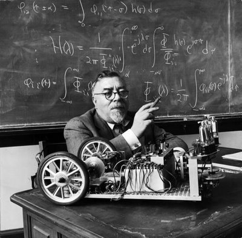

> "We are swimming upstream against a great torrent of disorganization,
> which tends to reduce everything to the heat-death of equilibrium and
> sameness\... This heat-death in physics has a counterpart in the
> ethics of Kierkegaard, who pointed out that we live in a chaotic moral
> universe. In this, our main obligation is to establish arbitrary
> enclaves of order and system\... Like the Red Queen, we cannot stay
> where we are without running as fast as we can."\
> --Norbert Wiener, mathematician, coined the term cybernetics

