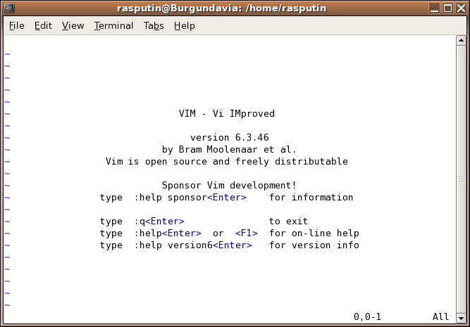

Yesterday I went to see some talks by the [dynamic
languages](http://www.meetup.com/dynlangchile/) group. My main interest
was the presentation by my friend [Aldrin Martoq](http://aldrin.martoq.cl/) and his project (or projects), of
worldwide impact, [Brayatan](https://github.com/aldrinmartoq/brayatan)
[Azicalao](https://github.com/aldrinmartoq/azikalao-lang) (for the
ladies).

I really liked the atmosphere of the meetup, and it's nice to see that
there are plenty of hackers getting together in our country to share
knowledge. Most of the attendees are quite a bit younger than me, so
there's a generation gap that I suspect is around 15 years, which is
very interesting. I can't help thinking about what I was up to at the
age of the people who go to these meetups, that is, what I was doing
fifteen years ago. I suppose I had that same attitude, and I'm sure that
if meetups had existed back then I would have gone to several. All we
had were the \#irc parties, but those are other stories that can't be
told during family viewing hours.

But where was I? Ah yes, the meetup. Some other time I'll talk about
Aldrin's project; what I want to tell you about now has to do with an
earlier talk given by [Jano González](https://twitter.com/#!/janogonzalez/) about VIM (VIM FTW).

For those of my generation, VIM is Vi IMproved, a new incarnation of
the second best editor in the world: VI.

It was the late 1980s, and during one winter break some friends and I,
instead of going to meetups, spent the mornings of those two weeks in
Unix and system administration classes taught by none other than
Patricio Poblete and Juan Alvarez. The idea was to form the sysadmin
group of the [DCC](http://www.dcc.uchile.cl/), the University of Chile's
computer science department, to help the professors and researchers and
to support our users.

We learned the basics of Unix System V, shell programming, sed, troff
(yes, troff, there was no LaTeX), and several other things, and of
course we learned to use vi (the second best editor in the world). So I
was lucky enough to learn Unix from these founding fathers of the
internet in Chile.

Today learning vi, or vim, is something exotic for many developers.
Almost all of them work with some IDE, and the more curious ones, or
those with hacker leanings, master a standalone text editor. If you are
a serious programmer you should know how to use a standalone editor and
be able to compile your programs without an IDE. Personally I don't like
IDEs much, although I recognize their value. For many years I programmed
with Visual Studio, a luxury IDE, and when I went back to programming on
the Java platform I tried Eclipse and NetBeans, which is a painful
experience after having used Visual Studio. When I have to use an IDE
these days my choice is IntelliJ IDEA.

But back to Jano's talk: he is trying to use vim in his daily work.
There is an important reason why it pays to learn vi or one of its
variants, like vim, or elvis in old Linux distros. Vi is present in
practically every unix installation. When you have to log in remotely to
a unix (or linux) server, you will very likely have this editor at your
disposal. But it is also a very powerful editor; there's a reason it's
the second best editor in the world.



Another reason I like VI is that I personally met its creator,
[Bill Joy](http://en.wikipedia.org/wiki/Bill_Joy).

It was around that same time, when we were learning Unix and our
professors were training us as sysadmins, that the University of Chile
was acquiring some modern [Sun
Microsystems](http://en.wikipedia.org/wiki/Sun_Microsystems)
workstations.

By then this young man, Bill Joy, had already become a millionaire, and
like a good millionaire he had decided to spend his money getting to
know exotic places around the world, and he wanted to come skiing in
Chile.

It so happens that the academics of the University of Chile and the
Catholic University decided to invite him to give a talk to their
students, and that is how I met Bill Joy. I had the chance to shake his
hand, I remember a friend asking him to autograph a copy of a CD (I
have no idea what was on it), and right then he encouraged us to write
open source software, which he planned to distribute on every SUN
machine. This was the first entrepreneurship talk I remember attending.

Vi was actually the visual mode of another editor, a line editor called
ex (ex and ed and other line editors still exist in many unix
environments).

In 1976 the idea was revolutionary: use the whole screen to write text.
Before that you typed on the bottom line of the screen and the
instructions kept appearing at the top; the screen emulated a long paper
tape scrolling upward. Because in fact there were many computers whose
terminals were not screens but actual teletypes with paper tape, where
the commands were recorded.

To give you an idea of what working with ed was like, if you have linux
or a mac, type the following in a terminal window:

> **ed**\
**a**\
**hola mundo**\
**.**\
**w hola.txt**\
*11*\
**q**

I put the commands you have to type in bold, and the system's responses
in italics; ed is unix's line editor. The letter a is a command that
means append, that is, add text. Then we type "hola mundo" (hello
world) and a period as the only character on the next line, which ends
text entry. The command "w hola.txt" writes all the text to the file
"hola.txt", and the program answers with the number 11, which is the
number of bytes it wrote. Finally, the q command lets us quit the line
editor.

Oh, and if I want to fix or modify the text and change "hola mundo" to
"hola mundo mundial" (hello whole wide world), it's super simple:

> **ed hola.txt**\
> *11*\
> **p**\
> *hola mundo*\
> **s/\$/ mundial/**\
> **p**\
> *hola mundo mundial*
> **wq**\
> *19*\

You can see that ed supports regular expressions, and a number of other
sophisticated commands, which of course are read from standard input
and whose result is sent to standard output (if you are a true hacker
you will understand the implications of that last sentence).

The interesting thing is that Bill Joy used to say that when he had to
use an editor in an unfamiliar environment he preferred ed, because its
behavior was stable; there were so many clones and versions of vi that
he wasn't sure whether the editor would behave like the original he had
written.

This is a horrible way to write programs, but it's how it used to be
done, after we gave up punched cards.

The remarkable thing is that Unix and C were written using ed, because
it was the editor Ken Thompson wrote in 1971. And that is why ed is the
best text editor in the whole wide world.


