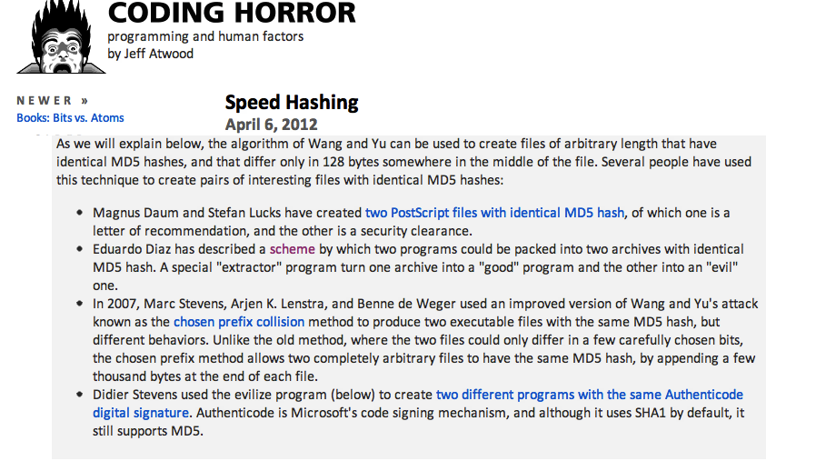

A few days ago Jeff Atwood, author of the famous blog [Coding
Horror](http://www.codinghorror.com), mentioned my 2005 work on
[MD5 collisions](http://www.codinghorror.com/blog/2012/04/speed-hashing.html):

-   Eduardo Diaz has described
    a [scheme](http://www.codeproject.com/dotnet/HackingMd5.asp) by
    which two programs could be packed into two archives with identical
    MD5 hash. A special "extractor" program turn one archive into a
    "good" program and the other into an "evil" one.

Besides being honored by the mention, and blowing my own horn :), there
are two things I'd like to say about [that
post](http://www.codinghorror.com/blog/2012/04/speed-hashing.html).

My first observation is about Atwood's article. He focuses on the speed
at which hashes can be computed on today's machines, especially using
the hardware available in graphics processors, or GPUs.

You see, a GPU is a very, very fast chip with parallel processing
capabilities, used to render graphics and video, which is very useful
for games, for example. To get a feel for the speed of a GPU, the best
demonstration I know is this live video by Adam and Jamie, the
MythBusters:



[CPU vs GPU](http://vimeo.com/1616258) from [Juan
Diez](http://vimeo.com/user483962) on [Vimeo](http://vimeo.com).

Is the power of these processors clear now? Well, that power, which can
be used to generate special effects or render hundreds of spaceships
floating in space, can also be used to compute hash functions, like MD5.

What is all that good for? For doing evil, like trying to work out the
user passwords stored in a database, or tampering with the digital
signature of a file.

Atwood's point is, in essence, that the "bad guys" have a lot of
computing power in their personal computers, and what we need to look
for are new encryption algorithms that are complex, so complex that they
can't easily be implemented on a GPU.

The problem is that Atwood's article focuses on a single aspect of
attacks on hash algorithms, the brute-force attack, and my 2005 proof of
concept is not an attack of that kind; it uses a property of the MD5
algorithm that is a design flaw. If you're interested in the technical
details, I suggest reading [my CodeProject
article](http://www.codeproject.com/Articles/11643/Exploiting-MD5-collisions-in-C)
from 2005 (in English). The important thing is that you don't need
access to very sophisticated hardware to break the MD5 algorithm; all
you need is ingenuity and a few lines of code. Everything can always be
improved through software.

The second observation starts from the fact that this is work from 2005,
and already that year this vulnerability had been known for quite a
while. The bad part is that the technology community keeps ignoring
these discoveries.

For example, in [a 2009 report](http://www.ief.es/documentos/recursos/publicaciones/revistas/cuadernos_formacion/08_2009/14.pdf)
Fernando Barraza reports that the digital seal used on electronic
invoices in Mexico is based on MD5 \[1\]. The Chilean electronic invoice
uses SHA-1, an algorithm that also has vulnerabilities known for years.
Many circulars from some regulatory agencies in our country define
exchanges of sensitive information that must be digitally "signed" using
MD5.

MD5 is still used as a valid hash on many download sites and in content
management systems, as a way to verify the integrity of files. So in
practice nobody seems to care about the issue. My proof of concept can
be used to plant a trojan in a software distribution repository, and the
users and even the administrators wouldn't notice, for example.

"The world is held up with toothpicks". Fortunately it seems we humans
are, by and large, good people, because nobody has used the schemes
described here to breach security in any serious way. That's not very
comforting for those of us who worry about computer security, but that's
how things stand\...

\[1\] Barraza's report is titled "La Factura Electrónica como
instrumento de control de las obligaciones tributarias de
los contribuyentes en América Latina" (The electronic invoice as an
instrument for controlling taxpayers' obligations in Latin America),
published by Spain's Instituto de Estudios Fiscales; the Mexican case is
mentioned on page 63. The description of MD5 is remarkable:

> MD5, which is a one-way hash function, such that for any input it
> produces a complex 16-byte output called a "digestion".
