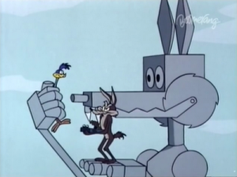

## **The laws of "Coyotics" (Part I)**

1\) The Road Runner cannot harm the Coyote except by going "beep,
beep."\
2) No outside force can harm the Coyote, only his own ineptitude or the
failure of Acme products. Trains and trucks were the exception from time
to time.\
3) The Coyote could stop anytime, if he were not a fanatic.\
(Repeat: "A fanatic is one who redoubles his effort when he has
forgotten his aim." -- [George
Santayana](http://es.wikipedia.org/wiki/George_Santayana)) 



## **ACME brand software**

This is an interesting definition:

> "Software is packaged intelligence."

Others define intelligence as "the ability to come up with answers to
hard problems".

For example, at some point we had the problem of storing large amounts
of data and being able to retrieve it quickly and efficiently. Over time
databases were developed, and later relational databases. Some companies
packaged the solution to this problem as a piece of software, known as a
database management system, and charged money for that product. The more
complex the solution, the higher the price; after all, many hours of
research and development went into building that system. What you were
buying was packaged intelligence.

This view is interesting, and very important, because it is the basis
of the wealth of big corporations like Microsoft or Oracle. What these
companies sell as a product is the packaged solution to a problem, and
going by the definitions above, what they sell is packaged intelligence.

The problem is that this view collides with the so-called "paradox of
intelligence".

##  **The laws of "Coyotics" (Part II)**

4) No dialogue ever, except "beep, beep" and yowling in pain.
5) The Road Runner must stay on the road -- for no other reason than
that he's a roadrunner.
6) All action must be confined to the natural environment of the two
characters, the southwest American desert.
7) All tools, weapons, or mechanical conveniences must be obtained from
the Acme Corporation.

## **The paradox of intelligence**

In an interesting article[^1] the English psychologist and
neuroscientist [Richard Gregory](http://www.richardgregory.org/) poses
the following paradox:

> "People are said to be more intelligent when they find an answer to
> something than when they already knew it beforehand (which is a kind
> of cheating); and yet we also say that scholars who know a great deal
> are more intelligent than the ignorant. This *paradox* can be resolved
> by pointing out that becoming a scholar requires intelligence -- since
> learning is hard. But the truth is that we speak of knowledge itself
> as if it were a kind of intelligence. When Macbeth asks "Say from
> whence you owe this strange intelligence?", he is asking about the
> source of knowledge or information. This has the same meaning as the
> expression "military intelligence", which does not imply that the
> military are especially bright. On the other hand, if we say that
> Einstein was intelligent, we are referring to what he invented or
> discovered, rather than to what he learned at school or later in life.
> It is because what he said was not yet known that we regard Einstein
> -- and Newton, Faraday, Darwin and other great innovators -- as
> exceptionally intelligent. This is not the "intelligence" of existing
> knowledge. It is the "intelligence" of the discovery or creation of
> new knowledge."

> "We therefore find two very different kinds of intelligence: the
intelligence of stored knowledge and the intelligence of processing,
applied to solving problems. I suggest it would be useful to call them
"**potential intelligence**" and "**kinetic intelligence**". Although
they correspond to different concepts, these two intelligences are
intertwined, since solving problems takes some knowledge and, to apply
knowledge properly, a certain initiative is required."

Gregory's proposal is meant as an analogy with the terms
[Potential Energy](http://es.wikipedia.org/wiki/Energ%C3%ADa_potencial) and
Kinetic Energy used in physics.

## **The laws of Coyotics (Part III)**

8) Whenever possible, make gravity the Coyote's greatest enemy

## **Analogies, analogies**

If you remember the old Road Runner cartoons, you'll remember that the
poor Coyote would haul an enormous boulder as high as he could in order
to crush the Road Runner. In doing so the rock accumulated potential
energy, so that when he let it go that potential energy would turn into
kinetic energy with enough force to flatten the hateful bird (which
confirms my suspicion that, in the end, the Coyote didn't really want
to eat that wretched bird; he simply hated it).



More formally, potential energy[^3] is the capacity of a system to do
work by virtue of its position or configuration. It is the energy stored
by the system, its capacity for work. Kinetic energy, on the other hand,
is the energy an object has because of its motion. In the diagram below
we see that the potential energy a rock accumulates because of its
position is transformed entirely into kinetic energy as it rolls.



Following Richard Gregory's analogy, when we solve a problem we are
applying kinetic intelligence; if we store the solution to the problem
somehow, what we have done is turn it into potential intelligence.

Potential intelligence is not only in our minds; it is in our books and
tools. Tools contain solutions to practical problems. Take scissors, for
example: they are the solution to the problem of how to cut cloth.

> "Scissors were developed over many generations through successive
> steps of problem-solving kinetic intelligence, thereby producing the
> potential intelligence that is built into their present design."

This analogy between intelligences and energies seems pretty good and
useful. But it is not entirely right. When the weight of the rock is
released, the potential energy is lost. What happens to knowledge when
it is used? Do scissors lose their potential intelligence when they cut
cloth?

In general that doesn't happen; a tool does not lose its potential
intelligence, except when it wears out. In the case of software, which
is a kind of tool, that wear is even smaller. Military intelligence
loses its reason for being when it becomes common knowledge, since that
intelligence must stay secret from the enemy if it is to be useful.
Science, on the other hand, gets its power from shared knowledge. Secret
potential intelligence is the only kind that wears out like potential
energy. Potential intelligence does not wear out except when there is
competition.

## **The laws of Coyotics (Part IV)**

9) The Coyote is always more humiliated than harmed by his failures. 
10) The audience's sympathy must remain with the Coyote.
11) The Coyote is not allowed to catch the Road Runner.

## **On the intelligence of the Coyote**

The Coyote[^2] has at his disposal the resources of the most important
corporation in the world, the famous Acme Corporation, which has
extraordinary logistics capable of delivering to the remotest desert any
kind of contraption the Coyote wants to buy.

And yet, despite all that capability, all the packaged intelligence at
his disposal, the Coyote is inept, incompetent. And it's not that he
lacks kinetic intelligence; the problem is that it's badly aimed. He is
so obsessed with his task that he has forgotten his goal. He is a
fanatic, and that is his flaw.

(Repeat: "A fanatic is one who redoubles his effort when he has
forgotten his aim." -- [George Santayana](http://es.wikipedia.org/wiki/George_Santayana))

> "The need for kinetic intelligence is minimized when knowledge is
> shared cooperatively".

One of the problems we face in IT, especially in corporate environments,
is the inability to manage potential and kinetic intelligence.

"Nobody ever got fired for buying IBM", goes an old saying in the
corporate IT world. What it means is that decision makers prefer to buy
packaged solutions from big brands, because that "gives them
guarantees". If something fails we can call in our warranty, support, or
whatever. So large sums get invested in licenses, support contracts,
license renewals, and so on. That is operating like the Coyote: to solve
the problem I buy Acme products, and I spend large sums of money
protecting myself against the eventual failures of the software.

That may have been true many years ago, when knowledge really was
packaged, and nobody but Acme had the formula for building complex
Road-Runner-catching robots.

But today many of the basic packages are practically commodities:
operating systems, databases, programming languages, office suites, and
so on.

We have open source software, free software, containing thousands of
hours of accumulated potential intelligence. The knowledge for solving
problems is being stored in repositories like
[GitHub](http://www.github.com/) or [Stack
Exchange](http://stackexchange.com/).

The world has changed; the IT executive is no longer the administrator
of the infrastructure and the great custodian of development
methodologies. The modern IT executive is the manager of intelligence,
not of packaged intelligence; he is the one who manages the two kinds of
intelligence we have discussed: potential intelligence, in the hands of
the security and infrastructure teams, and kinetic intelligence, in the
hands of the development areas. More resources should be spent on what
adds the most value, and that is development. I'll come back to this
later in another post.

The problem, I think, is that many IT executives have lost sight of
their goal; they have become fanatics: of security, of order, of
methodology. They have forgotten what they are there for.

There is a cartoon in which [the Coyote finally catches the Road
Runner](http://en.wikipedia.org/wiki/Soup_or_Sonic), and guess what
happens\...



[^1]: [What Is Intelligence (Darwin College Lectures)](http://amzn.to/IQIJU8), Jean Kalfa (editor), Richard Gregory, Roger Penrose, Daniel Dennett, et al. The passages are from chapter 1, "Seeing intelligence", taken from the Spanish translation by Paloma Gómez Crespo, Editorial Alianza, Madrid 1995.

[^2]: The Laws of Coyotics is the name I've given to the 11 rules drawn
up by Chuck Jones and the artists who worked on the original Road Runner
cartoons. You can read more about this cartoon in [this Wikipedia
entry](http://en.wikipedia.org/wiki/Wile_E._Coyote_and_Road_Runner).

[^3]: The potential and kinetic energy diagram was taken from
[here](http://www.fisicanet.com.ar/biologia/introduccion_biologia/ap01_introduccion_a_la_biologia.php).
