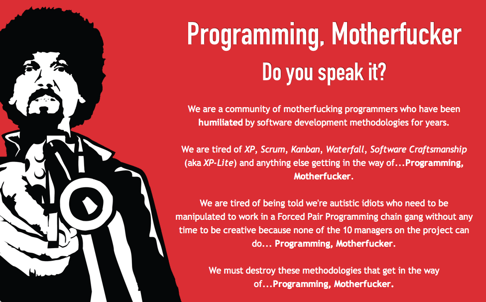

You'll say: "Eduardo, you obviously love writing, that must be your
true passion." And the truth is you're not that far off: I like writing,
and preparing these posts is one of the most fun things I do, but no, I
have a greater passion than writing: programming. It really is what I
like most. I don't think I'm a great programmer, but I think I'm above
average, and the best part is that I keep learning, every day.

Not long ago a colleague told me she had met a young man who was
studying *"computer engineering"*. Someone said to him: "how great that
you're studying that, you could work with us to finish the applications
we need!", and the young man's proud answer was: "no, no! **I don't get
my hands dirty anymore**!".

Well, that is what's wrong with our industry, that damned attitude of
"not wanting to get your hands dirty", as if they would actually get
dirty (there are products for cleaning keyboards, did you know?).

We are software developers, what we do is program! I'm in an executive
position and, even though the "dignity of the office" says I shouldn't,
"I still get my hands dirty!".

It's like telling me that a neurosurgeon who studied for 10 years
doesn't operate! Or that a soccer player doesn't use his feet!

The great Edsger W. Dijkstra [said it clearly](/en/blog/lnds/2010/01/10/the-doomed-discipline/):

> As economics is known as "The Miserable Science", software
> engineering should be known as "The Doomed Discipline", doomed because
> it cannot even approach its goal since its goal is self-contradictory.
> Software engineering, of course, presents itself as another worthy
> cause, but that is eyewash: if you carefully read its literature and
> analyse what its devotees actually do, you will discover that software
> engineering has accepted as its charter "How to program if you
> cannot."

What happens is that there are a lot of people who are incapable of
programming, and so they drift into *software engineering*, because they
believe that makes up for their ineptitude, and that is how the industry
has filled up with inept people. And that's why there is a software
crisis, and projects don't ship, because the few people who are good end
up subsidizing the bad ones. We have built our crisis by being nice
people.

Enough of that! Let's stop accepting mediocrity, ineptitude and
incompetence. Let's start with the hiring process: if you need jugglers,
[ask them to juggle in front of
you](/en/blog/lnds/2010/12/26/how-to-hire-jugglers/) before
hiring them.

The other thing is methodologies. Take the example of
[Waterfall](http://en.wikipedia.org/wiki/Waterfall_model): for years
this method has been taught as the traditional way to develop software,
when in fact the paper that introduces it says you should not use this
approach, because it doesn't work. Most software engineering books are
based on a [reading comprehension](/en/blog/lnds/2011/11/12/reading-comprehension/)
error!

And against this "methodology" the "new methodologies" get proposed. And
then come endless "software engineering" discussions, which keep
forgetting the essential point, that **the only way to develop software
is by programming, ctm! (\*)**

So it's inevitable that some programmers rebel and write their own
manifesto against all the previous manifestos, like this one:
[Programming, Motherfucker](http://programming-motherfucker.com/), which
basically has the same attitude we want to convey when we say ¡Programa
CTM! (\*)

This comes from a Manifesto written by [Zed Shaw](http://zedshaw.com/),
a programmer and musician, creator of the [Mongrel web server for
Ruby](http://rubyforge.org/projects/mongrel/). A controversial
character, with a pretty cool [website](http://zedshaw.com/) :smile: [^1]

Very much in his style, Zed Shaw writes:

> "We are tired of XP, Scrum, Kanban, Waterfall, Software Craftsmanship
> (aka XP-Lite) and anything else getting in the way of...Programming,
> Motherfucker."
>
> "We are tired of being told we're autistic idiots who need to be
> manipulated to work in a Forced Pair Programming chain gang without
> any time to be creative because none of the 10 managers on the project
> can do... Programming, Motherfucker."

The following is Shaw's counterproposal to the values of the
[agile manifesto](http://agilemanifesto.org/iso/es/):

They Claim To Value\
They Really Value\
We Fucking Do

Individuals and interactions

*Tons of billable hours*

**Programming, Motherfucker**

Working software

*Tons of pointless tests*

**Programming, Motherfucker**

Customer collaboration

*Bleeding clients dry*

**Programming, Motherfucker**

Responding to change

*Instability and plausible deniability*

## **Programming, Motherfucker**

I don't know about you, but I like that attitude. I might just end up
buying one of his
[t-shirts](http://programming-motherfucker.com/buy.html)\...

## **Notes**

The coprolalia, or foul and obscene language, used in this post is for
academic purposes only, ahem.

(\*) The acronym CTM stands for a profanity widely used in Chile and
also in Peru: "Concha de Tu Madre", or "conchetumadre" or
"conchetumare". An equivalent, though I suspect it isn't used the same
way in Mexico, would be "Chinga Tu Madre", which has the same initials.
It has become popular on Twitter in expressions like "Está temblando
CTM!!" (it's an earthquake, CTM!!) or "Gooool CTM!", so the expression
has many uses: to express fear or rage, to threaten or to insult. I
imagine it fits the Manifesto's use of motherfucker quite well.

[^1]:  Zed Shaw, like me, doesn't like the Ruby language, though he went
a bit further, because he really hates Rails, despite having made a lot
of money using Ruby. A few years ago he wrote a controversial article (a
rant, really) that he had to take down from his site, although a copy
remained on the net (which never forgets). Here it is in case you're
interested: [Rails Is A Ghetto](http://www.zedshaw.com.sharedcopy.com/rants/51489cec9386f7c13f69b3a58cd50b02.html).
By the way, his [essays](http://zedshaw.com/essays/) are interesting,
and he has several [books](http://learncodethehardway.org/) on
programming. I hope his attitude doesn't intimidate you.
