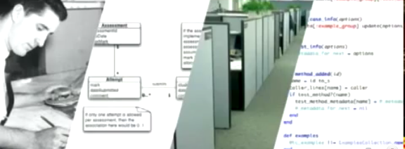
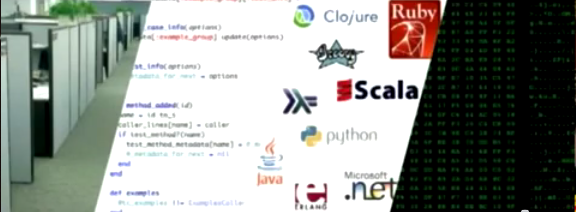

> "If you look at software today, through the lens of the history of
> engineering, it's certainly engineering of a sort—but it's the kind
> of engineering that people without the concept of the arch did.

> Most software today is very much like an [Egyptian
> pyramid](/en/blog/lnds/2008/01/22/the-mystery-of-the-pyramids/) with
> millions of bricks piled on top of each other, with no structural
> integrity, but just done by brute force and thousands of slaves." \--
> Alan Kay

The discussion about my previous post ([Program, CTM!](/en/blog/lnds/2012/04/29/program-ctm/)) has been
great fun, but I think I need to clarify a few ideas, because sooner or
later someone will conclude that this is about hiring programmers, tying
them to their chairs, getting out the whip and beating the drum: "code,
code!



Well, if it works for you\...

**NO!**
========

I never said this is about just diving in and "coding like a brute",
for crying out loud!

That doesn't work.

What I said is this: *\*the only way to develop software is by
programming, ctm! \**

**The problem is the metaphors ([again](/en/blog/lnds/2010/12/28/metaphors/))**

Fine! Let's accept for a moment the analogy that software engineering is
like civil engineering. What civil engineers do is build "civil works",
you know, bridges, buildings, highways, canals, that kind of thing. OK,
this is a gross oversimplification, forgive me, but let's keep going.

In a civil works project there are stages firmly established by
centuries of tradition, a tradition that has taken the art of
construction from the sorry state Alan Kay mentions in the quote that
opens this post to the modern marvels of super skyscrapers and enormous
towers with no traffic congestion problems (believe me, there are
countries where civil engineering has reached that level!).

Well, this metaphor is wrong, and that is the root of the fundamental
problem of so-called software engineering, and it is what Dijkstra
warned us about long ago. To explain the problem I'm going to quote [a
comment](/en/blog/lnds/2012/01/14/concept-album/#comment-1839)
by [Javier Rovegno](http://ideaschile.wordpress.com/) on an
[earlier post](/en/blog/lnds/2012/01/14/concept-album/#comment-1839):

> I agree that "the image of software as something that gets built" is
> wrong, but civil engineering is not very different from software
> engineering.

Civil engineering develops documents and blueprints that will be
interpreted by people to solve problems.

Software engineering develops source code that will be interpreted by
computers and people to solve problems.

The problem is confusing the design (development) stage with the
construction stage; it is equivalent to confusing the development stage
with the stage where the instructions are computed.

That comment holds the seed for starting to understand the problem,
which arises from this distinction between design and implementation, a
distinction that is completely wrong when it comes to software. It turns
out that **the design of the software is the source code**!

Let's see\... how do I explain this?\... I'm going to show you a
[video](http://www.youtube.com/watch?v=taoPYaOg9Uc#t=33m20s) (the
important part starts at minute 33, 20 seconds in):

For those who can't watch the video, I'm going to transcribe part of
what Glenn Vanderburg says in his talk.

"Software engineering was born as an analogy with the engineering
disciplines of the physical world, and that analogy goes more or less
like this:"

"You have engineers, who sit there in their white shirts and ties. They
produce designs. And those designs are handed to the workers, who use
the design to build the final product."

"By analogy, if we want to look at the world of software development,
and we want to learn from the existing engineering disciplines, we
should make software like this:"

"We have software engineers (the same guy, but now retrained), who
produce a design, which is then handed to the workers in their cubicles
who produce the final product".

This analogy is wrong, and every software engineering discussion starts
from this mistaken analogy. In the 90s Jack Reeves wrote a very
important article, "[What is software
design?](http://www.developerdotstar.com/mag/articles/reeves_design.html)",
where he argues that the whole analogy is typical of someone who knows
nothing about developing software, because the great lesson every
programmer learns with time and practice is this:

> "programming is not about building software; programming is about
> designing software"

So, the design is the source code!

Sure, we need diagrams, sketches, drawings, and models that help us
visualize our design, but in the end the design is the code. The models
are just another way of looking at the code. Those diagrams with little
boxes and arrows are visualizations of the only thing that matters: the
source code, and the code is the design. **Designing is programming, and
programming is designing software**. They cannot be separated.

So a better analogy would be: the programmers are the engineers, their
design is the source code, the workers are the compilers, the
programming languages and the frameworks. And the final product is a
solution to a problem, running on machines that users can use.

So when we say that the only way to develop software is by programming
we are not simplifying, or exaggerating, or saying anything strange; we
are just putting things in their place.

There you have [Jack W. Reeves's text](http://www.developerdotstar.com/mag/articles/reeves_design.html)
and [Glenn Vanderburg's presentation](http://www.youtube.com/watch?v=taoPYaOg9Uc#t=33m20s)
(kindly translated by Javier Rovegno). The details of what we mean by
programming are there. You have to start from that definition. If you
still see the programmer as a code monkey, a code grinder, a mediocre
being who needs a flowchart spelling out the steps to implement the
code, then let me tell you that you are very wrong, and you'd better go
do something else.

The view that programmers are antisocial autistics who just pound the
keyboard churning out code must be eradicated. As I
[said a while ago](/en/blog/lnds/2008/11/30/beware-of-the-self-absorbed/):
"Developing software is a social endeavor. You can't build good
software with a bunch of engineers with zero social skills."

Programmers are intelligent, brilliant people, with a lot to
contribute. The interesting question is how to
[channel all that intelligence](/en/blog/lnds/2012/04/17/on-the-intelligence-of-the-coyote/).
That is called managing software development, and we'll leave the answer
for another post.

Note:

Jack W. Reeves [revisited his text 13 years later](http://www.developerdotstar.com/mag/articles/reeves_13yearslater.html),
reviewing the criticism of his position. I recommend reading that too.
