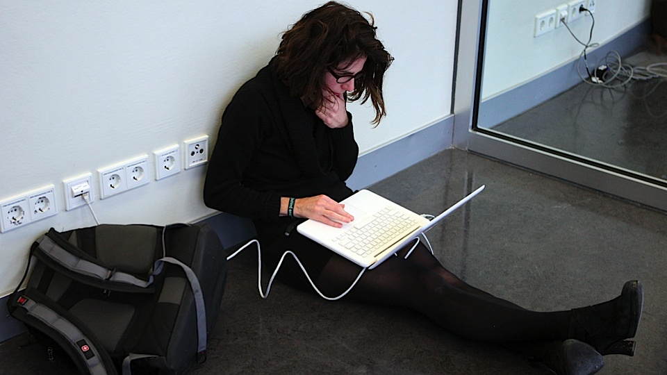
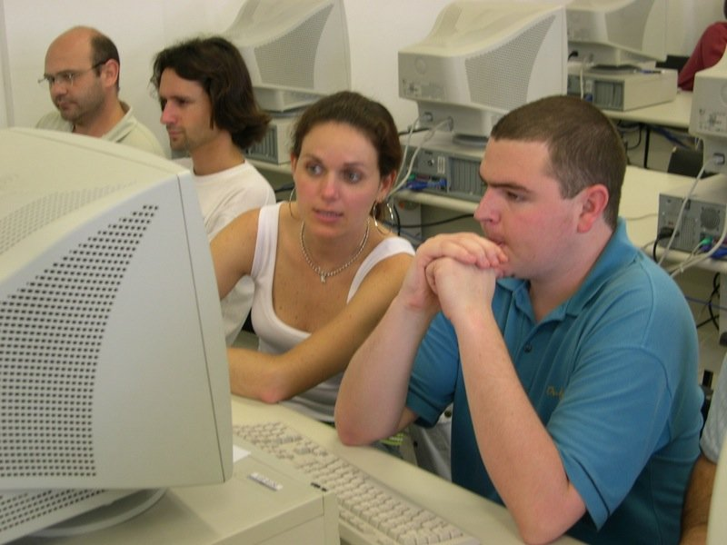

According to a recent study, software engineering is the most lucrative
and enviable career of 2012:
[Software Engineering 2012's Top Job](http://www.informationweek.com/news/global-cio/careers/240000347).
The employment rate for IT professionals is the highest worldwide. And
yet\...

## **Motivation**

A few days ago I heard a young first-year engineering student talking
about her introduction to computing course, and frankly the comment was
not encouraging. For her, programming is not much fun; having to tell
the computer step by step what it has to do to implement a simple
algorithm *is a real drag*.

And there must be something to it, because enrollment in computing has
dropped, not only at the university where I studied, but in several
other countries. There are reports saying that enrollment in "computer
sciences" has fallen by half in the last 10 years. There may be many
factors. For one, I think there is a disconnect between academia and
industry, which Bjarne Stroustrup describes very well in
[this post](/en/blog/lnds/2012/05/18/what-should-we-teach-new-developers/).
Others [blame Java](http://www.joelonsoftware.com/articles/ThePerilsofJavaSchools.html) :smile:.

The truth is that this is paradoxical. Computing is transforming our
society; there is practically no aspect of our lives that hasn't been
influenced one way or another by information technology. Even though
young people have a natural enthusiasm for using technology, to have fun
or to communicate, they find learning it tedious, and they even have the
impression that "creating these technologies lacks sufficient
intellectual depth".[^1]

What can we do to turn this view around?

Maybe the problem is that the programmer is seen as the bricklayer, the
last link in the chain, the base of the pyramid at whose peak stands the
proud engineer. We are [trapped in the wrong
metaphor](/en/blog/lnds/2012/05/09/what-is-programming/), and
the kids who want to be engineers don't think laying bricks is worthy of
them.

Probably the reason is simply that programming is seen as a very unsexy
activity.

And although we'd like to be seen like this:

The truth is we are seen like this:

That is one of our problems: in this world where image is so important,
we have to change how we are perceived.

Programming is not just writing code. Programming is a creative act,
highly challenging, and
[fundamental](/en/blog/lnds/2012/05/18/everything-is-software/).
It is the best activity you can devote yourself to, but how can we get
this across to young engineering students?

Let's see what the description of a first-year introduction to
computing course in engineering says:

> "The purpose of this course is to develop algorithmic and logical
> reasoning as fundamental, basic dimensions of problem solving in
> engineering and in the physical and mathematical sciences.
>
> The objective is for students to be able to solve problems using the
notations, principles, techniques, methods and procedures of the
discipline of Computing. Specifically, by the end of the course students
will be able to solve problems through programs written in the Python
and Matlab programming languages."
>
>    "Objectives:
>    - General: Solve problems 
>    - Specific: Write programs that solve problems  
>    - Long term (Purposes):
>        - Algorithmic and logical reasoning 
>        - Abstraction and modeling skills 
>        - General problem-solving ability 
>        
>    Contents:
>
>    - Unit 1: Handling lists and tables of values
>    - Unit 2: Introduction to numerical computing
>    - Unit 3: Searching and sorting information"

OK, it's important to note that this course is the first impression many
young people will get of computing. I don't find it very motivating; I
don't know about you.

A while ago I decided to start writing a [short programming
course](https://www.programando.org/categories/aprendiendo-a-programar.html),
and the truth is I realized I'm following this same pattern: teaching
how to solve problems by writing programs.

I'm not sure that's a good path. You see, of all the chapters I've
written so far I'm proud of one:
[La máquina universal](https://www.programando.org/blog/2011/04/17/la-maquina-universal.html) (The
universal machine); the rest is pretty standard. What makes me proud of
that chapter is that it has a lot of the spirit of this blog. It is an
attempt to convey why I'm passionate about my profession by telling you
a story, the story of two great men, Turing and von Neumann, and the
great legacy they left us.

I believe an introduction to computing course should be a course that
shows the great contribution our field has made to humanity. An
introduction to computing course should get students committed to the
adventure of
[taming chaos](/en/blog/lnds/2010/06/02/the-simple-the-complex-and-the-complicated/),
and convey the idea that our business is [the management of
intelligence](/en/blog/lnds/2012/04/17/on-the-intelligence-of-the-coyote/). 

It's not about solving problems,
[it's about improving people's lives](/blog/2009/04/la-computacion-como-una-ciencia-social.html).

In that spirit I propose the following syllabus:

1.  What computing is and how it affects our daily lives:

    -   How do search engines like Google or Bing work?

    -   How is it possible that information isn't altered when it is
        transmitted or stored?

    -   How does data compression work and what is it used for?

    -   What holds up our financial world? Databases and transaction
        engines.

    -   Security, cryptography, how we make sure our money is safe in
        our bank accounts, or how do we keep our digital identity from
        being stolen?

2.  What computer science is and what it tries to tackle

    -   Can we compute anything?

    -   What are the limits of computation?

    -   Is the universe just information?

    -   Do we live in a universe like the Matrix? How would we know if
        we were inside a virtual reality?

3.  Fun:

    -   How to make a computer game

    -   What a social network is and how to create one

    -   How to make a mashup that integrates different APIs on the web
        to create a new application

    -   How to create an app for our smartphone.

4.  Challenges:

    -   How does a GPS work and how does it choose the shortest route
        to get somewhere?

    -   How can I build a universal translator?

    -   Can we build a program that plays chess and beats us?

Don't you think a syllabus like this would be more fun and would get
more people hooked on studying computing? Why not do it?

And something very important: we must also manage to motivate more women
to join our field.
[The first programmers were women](/en/blog/lnds/2010/08/03/the-eniac-programmers/),
so why aren't there more?

That is the challenge: let's get more people to study computing. And
hopefully everyone will learn to program.

[^1]: I'm quoting [Chris Bishop](http://research.microsoft.com/en-us/um/people/cmbishop/) in his foreword to the book [Nine Algorithms that changed the future](http://amzn.to/JWubkp).
