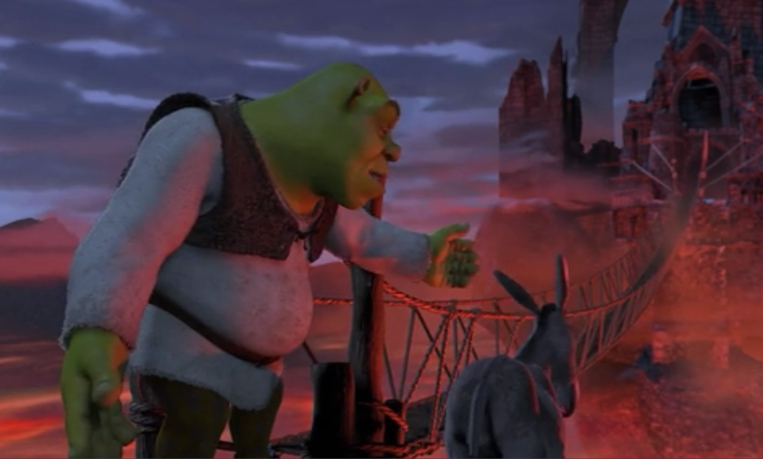
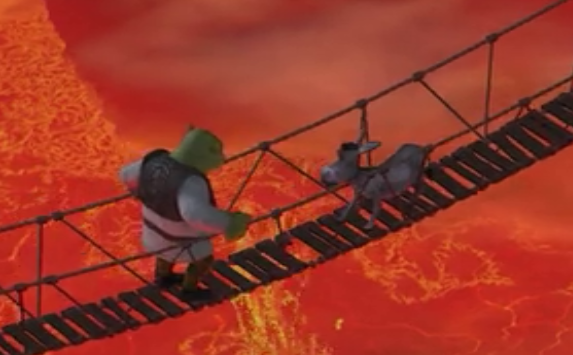
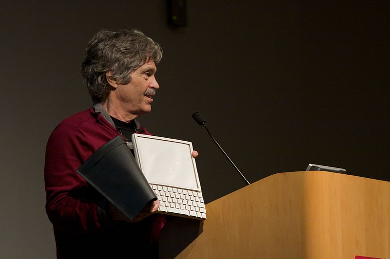

> [If] you think there's some sophisticated recipe for success, then
> I think you are doomed. You're making it too complicated.\
> -- Brad Bird

Ah! How do you make things happen? Or as they say up in the Untied
States: How to get things done.

We also talk about how to make a project succeed. "Real Artists Ship",
Steve Jobs used to say. "The ideas are good, but the execution often
fails", I've heard people say.

How do you make things happen? A lot of emphasis is placed on a
company's management worrying about strategy, leadership development,
and innovation, but very little thought goes into the work of execution.
And that is the most important part: you have to make things happen!

## Shrek's method

> *"It could be done, it could be done"* -- Shrek

You know, one of the things that annoys me most is hearing people say
"it can't be done", or worse, when they tell you "you won't be able to,
because of this and that", or "we did it, but we had all these
difficulties, and you know how they are at XXXX, they'll give you
nothing but trouble". Ugh, you have no idea how much that attitude
bothers me! That eagerness to find every possible "but" in an idea, to
scare people, or simply to dig into a posture full of excuses for just
not doing things.

We shouldn't set limits for ourselves; we all have to overcome our fears
and accept the challenges. And the truth is it can always be done.

Look at them, there are Shrek and Donkey at the edge of the abyss, a
fragile rope bridge over a chasm with burning lava at the bottom. That
is the obstacle to overcome, and there is Donkey, voicing his fears. "I
can't cross this bridge", says Donkey.

 And what does Shrek do? He motivates him, encourages him, and gives him
a direction:

> -- we're going to get through this together, one little step at a time \
> --  really? \
> -- really, really! \
> -- **Don't stop and don't look down**

And of course, Donkey ends up looking down and wants to go back, to
abandon the project; the fears have returned:

And the solution is *\*pure leadership. \**The role of Shrek, I mean of
the leader, is to persist with the goal, overcome internal opposition,
overcome conflict, and lead, lead and lead. The donkey can do it, he
just doesn't believe in himself; he doesn't want to do it because he
doesn't trust his abilities, or he's afraid of the environment, and
believes the obstacles are insurmountable. There are other kinds of
donkeys who are simply donkeys and don't want to do anything, but those
donkeys aren't worth the trouble and it's better to leave them on the
other side of the bridge; it's not worth carrying them across.

In the end Donkey made it. "It could be done, it could be done", Shrek
tells him, and with the test behind them they go on with their
adventure\...

# DOM

A while ago I came up with a model, which I call DOM. I have no idea
whether it's documented anywhere, and it's not very original either, but
it's how I believe things should be done, and I'm going to tell you
about it, to see if you buy it; who knows, I might end up giving one of
those $2,000-a-head talks :). The model is simple:

## **DOM**

**Direction+Organization+Method**

Direction {#direccin}
=========

> *"The worker is not the problem. The problem is at the top!
> Management!" -- W. Edwards Deming*

For [W. Edwards Deming](http://en.wikipedia.org/wiki/W._Edwards_Deming)
the job of management is to direct the efforts of all the components
toward the aim of the system. The first step is clarification: everyone
in the organization must understand the aim and how to direct their
efforts toward it.

Direction starts with providing a clear vision and stating the
objectives precisely.

I'm going to give you one of the best examples of this that I know:

> "I believe that this nation should commit itself to achieving the goal,
before this decade is out, of landing a man on the Moon and returning
him safely to the Earth."

This famous speech by John Kennedy clearly states **the result**:
"landing a man on the Moon", but it also sets **the deadline**: "before
this decade is out", and **the quality parameters**: "and returning him
safely to the Earth".

How often do we see people state what they want, but not by when. Or
ignore the quality parameters required. Can you imagine if Kennedy
hadn't included that last phrase, "returning him safely to the Earth"?
(For an example, I suggest watching Boris Quercia's film "Chile Puede",
a comedy about a Chilean astronaut left stranded in orbit.)

But the most remarkable thing is that Kennedy explains why he wants this
challenge:

> "We choose to go to the moon. We choose to go to the moon in this
> decade and do the other things, not because they are easy, but because
> they are hard, because that goal will serve to **organize** and measure
> the best of our energies and skills, because that challenge is one
> that we are willing to accept, one we are unwilling to postpone, and
> one which we intend to win, and the others, too."

Direction must offer a vision, clear and precise, but also a challenge.
That is leadership, and the organization must commit to this vision;
achieving that commitment is the leader's role. "It can be done", that
should be our mantra.

# Organization

In the late 90s Steve Jobs said: "The PC wars are
over. Done. Microsoft won a long time ago." Did that mean he had given
up? No, because Steve Jobs had a different vision.

Alan Kay said: "the best way to predict the future is to invent it".
In 1968 Kay had developed the concept of the Dynabook. On the right is
the photo of the mockup of that device; of course it wasn't possible to
build this in those years. Many things had to be developed first.

Steve Jobs wanted to make Kay's vision real. When he returned to Apple
his goal was to realize that vision, which ended up embodied in the
iPad. But getting to that point, crossing that rope bridge, required
organizing Apple's skills and energies.

Jobs focused on a first objective: making Apple a profitable company.
When he came back the company had many product lines. He canceled them;
notice that he even canceled the
[Newton](http://en.wikipedia.org/wiki/Newton_(platform)), a product that
resembled Jobs's vision. The first thing Jobs did on his return was to
focus Apple on 4 product lines. He organized everything around one
focus: becoming profitable again.

Focus, that is the most important thing. Concentrate on one thing at a
time; we'll walk together, one little step at a time. That is
organization. What is our situation? What is our goal? What are the
steps to get from our current situation to the desired one?
Establish [a plan](/en/blog/lnds/2012/12/29/the-best-software-development-process/),
the list of everything that has to be done, and
[do it](/en/blog/lnds/2011/03/01/do-it/)!

And Jobs had to take all the intermediate steps to get across the bridge
over the abyss: get money, develop the iPod, then the iPhone, and at
last he could hold his vision in his hands.



The important thing is that Jobs's way of organizing things was to
focus his team on the necessary tasks, each thing in its own time; when
one stage is done you move on to the next, not before, one little step
at a time.

And how do you do it? Well, like everything important in life, we
learned the how when we were 5 years old.

Method 
======

> **Gingerbread Man:** Do you know Pin Pon?\
> **Lord Farquaad**: Pin Pon?\
> **GM**:  Yes, Pin Pon!\
> **LF**: Yes, he's a very handsome doll made of cardboard\
> **GM**: Yes, he washes his little face with soap and water\
> **LF**: With soap and water!!!\
> **GM**: Yes, he washes his little face!!!

[Jorge Guerra](/en/blog/lnds/2009/02/06/goodbye-pin-pon/) used to tell how a
woman once came up to him in the street; she was a lawyer and she told
him she had managed to finish her degree and was successful in life
thanks to a song he composed, and which he sang on his children's TV
show in character as the doll [Pin Pon](https://www.pinpon.cl/).

This is that song:

> **Método**
>
> Método .. método\
Si quieres hacer algo bien necesitas mucho\
método, método, método, método, método.
>
> Si tenemos un problema\
con gran dificultad\
lo que hay que hacer primero\...\
es pensar.. es pensar \... es pensar.
>
> Pero como pensar?\
pero como pensar?\
pen-sar con\.....
>
> Método .. metodo\
Si quieres hacer algo bien necesitas mucho\
método método método metodo método.
>
> una vez que se ha pensado\
y encontrado solución\
lo segundo que se impone\
es la acción\... es la acción.. es la acción.
>
> Pero como actuar?\
pero como actuar?\
Actuar con \....
> 
> Método .. método\
Si quieres hacer algo bien necesitas mucho\
método método método método método.

And if you notice, everything I'm telling you about DOM is a method :)

It's all very simple. As [Brad Bird](/en/blog/lnds/2007/07/01/lessons-from-ratatouille/) says,
"If you think there's some sophisticated recipe for success, then I
think you are doomed. You're making it too complicated."

It all comes down to thinking, finding the solution, and then action.
That is DOM: direction, organization, and method.

Direction to establish the vision and state the problem, defining its
scope, its timing and the quality parameters required. Organization: you
have to analyze the current situation, find the solution, and lay out
the steps to carry out. And Method, which is the way to execute each
step, one by one.

Many leaders stop at direction; they believe that just by stating the
vision things will happen. It's the style of many of the rulers we've
had, who go around the world thinking they are statesmen, who believe
they ran a good government when all they did was give pretty speeches
full of good intentions.

There are others who are incapable of acting when it's required, or who
don't know how to organize. There are those who limit themselves to
asking how things are going, but if they see something is wrong they
stay right there, waiting for it to fix itself. Or those who present the
plan and then lock themselves in their offices, without interacting with
their team, without checking or leading. And at the other extreme, those
who don't trust their team and end up doing everything themselves or
micromanaging.

No, leadership is balance. You have to provide the vision, organize, and
provide a method, but the work has to be done by those whose job it is.
That's what the team is for, and a good leader is known for managing to
put together a good team, one that gets the tasks done, a team that
makes things happen.

It's method; that is how you make things happen, and how projects come
in on time and on budget: with method, method, method.

And all of this I learned from a very handsome doll made of cardboard.
I don't know why I wasted so much time going to college.

