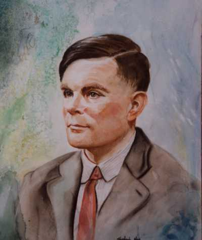

> One day ladies will take their computers for walks in the park and
> tell each other, "My little computer said such a funny thing this
> morning." \-- Alan Turing

I can't help thinking of Alan Turing's words when I look at this
photograph: 

 

> 'One day ladies will take their computers for walks in the park and
tell each other, "My little computer said such a funny thing this
morning."'

As [Tom Siegfried says](//www.sciencenews.org/view/feature/id/341450/title/A_Mind_from_Math),
if you don't like the way computers have taken over the world,
you can blame Turing.

A hundred years ago there were no computers. In fact the word computer was
used for a person who performed calculations by hand,
usually a woman. Almost 200 years ago a remarkable computer was born
who came to be known as Lady Ada, Countess of Lovelace, daughter of the
great English poet Lord Byron.

 

Lady Ada was a pupil of 
[Augustus De Morgan](//es.wikipedia.org/wiki/Augustus_De_Morgan), the famous British
logician. On one occasion, at the De Morgans' house, the inventor Charles
Babbage was demonstrating his Difference Engine, and De Morgan's wife recorded in
her memoirs the impression the invention made on the young woman:

> "While the rest of the party gazed at this beautiful invention
> with the same sort of expression and feeling that some savages are said
> to have shown on first seeing a looking glass or hearing a gun, Miss Byron,
> young as she was, understood its working and saw the great beauty of the
> invention."

Lady Ada and Charles Babbage worked together, and the inventor admitted that
she understood and explained the advantages of his machine far better than he did.
The big difference between Babbage's invention and earlier
attempts is that it was a digital machine (it performed calculations by
counting), and it combined logic to define its operations. Ada
understood this very well and developed a series of concepts for
programming this difference engine (as a bit of trivia, she invented
the concept of the loop). Sadly this great woman died of cancer
at 36 and Babbage's project was abandoned.

Another pupil of De Morgan's was George Boole. Babbage did get to
meet him, and although he was the same age as Ada, it seems they never
met. Perhaps if they had, the computer would have been
invented almost 150 years ago.

 

At 17, George Boole had a revelation while walking through a
park: he thought that all human reasoning could be expressed in the
form of an algebra. With Boole's algebra every logical problem
could be reduced to equations, a piece of knowledge that went ignored
for generations. 
In [the words of Howard Rheingold](//www.rheingold.com/texts/tft/2.html), 
"The problem, at the time, was that nobody cared. Partly because he was
from the wrong social class, and partly because most mathematicians of his
time knew very little about logic, Boole's eventual articulation of this insight
didn't cause much commotion when he published it."

Boole was convinced that logic was the key to understanding human
reasoning. His system is simple, and it uses the elements of the
algebra we all learn in school, but restricted to only two
possible values: the Universe and Nothing, represented by the numbers 1
and 0 respectively. The 1 and the 0 provide an ideal method for
analyzing the logic of two-state devices such as electrical relays
or vacuum tubes.

## The birth of computers

A hundred years after Babbage's attempts the computer was born in the
form of an esoteric paper on mathematical logic. In 1936 Alan
Turing was finishing an article he did not expect to be
understood by more than a dozen people in the whole world.



Despite coming from an upper-middle-class family, the way he dressed,
his careless grooming and his harsh, hesitant voice provoked a degree of
rejection from his classmates. He had few friends in
academia, and preferred to ignore them, burying himself in chess
problems, running chemistry experiments or running. Turing was a
runner.

Like Boole, Turing believed there had to be a mathematical model
that could simulate the way people reason.

Turing's achievement, which we will analyze in more detail later on, is
that he devised a machine that contains all the rules of a formal system,
and showed that it makes it possible to determine whether a mathematical statement is or
is not decidable within that formal system.

Turing asked himself what a human does when processing symbols
during a calculation. He assumed that mental calculations consist of
transforming the input numbers into a series of intermediate states
that progress sequentially according to a fixed set of rules
until the answer is found.

Sometimes we use pencil and paper to keep a record of the intermediate
states of our calculations. The rules of mathematics
require more rigid definitions than the mental states studied
by philosophers or metaphysicians, so Turing concentrated on defining these
states as clearly and unambiguously as possible, so that the
description could be used to command the operation of a machine.

Turing argued that this machine, given the right configuration,
would in principle be able to tackle any mathematical problem, and the
goal of his thesis was to demonstrate the real capability of this
device.



The Turing machine is relatively simple. Its design consists of
three parts: an infinite tape of squared paper, where symbols can be
written in each square; then a head that can write
symbols on the paper or read them, making it possible to decode them; and
finally a rule book that tells the machine what to do
depending on the symbol under the head.

These rules tell the head how to respond to a given symbol and
then which rule to use next.



For example, suppose the head detects a 1 on the tape. One
rule might be to move the head one square to the left and
write a 1, or to stay on that square, erase the 1 and leave the
square blank. By designing the right set of rules you can
get this mechanism to compute any number that can be
computed and write it out as 0s and 1s.

The remarkable thing is that Kurt Gödel had earlier managed to establish a
mechanism for representing any mathematical expression as a single
number (a process known as Gödelization). Since the Turing
machine can compute numbers, it seemed this machine would be able
to analyze any mathematical expression and determine whether it is computable
or not.

Turing's contribution to mathematics was to show that there are mathematical
expressions that are not computable by this machine, and with that he
established the limits of computation (and of formal mathematical
reasoning).

This settled one of the open problems of mathematics
at the time: "is there some formal procedure for determining whether
a given mathematical statement is provable?" Turing's answer to
this problem is a resounding NO.



Turing was not the only one to prove this; the American mathematician
Alonzo Church had established the same result. What was new about
Turing is that his proof is simpler, and the invention of the
mechanism, a machine that is the theoretical basis for building a
computer. Later Turing goes to Princeton to study with
Alonzo Church and proves that both results are equivalent.

Turing himself argues from the start that it is possible to build
this kind of machine, and he also generalizes the concept. The Turing
machine requires a set of rules that must be configured according
to the kind of problem to be solved. The generalization is that the set of
rules can be read at the start from the paper tape itself.
This is known as the Universal Turing Machine.



During his time at Princeton Turing discusses these ideas with John von
Neumann, and the result is that these principles were built into the
design of the first modern computer architecture. That set of
rules preloaded into the Turing machine is what we now know
as a program, and the von Neumann machine establishes it
as a fundamental requirement for operating.

Around that time Claude Shannon took Boole's work and applied it to the
design of logic circuits, creating the concept of logic gates and
showing how it was possible to build electrical circuits capable of
modeling logical statements. It was now possible to put flesh on Turing's
ideas. Shannon also knew von Neumann.

We know the three of them exchanged views on the subject, something
I told in 
[A lunch at Lafayette Square](/en/blog/lnds/2012/03/31/a-lunch-in-lafayette-square/). The
Turing machine took shape in real computers thanks to the
work of Shannon and von Neumann and of many British and
American engineers in the 1940s.



Every modern computer, and a large part of our society today, depends
on the workings of this machine, probably the machine that has had the
greatest impact on humanity. We depend on them more and more, and
we will probably depend on them much more in the future to carry out
our activities, from communicating to controlling our
energy sources. If anyone is to blame for all this, that someone
is Alan Turing, and that is why it is a shame that so little is known about
him.

This man is on the level of Galileo, Newton, Einstein or Darwin. He is
one of the great minds of our history, and his story has a
drama matched by almost no other great scientist (perhaps the closest
is the case of Galileo). That is why I am devoting my time to
writing to you about him, about his life, his disgrace and his redemption. Because
you would probably not be here if it weren't for him. I don't just mean
that the internet as we know it would not exist; our
historical context would probably be a different one, with Nazi Germany winning
the Second World War, for example. We will see what Turing's
contribution as a war hero was.

Today is Father's Day, and what better way to celebrate it than by saluting the
true father of computing, the man who made it possible for the ideas of
Babbage and Ada Lovelace to actually materialize. Happy Father's
Day, Alan Turing!

