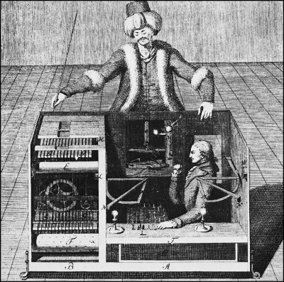
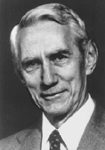
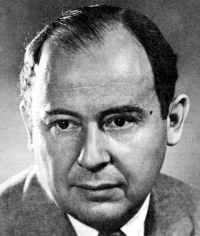
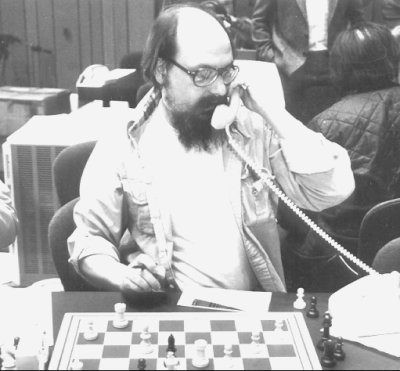
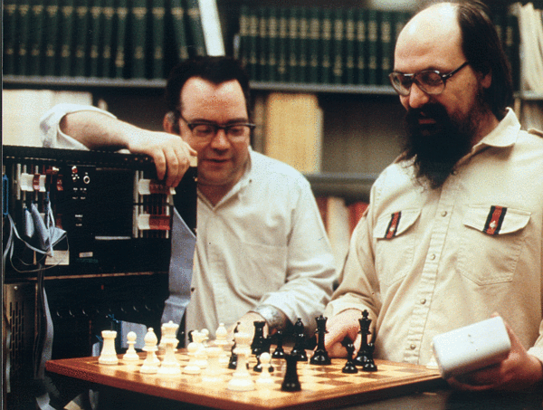

Chess was one of Alan Turing's passions. In fact he shared
the hobby with Shannon and John von Neumann, and the challenge of the
game has been on the minds of many of the great pioneers of
computing.

The history of chess played by a machine goes way back. The famous
case is the
[Mechanical](http://www.portalajedrez.com/anecdotas/turco.php) [Turk](/en/blog/lnds/2005/11/04/artificial-artificial-intelligence/),
a machine dressed up as a Turk that is said to have beaten even Napoleon
Bonaparte. In reality there was no mechanism at all: it was
operated from the inside by the Austrian chess champion Johann
Allgaier.

## **Turing**

In a 1948 report titled "Machine Intelligence" he wrote:

> It is not difficult to devise a paper machine which will play a not
> very bad game of chess. Now get three men as subjects for the
> experiment. A, B and C. A and C are to be rather poor chess players, B
> is the operator who works the paper machine. \... Two rooms are used
> with some arrangement for communicating moves, and a game is played
> between C and either A or the paper machine. C may find it quite
> difficult to tell which he is playing.

In this text we can see the seed of the famous [Turing Test](http://es.wikipedia.org/wiki/Test_de_Turing) (which we will look at in another of these articles).

In fact he later designed the instructions for a machine capable
of playing chess, and since there were no machines at the time that could
run the instructions he wrote (the program), he decided to act
as a "human CPU" himself, which took him about an
hour and a half per move. In other words, he executed his own proposal, and we have the
record of one of his games, in which Turing's paper machine
loses to one of his colleagues.

Chess game between Turing's paper machine and Alick
Glennie, Manchester, 1952:

> 1.e4 e5 2.Nc3 Nf6 3.d4 Bb4 4.Nf3 d6 5.Bd2 Nc6 6.d5 Nd4 7.h4 Bg4 8.a4
> Nxf3+ 9.gxf3 Bh5 10.Bb5+ c6 11.dxc6 0-0 12.cxb7 Rb8 13.Ba6 Qa5 14.Qe2
> Nd7 15.Rg1 Nc5 16.Rg5 Bg6 17.Bb5 Nxb7 18.0-0-0 Nc5 19.Bc6 Rfc8 20.Bd5
> Bxc3 21.Bxc3 Qxa4 22.Kd2? \[22.h5 would have won the bishop\]
> 22\...Ne6 23.Rg4 Nd4? \[23\...Rxb2! 24.Bxb2 Rxc2+\] 24.Qd3 Nb5 25.Bb3
> Qa6 26.Bc4 Bh5 27.Rg3 Qa4 28.Bxb5 Qxb5 29.Qxd6 Rd8 0-1.

## **Shannon**

Claude Shannon,
creator of information theory, analyzed the problem in 1950 and
considered two kinds of strategies, one of brute force (Type A) and another,
more selective one (Type B).

Shannon considered Type B algorithms more efficient, because
they consume fewer resources and take less time. Yet the best
chess programs are Type A, because in practice the problem
of selecting the most plausible moves at a given moment is
a very hard one, and advances in hardware have made it possible to
overcome some of the objections about running time that
Shannon raised in his study.

## **John von Neumann**

During the development of the atomic bomb one of the hard problems
was calculating the right shape for
the implosion charges that trigger the chain reaction. The
construction of a computer to do those calculations was entrusted
to John von Neumann.

In 1950 von Neumann's work took shape as a gigantic machine
called MANIAC I. Made of thousands of vacuum tubes and relays, it could
execute 10,000 instructions per second and it was
programmable (remember that the von Neumann model is the standard in
almost every modern computer).

Instead of getting to work on the atomic bombs right away, the
scientists decided to put the machine to a more interesting use, and the
first thing they did was write a program that played chess. A
special kind of chess, mind you, where the board had 6×6 squares
and no bishops. With these restrictions the program could analyze
moves up to 4 levels deep and took about 12 minutes to
do it (if the bishops had been included the task would have taken
three hours).

Three games were played with this program in the mid-fifties: the first
against itself, won by white; the second against
an expert player, who took 10 hours to finally lose; and the
third against a young volunteer (who had learned to play a
week earlier). In that one the human lost in less than half an hour, and
we have the record of that game too (remember it is a
6×6 board with no bishops):

> MANIAC 1 - Human, Los Alamos 1956: 1.d3 b4 2.Nf3 d4 3.b3 e4 4.Ne1 a4
> 5.bxa4? \[5.Nd2 and 6.Nd2-c4+ Nbcxc4 7.b3xc4 with a good game\]
> 5\...Nxa4 6.Kd2? Nc3 7.Nxc3 bxc3+ 8.Kd1 f4 9.a3 Rb6 10.a4 Ra6 11.a5
> Kd5 12.Qa3 Qb5 13.Qa2+ Ke5 14.Rb1 Rxa5 15.Rxb5 Rxa2 16.Rb1 \[to
> prevent 16\...Ra1 mate!\] 16\...Ra5 17.f3 Ra4 18.fxe4 c4 19.Nf3+ Kd6
> 20.e5+ Kd5 21.exf6Q Nc5 22.Qf6xd4+ Kc6 23.Nf3-e5 mate.

This game is the first time a computer beat
a human.

**Ken Thompson**

The last computing pioneer
we will talk about, one who also took part in the race
to build a machine capable of beating a human being, is Ken Thompson,
who created the UNIX operating system together with Dennis Ritchie.

In the early 80s Thompson and some colleagues at Bell Labs
built a machine designed specifically to play chess. It
was in fact the first machine to reach master level, in 1983.

The machine, affectionately called Belle, cost about 20,000 dollars and
could analyze 180,000 positions per second (the
supercomputers of the day could only manage 5,000 positions).

This computer was so powerful that it was confiscated by the US Department
of Defense when the team tried to take it to a
tournament in the Soviet Union in 1982.

Belle was the unbeatable champion in nearly every computer
tournament between 1980 and 1983, until it was defeated by the
Cray XMP supercomputer, which cost a thousand times more.

**Deep Blue**

We will never know what Turing would have thought of Deep
Blue, the famous supercomputer built by IBM that defeated
world chess champion Garry Kasparov in 1997.

The team that developed Deep Blue was made up of Jerry
Brody, Murray Campbell, Feng-hsiung Hsu, A. Joseph Hoane Jr., Joel
Benjamin and Chung-Jen Tan.

Kasparov's defeat inspired Omar Syed to create Arimaa, a game that
poses a bigger challenge than chess for an artificial
intelligence.

> "Syed was inspired by Garry Kasparov's defeat to design a
> new game that could be played with the same set of chess
> pieces, that would be hard for a computer to play well, but
> that would have rules easy and simple enough for his four-year-old
> son, Aamir, to understand. The name "Arimaa"
> comes from "Aamir" spelled backwards plus an initial "a". In 2002,
> Syed published the rules of Arimaa and announced a prize of 10,000
> dollars, available annually until the year 2020, for the
> developer, group or corporation that created the first computer
> program (running on cheap, commonly available hardware)
> able to beat a top-level player in a match of six
> games or more."

According to [Wikipedia](http://es.wikipedia.org/wiki/Arimaa):

> "The successful construction of a world-championship-caliber chess
> program has produced many techniques for
> playing well, but it has contributed nothing to
> making these programs more intelligent in general; in fact, the
> techniques of chess-playing programs have been excluded from
> some definitions of artificial intelligence. One goal of Arimaa is
> that the techniques used to get a computer to play it
> will help achieve larger goals in the field of artificial
> intelligence."

True, we cannot know what Turing would have thought of Deep
Blue, but it is easy to imagine he would have been pleased with Omar
Syed's challenge, since it is very much in line with his restless spirit, always looking for
new challenges for his restless mind.

Sources:

-   [A short history of computer chess](http://www.chessbase.com/columns/column.asp?pid=102)

-   [KEN, UNIX, AND GAMES](http://cm.bell-labs.com/cm/cs/who/dmr/ken-games.html)

-   Wikipedia [Arimaa](http://es.wikipedia.org/wiki/Arimaa)

-   [Official Deep Blue page at IBM](http://www-03.ibm.com/ibm/history/ibm100/us/en/icons/deepblue/)
