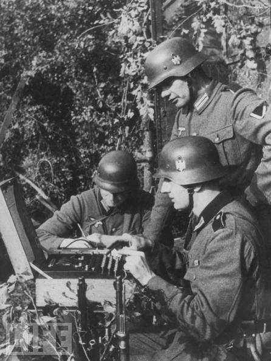
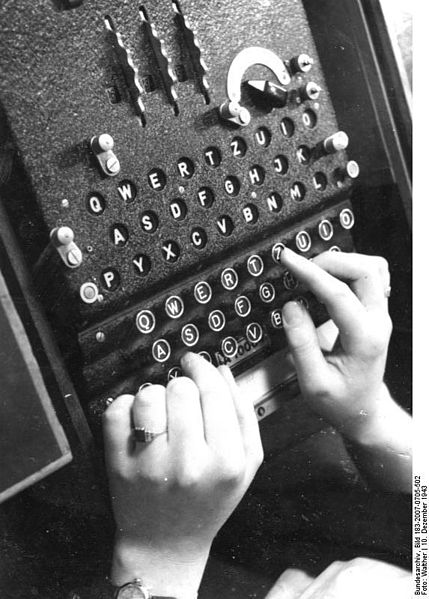

You may not know this, but Alan Turing and Ian Fleming (the author of the
novels about Bond, James Bond) worked together.

During the Second World War Alan Turing led the Hut 8 group at
Bletchley Park, the headquarters of the  
[Government Code and Cypher School (GC&CS)](http://en.wikipedia.org/wiki/Government_Communications_Headquarters#Government_Code_and_Cypher_School_.28GCCS.29).
Hut 8 was in charge of breaking the secret codes
created with the Enigma machines used by the German navy. This
famous machine had an encryption mechanism that was considered
impenetrable at the time.

The photograph shows three German soldiers using one of these
devices.

The Enigma machine is an electromechanical device. From the point
of view of the "user interface", it has a keyboard where you type
the message in plain text, and at the top, on a lamp board,
the lights come on with the letters that make up the ciphertext. The
mechanism is symmetric, so to decipher a text you perform
the same operation: you type the ciphertext on the keyboard and the
letters of the decrypted text light up on the lamp board.

A mechanism of rotors and plugs is used to configure the machine for
operation, and this initial setup is the **encryption
key**. These keys were changed every day, and were
recorded in codebooks that were distributed to the various
units of the German army and navy.

I am not going to describe in detail how Enigma works; I would need
a fairly long article to explain it. You can dig into the
details in [this Wikipedia article](https://es.wikipedia.org/wiki/Enigma_(m%C3%A1quina)),
although I recommend reading the book 
"[The Code Book](http://amzn.to/MzGq3g)" by Simon Singh

An early version of the Enigma machine was broken by
Polish intelligence before that country was invaded by the
Germans in September 1939. The Germans added more complexity to
the machine, adding new rotors and plugs. The number of
possible combinations to go through to determine the encryption key
was astronomical.

Turing had the advantage of his theoretical work devising his famous
universal computing machine. When he joined the team of codebreakers at
Bletchley Park he was able, in a few weeks, to devise a mechanism capable of
determining the keys of the Enigma machines used by the German
army. His work led to the design of machines called Bombes, which
could calculate the keys in a few hours.

However, the Enigma machine used by the German navy was more
sophisticated, and on top of that this group applied "best practices" that
made decryption harder. For example, the cryptanalysts relied on
stereotyped messages to determine "cribs", sequences
of text that could be "guessed" and that made the
bombes' work easier. The German sailors avoided that kind of
stereotyped message.

For months Turing's team could make no progress deciphering
the German messages. That was when Ian Fleming suggested
[Operation Ruthless](https://en.wikipedia.org/wiki/Operation_Ruthless).
A plan to stage the crash landing of a German
bomber, with the idea that it would be rescued by a German ship, and in this way
steal the Germans' codebooks. Turing was
especially anxious for this operation to succeed, since having
those books would let him improve his decryption mechanisms. Although
Operation Ruthless was cancelled, the books were eventually obtained
in other attacks on German submarines and weather ships.

The information obtained by these teams of cryptographers made up a
body of intelligence known as
[ULTRA](https://en.wikipedia.org/wiki/Ultra).

Ultra gave the Allied command a high degree of confidence. It has even been
claimed that Ultra shortened the war by several years.
According to the historian David Kahn, breaking Enigma "saved
lives. Not only Allied and Russian lives but, by shortening the war,
German, Italian, and Japanese lives as well. Some people alive after World
War II might not have been but for these solutions.
That is the debt that the world owes to the codebreakers; that is the crowning
human value of their triumphs."

After the war ended the British captured thousands of
Enigma machines, which they gave away to their former colonies. Of course they never
revealed that these machines were completely transparent to their
cryptanalysts. For years the former colonies believed the Enigma machine
was unbreakable. That is the reason the contributions of Bletchley
Park stayed hidden for more than 30 years. That is the reason the
world did not learn of Turing's contribution during his lifetime.

In 1952 Turing reported a burglary at his home, and during the
investigation he naively revealed that he was in a homosexual relationship.
 The police decided to arrest him and charge him with "gross indecency
contrary to Section 11 of the Criminal Law Amendment Act 1885".
The trial was reported in the newspapers and Turing was publicly
humiliated. The British government withdrew his security
clearances, and he was barred from working on projects related to the
development of the computer. He was forced to see a psychiatrist and
undergo a hormone treatment that affected him physically: he was left
impotent and obese, developed gynecomastia (he grew breasts), and
fell into a deep depression. In 1954 he killed himself by eating an
apple poisoned with cyanide. The world lost one of its most
brilliant minds, and the savior of thousands, perhaps millions of lives, all because
of prejudice and intolerance.

References:

1.  [The Code Book](http://amzn.to/MzGq3g), Simon Singh,
    Editorial DEBATE.

2.  [The Codebreakers](http://amzn.to/KObEKa), David Kahn.

3.  [The father of computing](/en/blog/lnds/2012/06/17/the-father-of-computing/)
