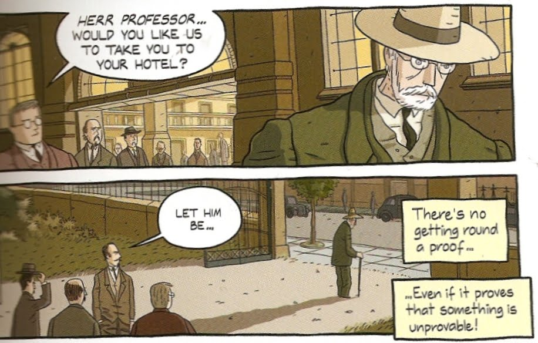

Yesterday's paper ran the headline "Computer failure paralyzes the Metro and leaves
37 thousand people without service." The riders' anger is understandable,
I was affected myself. I am not going to talk about this failure, since
I don't know the details. It could be anything from a programming error to a
cut communication line, but whatever it was, the incident reflects the
high degree of dependence our society has on
computers.

The reason is a fundamental principle of computing, described by
Andrew Hodges as follows:

> "Any mechanical process, no matter how ridiculous, evil, petty,
> wasteful or pointless, can be put on a computer."

And this principle has been established since 1936, thanks to Alan Turing. Yesterday's
failure in the Santiago Metro is not Turing's fault, but if
some programmer made a mistake in the system, it is a consequence of
this powerful principle.

The Turing machine is a universal machine.

Look at your smartphone. The computer replaces or controls any
machine we have created so far. Your phones are no longer just
phones, they are clocks, calculators, video cameras, still
cameras, barcode readers, game machines, maps, compasses,
radios, musical instruments, music players, long-distance communication
systems, televisions, and so on. All it takes is the
right software and our phone can turn into
anything. It is almost like magic.

"Any sufficiently advanced technology is indistinguishable from
magic," said Arthur Clarke. Turing is the first sorcerer who gave us
the keys to master this magic. His universal machine is the spell
that made all this possible.

In 1935 Alan Turing was facing one of Hilbert's outstanding
challenges, known as the
[Entscheidungproblem](http://en.wikipedia.org/wiki/Entscheidungsproblem),
and that is what led to the creation of computers. This is part
of that story.

## Ignoramus et ignorabimus {#ignoramusetignorabimus}

These were hard times for the Republic. The forces of the dark side
were winning more and more followers. Many Jedi were perishing at the hands of the
Sith\... um, sorry, that's another story.



But yes, the truth is that the first decade of the twentieth century really was a hard
time for mathematics. The discipline was in a deep
crisis over formalism.

The formalist school is a group of mathematicians who held
that "mathematics is a game ---devoid of meaning--- that
one plays with meaningless symbols according to
formal rules established beforehand". David Hilbert was a
German mathematician who had founded this school of thought. He
was annoyed at the time by the paradoxes that kept turning up
in the works and attempts to axiomatize mathematics in those
days, such as Russell and Whitehead's monumental work
"[Principia Mathematica](http://es.wikipedia.org/wiki/Principia_mathematica)".

Hilbert was a strong-willed man who refused to consider
that the mind had any kind of limitation.



In 1880 the German physiologist and psychologist Emil du Bois-Reymond argued, in
a famous lecture at the Berlin Academy of Sciences, that there are
problems that neither science nor philosophy would ever be able to solve. He
summed this up in the Latin phrase "I*gnoramus et Ignorabimus*" ("we do not
know and we will not know").

To Hilbert that view was wrong, and in 1930 he replied:

> "We must not believe those, who today, with philosophical bearing and
> deliberative tone, prophesy the fall of culture and accept the
> \_ignorabimus. \_For us there is no ignorabimus, and in my opinion
> none whatever in natural science. In opposition to the foolish
> ignorabimus our slogan shall be  **Wir müssen wissen --- wir
> werden wissen!** ("We must know - we will know!").

What Hilbert did not know is that while he was speaking these words a
quiet Austrian mathematician was tearing his whole program apart with a
brilliant theorem.

In 1920 Hilbert had proposed a research program to
resolve the paradoxes of mathematics and establish a formal system
that would give the discipline solid foundations.

Hilbert asked that mathematics have, among others, these
attributes:

-   **Formalism**, that is, all mathematical statements
    should be written in a precise formal language and manipulated
    according to well-defined rules.

-   **Completeness**, a proof had to be given that all
    mathematical statements can be proved within the formalism.

-   **Consistency**, Hilbert asked for a proof that no
    contradiction can be obtained within the formalism of
    mathematics.

-   **Decidability**, there should be an algorithm for deciding the truth or
    falsity of any mathematical statement.

Kurt Gödel's work ruled out the first three attributes
Hilbert asked for: it is not possible to fully formalize
mathematics, so it cannot have the property of
completeness, and on top of that it cannot be consistent. 
I [mentioned this earlier](/en/blog/lnds/2012/06/21/right-and-wrong/).

The problem of Decidability remained open. Gödel got close to this
problem, but solving it required a good definition of
what was meant by an algorithm.

## The Entscheidungsproblem {#elenstscheindungproblem}

The decidability problem is the
famous [Entscheidungproblem](http://en.wikipedia.org/wiki/Entscheidungsproblem).
What Hilbert asks for is a mechanism that makes it possible to determine
whether a given statement is valid within a formal system, or whether
there is a way to decide if a mathematical statement can be
proved from a set of axioms by following the rules of
logic.

The answer given first by Alonzo Church and then, independently
and very shortly afterward, by Alan Turing was that it was not
possible. And poor Hilbert was left without a program :pensive:

Turing later went to study with Alonzo Church and they showed that
both proofs were equivalent. What was new about Turing's method is that
to develop his proof he built an ideal machine that simulates the
states we go through when reasoning mathematically.

This machine is really the description of a computer program.
Turing found a way to build the hardware and the software into the
same idea. The hardware that serves as the substrate for the instructions
contained in the software.

Turing taught us the true **Nature of Software**, and that is why
his achievement is so important, and why we celebrate his centenary today.

Read also:

-   [Right and wrong](/en/blog/lnds/2012/06/21/right-and-wrong/)

-   [The father of computing](/en/blog/lnds/2012/06/17/the-father-of-computing/)

-   [Turing, Alan Turing](/en/blog/lnds/2013/11/06/turing-alan-turing/)

Bibliography

If you want to know more about this subject I recommend these books and comics

-   [Turing The Enigma](http://amzn.to/NfivHu), Andrew Hodges

-   [The Annotated Turing](http://amzn.to/NFIQDg), by Charles Petzold

-   [Logicomix](http://amzn.to/L439pN), by Apostolos Doxiadis, Christos
    Papadimitriou, Alecos Papadatos and Annie Di Donna.

-   [The Information](http://amzn.to/MFqcHX), by James Gleick
