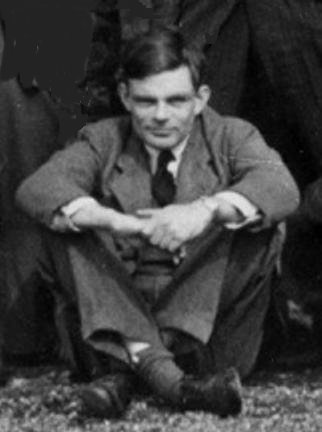

The [father of computing](/en/blog/lnds/2012/06/17/the-father-of-computing/)
was gay. The [hacker who broke the Nazis' secret codes](/en/blog/lnds/2013/11/06/turing-alan-turing/) was
tried and convicted on the basis of prejudice and intolerance. The
[mathematical genius](/en/blog/lnds/2012/06/23/universal-machine/)
died when he was just 41 years old, and whether he was driven to suicide or
it was an accident is [an open question once
again](http://www.bbc.co.uk/news/science-environment-18561092).

His death has traditionally been considered a suicide, although his
mother long maintained that it was an accident. The field is
wide open for conspiracy theories: after all, Turing
held many military secrets; after all, his death was
convenient.

## The search of a lifetime 

In 1928 Alan Turing was a lonely 16-year-old studying at
Sherborne School, an institution where the focus was on the humanities
and a classical education, and the sciences were looked down on. Alan had other
interests that clashed with the atmosphere of the school. Around that time
he had read a popular account of Einstein's work on the theory of
relativity. One of the things that caught his attention in
Einstein's work was how this great scientist had doubted the axioms of
Newtonian physics. He noticed that Einstein avoided philosophical
discussions about what time and space were and concentrated on something that could be
done.

Young Turing develops a passion for science. He wanted to complete
Einstein's ideas, and in fact he formulated corollaries to the general theory
of relativity that Einstein had not yet published. However,
these interests did not find the necessary support in his teachers.
But there was a boy, barely a year older than he was, thin and sickly,
who took scientific ideas with the same intensity as Alan. Everything
suggests this boy was more brilliant than Alan himself. He was
Christopher Morcom. Meeting him allowed Alan Turing, for the first
time, to communicate deeply with a human being other than
his mother. Morcom was his first love, a feeling he kept
secret and never revealed to him. We know a lot about this friendship
thanks to the testimony of Turing himself, who in 1930 wrote a series
of letters to Morcom's mother after Christopher's unexpected
death from bovine tuberculosis, contracted by drinking
infected milk several years earlier.

Morcom's death inspired Turing to do better in his studies. In one
of the letters he asks Christopher's mother for a photograph of the
boy, which he kept on his desk as inspiration and as a spur
to study and make it to Cambridge.

The loss also affected him deeply, to the point that he became obsessed
with discovering the nature of consciousness, its structure and origin.
His letters to Mrs. Morcom reveal that he longed to know what
had become of Christopher, of that essential aspect of him: the mind.

## Studies

Turing decided to study philosophy, metaphysics, biology and above all
mathematics, logic and quantum physics. He wanted to understand how
that thing we call mind is embodied. And since he liked to play with and explore
mechanical devices, it is natural that he developed his central idea that
the mind is a machine. The question was how a machine could
evolve from simple, predictable mental operations to a level of
complexity capable of producing great innovations.

Getting into King's College, Cambridge, gave him an
environment where he could freely explore his thinking. At
22 he had already written an important contribution to the field of
probability, which earned him a fellowship at the
university. But he also found in the university environment greater
acceptance of his eccentricities and tolerance of his sexual identity, even
though homosexuality was illegal in England at the time.

It was in 1935, during his graduate years at Cambridge, that he attends a
series of lectures by Max Newman on the "Foundations of Mathematics",
which included the debate between Gödel and Hilbert. In those lectures he
learns of the third problem posed by Hilbert, that of
decidability. It is in this period that his idea of visualizing an algorithm as
a machine surprises the mathematical world and lays the groundwork for the
creation of the first computers.

He travels to Princeton to continue his studies and earn his PhD. And
although he keeps working in mathematics, he simultaneously explores the
development and application of computing devices. The war gives him the
opportunity to design his first concrete machines, working on
breaking the Enigma codes at Bletchley Park.

Around that time Turing introduces Tommy Flowers to the team of
cryptographers; Flowers, guided by Max Newman, develops the world's first digital
computer, Colossus.



After the war he is asked to design a computer for the
National Physical Laboratory in London, a project known
as ACE (Automatic Computing Engine). The ACE was an
extraordinary machine with a more advanced and sophisticated design than the
EDVAC computer developed by John von Neumann in the United States.
Turing thought speed and memory size were crucial.
He proposed a memory with a capacity equivalent to 25 kilobytes and
a speed of 1 MHz. Unlike the EDVAC, the ACE had support
for subroutines and an abbreviated instruction system. He proposed that the
work be led by Tommy Flowers, whose work on Colossus was
secret.

Unfortunately bureaucracy, and ignorance of Colossus,
cast doubt on the success of Turing's design. Several
modifications were made and a simpler version was built. Turing became
disillusioned and returned to Cambridge, where he focused his research on
neurology and the notion of the electronic brain.

# Electronic brains 

In 1948 his friend Max Newman invited him to work on the development of the
Mark I, a computer built at the University of Manchester. During
this time Turing takes part in software development, programming
for the project.

In 1946 Lord Mountbatten had introduced the term electronic
brain while speculating about the development of the primitive
computers of the time. In 1949 the pioneer of neurosurgery,
Sir Geoffrey Jefferson, set out to discredit the Manchester
project, writing in a speech:

> "Not until a machine can write a sonnet or compose
> a concerto because of thoughts and emotions felt, and not by
> the chance fall of symbols, could we
> agree that machine equals brain---that is,
> not only write it but know that it had written it. No mechanism
> could feel (and not merely artificially signal, an easy contrivance) pleasure at its successes, grief when its valves fuse,
> be warmed by flattery, be made miserable by its mistakes, be charmed by
> sex, be angry or depressed when it cannot get what it wants."

Newman responded with an article in the Times detailing the parallels
between the Mark I and the human brain. Newman's article includes an
interview with Turing, who stated

> This is only a foretaste of what is to come, and only the shadow of what is
> going to be. We have to have some experience with the machine before we
> really know its capabilities. It may take years before we settle down
> to the new possibilities, but I do not see why it should not enter
> any one of the fields normally covered by the human intellect,
> and eventually compete on equal terms.



In 1950 Turing publishes his influential paper "Computing Machinery and
Intelligence", where he proposes his famous test. To deal with the
objections of people like Sir Geoffrey Jefferson, and others, he decides to take a
more pragmatic path. Since the words "machine" and
"thinking" mean different things to different people,
instead of asking "can machines think?", Turing suggests
replacing the question with something less ambiguous and closely
related.

Instead of determining whether a machine is thinking, Turing suggests
we ask whether a machine can win a game, called "The Imitation
Game". The game involves three participants in three
isolated rooms: a computer (the one being tested), a human, and a human
judge. The judge converses with both the computer and the other human
through a terminal. Both the computer and the human try to
convince the judge that they are human. If the judge cannot
consistently tell which is which, the computer wins the
game.

Although the test is now considered inadequate, his
proposal inspired a great deal of work in the field of artificial
intelligence. Even today a reverse version of the test is used
against us in the form of the annoying
[CAPTCHA](http://es.wikipedia.org/wiki/Captcha)s used for entering
information in web forms.



## Morphogenesis

Although his interest in computers never waned, in his last years
he turned his mind to new areas of exploration in the field of
biology. The intrigue began with the way Fibonacci numbers seem to show up in
nature, especially in the shape and structure
of plants, where it is most evident. Inspired by the biologist and
mathematician [D'Arcy Thompson](http://es.wikipedia.org/wiki/D'Arcy_Wentworth_Thompson),
he explored the notion that biological form was the product of a
chemical process. In 1952 he published a paper titled "[The Chemical Basis of Morphogenesis](http://www.dna.caltech.edu/courses/cs191/paperscs191/turing.pdf)".

Turing was an experienced chemist. He had been passionate about
chemical experiments from a very young age, and kept a small laboratory
in his bedroom. His work on morphogenesis turned out to be provocative and
original. Only 40 years later was scientific evidence found
for his proposals, in what are known as Turing structures and
Turing patterns.



This work, by the way, is just another manifestation of his search for
a mathematical and mechanical interpretation of life and its structures.
All of it is a search for the tools that would make it possible to develop
artificial life and intelligence.



Was Turing trying to build a soulmate with whom to share his
deepest feelings? Did he feel so alone and misunderstood in this
world that he wanted to create a synthetic soul to share his life with?
Did he want to resurrect his beloved Christopher Morcom by embodying him in one
of his computers?

## The mystery of his death

In 1952, during the investigation of a burglary at his house, he revealed that one
of the young men involved in the incident might have been his young
19-year-old lover. Since homosexual acts were illegal in
England at the time, Turing was immediately arrested and put on
trial. He was found guilty under the law against "gross
indecency". To stay out of prison he agreed to undergo psychiatric
therapy and a hormone treatment. One of the side effects,
which Turing himself told his friends about, is that he became
impotent and grew breasts (gynecomastia).

Having been declared a criminal, Turing lost all his security
clearances and was not allowed to work on cryptographic projects or on
the development of computers for the government. Turing was
stigmatized. British intelligence considered that as a
homosexual he was more exposed to blackmail, and so he was
deemed a high-risk person. Turing was in possession of a great deal of
confidential information.

It has been suggested that his death was a murder staged by the British
security services. His mother considered it an accident.

Officially Turing died by suicide in a strange way, biting into
an apple poisoned with cyanide. According to Andrew Hodges, the
film Snow White was his favorite, and several acquaintances reported
hearing him chant the witch's macabre couplet: "Dip the
apple in the brew, let the sleeping death seep through."

The mystery of his death is still there. According to the testimony of his friend
Robin Gandy, who spent the weekend before his death with
Turing, there were no signs revealing suicidal intentions. On the
contrary, he seemed in good spirits, and despite the discomfort and the year
of hormone treatment, he appeared to be fine. He even seemed
happier than usual.

Turing handled cyanide, and he was a careless experimenter. On one
occasion he electrocuted himself, and he tasted compounds with his tongue to
identify them. At the time he was doing electrolysis in cyanide
solutions and gold-plating spoons, a process that requires potassium
cyanide. The electrolysis experiments were wired to the
light fittings in his room. It is likely, as his mother suggested, that he
accidentally put the apple in contact with the cyanide. Or
perhaps, and this is more likely, he accidentally inhaled cyanide
fumes from the bubbling liquid. The distribution of the poison in
Turing's organs, according to the autopsy, is more consistent with
death by inhalation than by ingestion, according to Professor Jack
Copeland, who 
[presented a new theory about Turing's death at Oxford](http://www.bbc.co.uk/news/science-environment-18561092) 
in the last few days.

We will probably never know the cause of Turing's death, just as
we will never know what his legacy would have been had he lived to
our day. His contributions would likely have been astonishing,
considering he died so young.

Whether Turing died because of intolerance is an open question,
but we do know that intolerance affected him deeply. As
a colleague of his at Bletchley Park said, fortunately the authorities of the
time did not know that Turing was homosexual, or
the war would have lasted several more years.

Nor can we know his personal motivations, but everything suggests
that his drive to develop an intelligent machine may have a
deeper psychological origin than we suspect.

Turing's work cannot be separated from his reality as a person, and
his work cannot be understood without understanding his life. That makes him
a complex, valuable and admirable person.

With this we end this humble tribute to the father of computing.
I have barely scratched the surface of a complex life, full of details and
achievements. I invite you to keep digging and learning about the contribution
of this great thinker.

Read also:

-   [A lunch at Lafayette
    Square](/en/blog/lnds/2012/03/31/a-lunch-in-lafayette-square/)

-   [The father of computing](/en/blog/lnds/2012/06/17/the-father-of-computing/)

Bibliography:

-   [Alan Turing article at
    NNDB](http://www.nndb.com/people/952/000023883/)

-   [Turing The Enigma, Andrew Hodges](http://amzn.to/NfivHu)

-   [Alan Turing´s Patterns in Nature and
    Beyond](http://www.wired.com/wiredscience/2011/02/turing-patterns/),
    article in Wired Science

-   [Controversia sobre Mentes y Máquinas](http://amzn.to/KGOX9A) (the Spanish edition of Minds and Machines),
    various authors; this book includes Turing's paper where he
    describes the imitation game.
