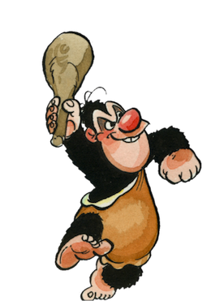
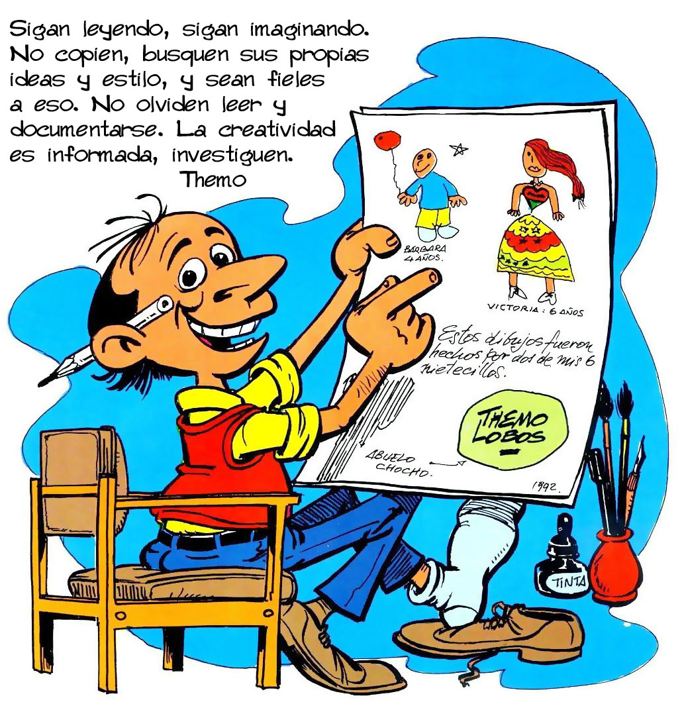

A few months ago I met Ada, the daughter of Themo Lobos, the great Chilean
cartoonist. We met one midday in the cafeteria of a university
where she teaches. The reason for our meeting was to ask
permission to use the image of Ogú as the mascot for an open source
project I wanted to start.

I never met Themo; the closest I got to him was this
contact with Ada. Themo's generosity surprised me. He understood
the idea of the project perfectly and "gave" me one of his
"monitos", his little cartoon characters, to be used as the first logo of
[Ogu](https://www.ogu-lang.org/), that programming language I am
developing (if any of you feel like helping me, we can
finish it soon).

I promised Themo that the main use of this project would be to teach
young people to program, and he loved that idea. At the time he was
in rather delicate health, but through his daughter I learned that
he was following with interest several projects around his creations, and the
publication of the collection of his main comics, along with some
unpublished ones, such as "Ogú y Mampato en el Tíbet" and "Ogú y Mampato en la ciudad
azteca", the latter due out in the coming months. So
with great humility and joy I received his little character and promised to use it
properly. Unfortunately, the time and dedication have not been
everything I would have liked. That's why I feel bad at the sad news of
his death. I'm sorry I couldn't move the project further along
and show it to him while he was alive. My dream was to go meet him and
show him what I was doing.

For many of the men and women of my generation Themo is a very
important figure. We grew up reading Mampato, a magazine created by
Eduardo Armtrong and published between 1968 and 1977. Of all its interesting and
educational reading, the things we remember most by far are the
adventures of Mampato, Ogú and Rena, the last two characters being
Themo's creations.

His style is remarkable, full of humor, and very well researched. It's
impossible to forget his take on history in the saga about the
Reconquista, or the trip to Rapa Nui's past. The adventure I like
best is the story of the Giant Tree and the Mutants' Rebellion that followed.
But there are many, and in the 80s Themo published several of them in
his own magazine, Cucalón, and later in several books, which are now
in my library and are read by all my children. They too
learned to appreciate this great artist.

Themo was much more than the adventures of Mampato. He drew several
different characters for other publications, such as Alaraco (who was
brought to television by Fernando Alarcón), Cucufato, Máximo Chambonez and
his Grandfather, Ferrilo the automaton, Ñeclito, Nick Obre, Martin Conejin,
Dokan el Barbaro, etc. There is a legend that says the true creator
of Condorito was him.

Themo was very generous, and unfortunately many people took advantage of his
good nature. Be that as it may, I believe he owned a far greater
wealth: the love all of us feel for him, those of us who read his
works, which kept us company in childhood. You have no idea how much
the news of his passing saddens me. I want to leave you with an image he sent to
a blog called [generación
Mampato:](http://generacionmampato.blogspot.com/)

So thank you, Themo. It feels like a friend is leaving. Thank you for the
act of generosity you showed me without even knowing me. I
promise I will do something good with it. Thank you for teaching me that
"creativity is informed". In your honor I raise my glass, to remember you.
Goodbye, friend. Goodbye, maestro.
