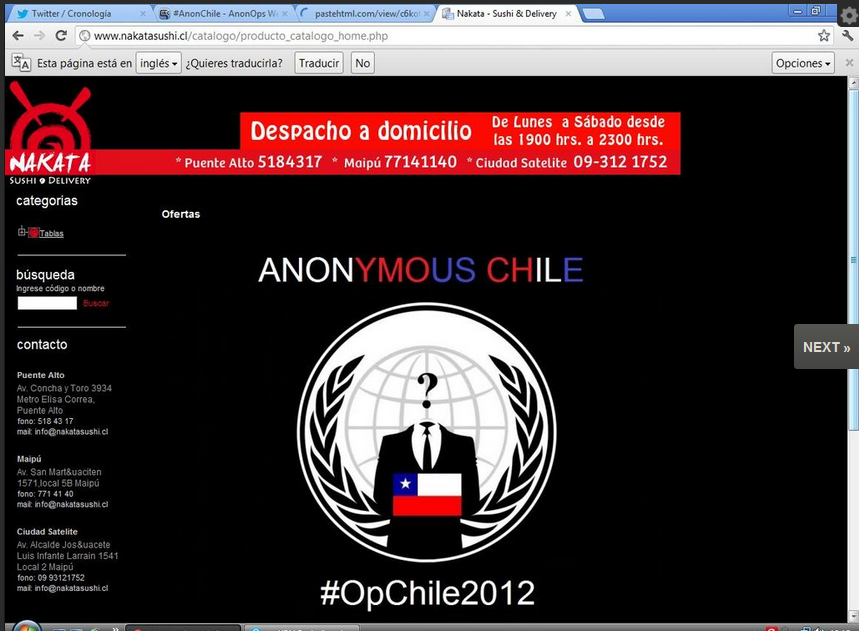

The [defacement](http://es.wikipedia.org/wiki/Defacement) of a sushi bar
in Puente Alto, one of the high points of Anoymous's \#OpChile2012 operation
yesterday, July 30:

What is the political message behind this?
