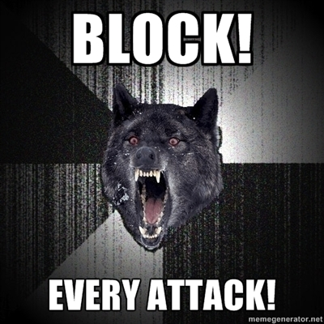

During this anniversary month we will have contributions from several friends who
have kindly agreed to send their pieces to this blog.
We start with this interesting and very useful article written by Daniel
Molina Wegener ([\@damowe](https://twitter.com/damowe)), software
architect, great programmer, and author of [coder.cl](http://coder.cl/).

Thanks, Daniel! I leave you to enjoy this excellent post (I, for one,
am going to go over this site and apply some of this advice):

## Preventing novice attacks

by [Daniel Molina Wegener](http://coder.cl/)

I'm a programmer, I like programming. That has been my professional focus
for many years. I like it so much that I now handle more than 10 programming
languages, and I currently work at a company that uses my
programming services in Assembler, C, C++, Haskell, Lisp, Python and Java. My
concern is not just learning languages; there is an important theoretical
background behind each language, and many things are not put there at random but
have an important theoretical framework in Computer Science, and
often a mathematical one. Finally, my third concern is how
to organize the performance of several languages within a given
architecture. This leads me to a skill area
known as systems administration.

A few days ago an Anonymous action was called through one
of their operations here in Chile. Since I have several friends who run
servers, I frequently get questions about what happened to
a certain page and how they managed to *change* the original page from
the outside. I believe **95%** of attacks on servers are the same. A
not very skilled individual uses very poorly administered servers outside
his home country to launch attacks prefabricated by foreigners ---
where you can even see the signatures of the attack developers
in the requests they make to the servers --- and they try to
exploit, typically, the extensions installed in content management
systems, which are often made by designers and not
programmers, with several errors in the validation of the data used by
those extensions, such as extensions able to upload
files with very little control.

The other detail is who the only beneficiary of the latest of this
kind of action is, when many of the servers have no relation whatsoever to
the goals that prompted it --- like a sushi restaurant and
similar sites. The simple fact of launching this kind of attack on
sites that have no relation whatsoever to the goal that prompted
the *operation* makes me think they are nothing more than crackers --- to me they
are not hackers; a hacker is a very skilled programmer or a very
skilled specialist in his field.

But avoiding this kind of attack is not such a complex task, and I believe
any systems administrator can protect his servers
against a significant number of these attacks, and the
developers in charge of the platforms can analyze the software
they are using in order to avoid them. Every system has some way of being
protected to some extent. Having a firewall is not enough; other
aspects must be considered. Below I present some
advice for protecting servers with freely available software ---
mainly Linux servers and the like.

### uploads and mod\_rewrite

If you are one of those people who use extensions for content management
systems without reviewing the code you are installing, the first thing you should
do is check which directories are used for uploading files in
that content manager and which modules the server is using to
interpret languages. If the web server has a PHP
interpreter, someone can upload a remote shell written in PHP that can serve as
a remote file explorer. Let's take the example of a CMS that uses the
/uploads directory to store uploaded files --- such as
images.

>     ErrorDocument     404     "404 - : ("
>     ErrorDocument     403     "403 - : ("
>
>     <IfModule mod_rewrite.c>
>
>     RewriteEngine     On
>     RewriteBase       /
>
>     RewriteCond       %{REQUEST_METHOD}         !^(HEAD|GET|OPTIONS|POST)$
>     RewriteRule       (.*)                      [F,NS,L]
>
>     RewriteCond       %{REQUEST_FILENAME}       ^.*uploads.*\.(py|php|pl|cgi|bin|sh)$
>     RewriteRule       (.*)                      [F,NS,L]
>
>     RewriteCond       %{REQUEST_FILENAME}       ^.*users.*\.(py|php|pl|cgi|bin|sh)$
>     RewriteRule       (.*)                      [F,NS,L]
>
>     RewriteCond       %{REQUEST_FILENAME}       !-f
>     RewriteRule       .                         /index.php [L]
>
>     </IfModule>

In the example above, if the HTTP verbs are anything other than the 4 verbs
browsers commonly use (head, get, post and options), the
server sends an HTTP 403 error and ends the request. If the request gets past
that rule, it checks whether the request is aimed at a directory that
contains uploads, and applies the same to users, and it must not end with
the extensions py, php, pl, cgi, bin and sh, blocking any script
placed in that directory. Finally, it allows any
request for files and, otherwise, routes the
request to index.php. This spares you the headache of
installing an extension for content management systems that
is badly programmed and allows file uploads. The error
document directives reduce the size of the error documents to a
few bytes.

### common attacks and mod\_security {#ataquescomunesymod_security}

Prefabricated attacks are mostly covered
by mod*security. But the basic rule set is not enough; the
best thing for this module is to use the paid rule set, which
is handled as a
subscription [subscription](http://www.modsecurity.org/projects/commercial/rules/) that
lets you have up-to-date commercial rules. This will block a good
number of attacks, such as \_sql injection* for example, mainly
those attacks on bugs that don't yet have fixes from the
software vendors.

### DDoS attacks and mod\_evasive {#ataquesddosymod_evasive}

This module keeps the server from being overloaded by
DDoS-type attacks by blocking the IP addresses that hit the server
frequently and do not show the typical behavior of a user
browsing --- for example, by making more than 5 simultaneous requests,
as a browser does. The
[mod\_evasive](http://www.zdziarski.com/blog/?page_id=442) module will block
unusual requests, protecting the server from
concurrent requests such as a synflood and the like.

### blocking port scans {#bloquearescaneodepuertos}

Blocking port scans is fairly simple: certain services
should not be used on the server. For example, it is clear that the
FTP protocol should not be used under any circumstances. Knowing this, we can
use [PortSentry](http://sentrytools.sourceforge.net/) to block
curious users. If the server is a Web server and the only important
public-facing service on it runs on ports 80 HTTP
and 443 HTTPS, we can open ports 20 FTP, 21 FTP and 25 SMTP and hand
them over to PortSentry to watch. That way PortSentry
will block the curious users who are snooping around the server where
they shouldn't. All it takes is for the user to try to connect to ports
20 and 21 for PortSentry to block him at the operating system's internal
firewall, or it could also be integrated with other network
management systems and block him at the external firewall.

### brute force against SSH {#fuerzabrutahaciassh}

We can block brute force attacks against SSH servers --- and
it is advisable not to use port 22, since it is frequently
scanned by bots --- using a monitor
such as [DenyHosts](http://denyhosts.sourceforge.net/). It is also
advisable to use keys with long passphrases instead of
direct passwords on the server, and to block access for the
administrator user --- such as root and operator --- with the
users authorized to log in and administer the server
registered as sudoers.

### obfuscating JavaScript {#ofuscarjavascript}

Never leave JavaScript inside the HTML, and obfuscate all the site's
JavaScript by centralizing it in one or several files. There are several
tools you can use for this, such as [YUI
Compressor](http://developer.yahoo.com/yui/compressor/). This will keep
the JavaScript from being analyzed by the inexperienced, mainly
when the JavaScript makes attacks like XSS possible. The same
goes for CSS: you can
use [CSSTidy](http://csstidy.sourceforge.net/) to compress your site's
CSS. This will leave the inexperienced lost for a good while.

### what I found on the servers {#queencontrenlosservidores}

On the servers I found many of these common attacks, and at least
the servers I administer, where I apply this software and
similar tools, along with good administrative practices, suffered no
damage at all. A good way to filter the Apache log, for example
looking for attacks on a Wordpress blog, is to run the following
command on the Apache access log:

>     grep POST access.empresa.log | sed '/wp-login/d; /wp-comments/d; /wp-cron/d; /trackback/d;'

You find interesting things with this command, such as those
common attacks on Wordpress extensions that allow files to be
uploaded to the blog, but which can be blocked with a couple of
mod\_rewrite rules, like these for example, which were run against a
Wordpress blog:

>     XXX.XXX.XXX.XXX - - [30/Jul/2012:21:11:56 -0400] "POST //wp-content/plugins/ajax_multi_upload/upload.php HTTP/1.1" 403 23716 "-" "Mozilla/5.0 (compatible; Googlebot/2.1; +http://www.google.com/bot.html)"
>     XXX.XXX.XXX.XXX - - [30/Jul/2012:21:12:04 -0400] "POST /wp-content/plugins/auctionPlugin/uploadify/upload.php HTTP/1.1" 403 23721 "-" "Mozilla/5.0 (compatible; Googlebot/2.1; +http://www.google.com/bot.html)"
>     XXX.XXX.XXX.XXX - - [30/Jul/2012:21:12:12 -0400] "POST /wp-content/plugins/wpstorecart/php/upload.php HTTP/1.1" 403 23713 "-" "Mozilla/5.0 (compatible; Googlebot/2.1; +http://www.google.com/bot.html)"

Most attacks can be prevented with a good server
configuration, and the set of applications and modules presented
here is available in operating systems as part of the system.
You just have to install them and pay the suggested fee where applicable.
