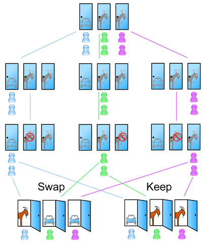
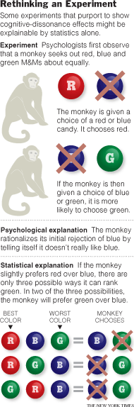



When I was a kid there wasn't much to watch on television, and [Sábados
Gigantes](http://es.wikipedia.org/wiki/S%C3%A1bado_gigante) (that's what
it was called back then), the Chilean variety show, ruled the weekend screen.

Its game shows were popular, all of them copies of American programs,
though many of us didn't know it (which explains the nickname
\"Guatón Copión\", the copycat fatso, given to [Don
Francisco](http://es.wikipedia.org/wiki/Don_Francisco) by the comedian
Fernando Alarcón, with his character Pepito TV, who was in charge of
entertaining us on Sundays).

One of the typical games was the one with the doors. There were 3
doors, A, B and C. The contestant had to pick one of the three;
behind only one of them was a juicy prize,
typically a car.



This game was a variant, or adaptation, of an American
game show called [Let\'s Make a
Deal](http://en.wikipedia.org/wiki/Let%27s_Make_a_Deal), hosted by
[Monty Hall](http://en.wikipedia.org/wiki/Monty_Hall). That show is
the inspiration for an interesting mathematical problem called the
[Monty Hall
problem](http://es.wikipedia.org/wiki/Problema_de_Monty_Hall).

The problem is stated as follows:

> "The contestant must choose one door out of three (all
> closed); the prize is whatever is behind
> the chosen one. It is known for certain that behind one of them there is a
> car, and behind each of the other two a goat. Once the
> contestant has chosen a door and announced the choice to everyone
> present, Monty, the host, who knows what is behind each
> door, will open one of the other two and show that there is a
> goat behind it. He then gives the contestant the option of switching
> doors, if desired (there are two options). **Should the contestant
> stick with the original choice or pick the other door? Does it make any
> difference?**"

If you remember, Don Francisco's game was very similar. But
let's concentrate on the problem. Here is a diagram taken from Wikipedia:



Since there are two doors left to open, you would think the probability
of the car being behind either door is 1/2 (50%),
right? So it would make no difference whether you stick with your initial choice or
switch. But the truth is that it does. If you were in this
situation, the right thing to do is switch, to have a better
chance of winning.

This seems paradoxical, but if you do the probability analysis
correctly, what maximizes your chances of winning the car is switching
doors.

The reason is the following. First, Don Francisco, or the host, knows
which door hides the car. Initially, before the
host opens a door, the probability of picking the door with the
car is 1/3. If you have picked the car, Don Francisco can
choose either of the other two doors, and if you switch doors
you lose. On the other hand, if you have picked a door that hides a goat,
then Don Francisco can only choose the door that hides the other
goat. In that case, if you switch you will pick the door with the
car. To sum up: if you stick with the original choice you win if you
originally picked the car (with probability 1/3), while if
you switch you win if you originally picked one of the two goats (with
probability 2/3). Therefore, the contestant should switch
if he wants to maximize the probability of winning the car.

This is a diagram of the possibilities. I suggest you go over it so
you can follow the reasoning:

Or you can read [the Wikipedia
article](http://es.wikipedia.org/wiki/Problema_de_Monty_Hall), which
has the mathematical calculation of the probabilities.

Now, this paradoxical result affects some results in
psychology experiments used to study one aspect of
[cognitive dissonance](http://es.wikipedia.org/wiki/Disonancia_cognitiva). In
particular, something known as the choice rationalization
paradigm.

There was an experiment at Yale involving capuchin monkeys. The
monkeys were shown colored M&M's, say red, blue and
green. The monkeys were given a choice between two of them.

If the monkey chose the red one over the blue one, it was then
given the option of choosing between blue and green. The researchers
noticed that two thirds of the time the capuchins rejected the
blue M&M's in favor of the green ones, which seemed to confirm the
theory of choice rationalization: once we reject something,
we tell ourselves we didn't like it anyway (and with
that we get rid of the dissonant thought that we made
the wrong choice).

The image on the right, taken from [this
article](http://www.nytimes.com/2008/04/08/science/08tier.html?_r=1)
in the New York Times, shows the psychological explanation, based on the
rationalization paradigm. But it turns out it can be explained
statistically using the same principles as the Monty
Hall problem.

That is the result reached by the economist [M. Keith
Chen](http://faculty.som.yale.edu/keithchen/). Chen questions the validity
of many psychology experiments on rationalization theory,
going back to 1956!

According to Chen there are hundreds of psychology experiments that fail in the
same way.

For Chen it's possible that the choice rationalization paradigm
is still valid, but he has not found scientific experiments that
measure this effect correctly. \"The whole literature on this
subject operates as if the Monty Hall problem didn't exist\", is his
conclusion.

Sources:

- Wikipedia: [The Monty Hall problem](http://es.wikipedia.org/wiki/Problema_de_Monty_Hall)

- [Go Ahead Monkeys, Rationalize, Monkeys Do It Too](http://www.nytimes.com/2007/11/06/science/06tier.html?ref=science), New York Times, November 2007.

- [And Behind Door No. 1, A Fatal Flaw](http://www.nytimes.com/2008/04/08/science/08tier.html?_r=1), New York Times, April 2008.

- [How Choice Affects and Reflects Preferences: Revisiting the Free Choice Paradigm](https://www.ncbi.nlm.nih.gov/pubmed/20658837), M. Keith Chen & Jane L. Risen.
