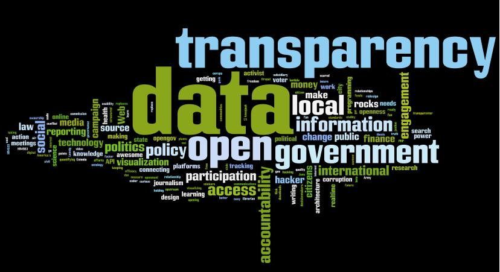

 
Álvaro Graves is another of the guests who accepted my invitation to
write during this month of the blog's seventh anniversary. Álvaro
has spent several years contributing to the [Manzana Mecánica](http://www.manzanamecanica.org/) team. He has also become one
of our national experts in the field of OpenData, advising
various bodies on the subject. Álvaro is currently working on his
PhD in Cognitive Science in the United States. He has given us this
interesting post on the importance of having open data and how its
availability could positively affect our democracies:

# Data as democratic artifacts

By [Alvaro Graves](http://graves.cl/)

Several of us have been complaining for years about the need for
Open Data policies at many institutions that matter to
society: ministries, municipalities, universities, etc. The question
is why these institutions should implement such policies. I have
[written](http://dccuchile.blog.terra.cl/2010/12/29/open-data-paso-clave-para-la-transparencia-y-participacion/)
in [several](http://manzanamecanica.org/2009/11/datagobcl.html)
[articles](http://manzanamecanica.org/2011/11/lucro_y_open_data.html)
about the many benefits organizations can obtain
by investing in Open Data (which, besides, generally requires a
relatively small budget). Today, however, I would like to describe
some of the reasons for implementing Open Data projects from the
point of view of society as a whole. This doesn't concern only
government organizations, but almost any body that seeks
to make its activity transparent to society.

## Data as an artifact for accountability

First of all, **I firmly believe that access to and handling of (raw)
data are becoming ever more fundamental pillars
when it comes to defining our capacity to decide and to participate in
society**. This is especially true of the relationship between
citizens and the government of the day, but it also applies to the
relationship citizen-AFP (pension fund), citizen-neighborhood, citizen-hospital, etc. One
of the biggest problems there is (mainly with the political
world) is the lack of trust and good faith toward the other party:
fewer and fewer people vote for a congressman because he belongs to
party X. Nor is it much of a guarantee that mayor Y belongs to
church A or is a fan of soccer team B. An increasingly
common trend is to look for data that lets you validate the quality of the candidate,
even his "moral quality". Examples abound; the most relevant one in the
United States right now is the tax returns of Mitt
Romney, the current Republican Party candidate for president:
there are rumors of tax avoidance which, if true,
[would put](http://www.baltimoresun.com/news/opinion/readersrespond/bs-ed-romney-tax-returns-20120812,0,2145482.story)
the success of his candidacy in serious trouble. In Chile, a very interesting piece of work
is what Fundación Ciudadano Inteligente has done with its
[Inspector de Intereses](http://inspectordeintereses.cl/), where
they show possible conflicts of interest between legislators'
investments and the laws they have voted on.

Another endemic problem where Open Data can be a key player is
how public policies get made: many times these policies are
conceived and produced based on the "vision" (in plain Chilean, the
"tincada", the hunch) of the leader of the day, with all the biases that entails
and with no other kind of justification. In a society that hands
its leaders fewer and fewer votes of confidence, they need to
make decisions backed by data rather than by the
subjective perception of a small group of individuals.

The above also applies to justifying not only the policies,
but how information about them is conveyed in the
media: when we say that crime went down or that education
improved, what do we really mean? Are we really comparing apples with
apples? Is the difference statistically significant?
There are questions that are even harder to answer: is it possible to identify a
set of reasons why this change happened? Is it possible
to identify the relevant actors connected to this change? The
problem is that we stop at the newspaper headline, "CRIME
UP", with no further information. **Just as in the world of
scientific publishing, we need access to the data that
justifies such claims**, which are otherwise empty.

## Data as an artifact citizens can consume

This brings us to the second point, which is more complicated than the first:
to improve our participation in society, having nominal access to
the data is not enough; we need the ability to process and consume it.
This implies at least two challenges. On one hand, there's the Open Data
movement's original "warhorse": the online
availability of data, in open formats and under licenses that are as
unrestrictive as possible. The second part is how we get other
human beings to be able to consume this data, especially those who aren't
hackers, computer geeks, etc. That is, those who don't have the technical
knowledge to process large volumes of data. How do we show the
data that justifies the decisions of government bodies at
different levels of depth for different people? An expert
will want the maximum level of detail and granularity, while an
ordinary citizen will probably want a more digested version (but
stopping at the headline of a newspaper article is already too much of a
summary).

Another opportunity that could have a high impact is letting
citizens build a dialogue with the government based on data, instead of
presenting demands based only on ideology without evidence. Although
movements whose proposals are grounded in
studies and "hard data" have existed for a long time (for example, the case of [Educación
2020](http://www.educacion2020.cl/)), these groups and organizations
still need specialists, researchers, etc. That
means this kind of discussion is possible only on "high-level"
issues (e.g., national education policies), but not for
decisions that matter to smaller communities (e.g., which
streets should get priority for repairs in the town of Los
Vilos?). Ideally, the great majority of the proposals
made both at the level of state policy and at the level of the neighborhood council
could be discussed with data to back them up, so that
citizens can decide, not on the basis of vacuous speeches, but on which ones
present the most reliable data and show the best
solution to the problems raised.

## A society of critical thinking

There are many ideas whose stumbling block is sociological and
cultural, beyond whether data is available or not. However,
our society is increasingly technical, and that puts more tools
within people's reach that use hard data to make
decisions. These tools let us process larger volumes
of data than we could ever have imagined a century ago.
Still, these technologies need to be made more accessible in order to
improve our democracy. If we really want to raise the level of
political dialogue and discussion (i.e., discussions in and about the
*Polis*), we need to be able to rationalize our decisions, strip
the empty rhetoric out of them and open them to public scrutiny.
That can only be achieved with data that justifies our opinions and
decisions.
